# ✔ 맷플롯립의 고급 기능 배우기

> ['맷플롯립의 고급 기능 배우기' 구글 코랩](https://colab.research.google.com/github/rickiepark/hg-da/blob/main/06-2.ipynb)

## 1️⃣ 실습 준비하기

#### 1. 코랩에서 '나눔바른고딕' 폰트를 설치해보자

```py
# 노트북이 코랩에서 실행 중인지 체크합니다.
import sys
if 'google.colab' in sys.modules:
    !echo 'debconf debconf/frontend select Noninteractive' | debconf-set-selections
    # 나눔 폰트를 설치합니다.
    !sudo apt-get -qq -y install fonts-nanum
    import matplotlib.font_manager as fm
    font_files = fm.findSystemFonts(fontpaths=['/usr/share/fonts/truetype/nanum'])
    for fpath in font_files:
        fm.fontManager.addfont(fpath)
```

#### 2. 맷플롯립의 기본 폰트를 '나눔바른고딕'으로 설정하고, 기본 해상도를 100으로 높여주자

```py
import matplotlib.pyplot as plt

plt.rc('font', family='NanumBarunGothic')
plt.rcParams['figure.dpi'] = 100
```

#### 3. 구글 드라이브에 저장된 'ns_book7.csv' 파일을 다운로드하자

```py
import gdown
import pandas as pd

gdown.download('https://bit.ly/3pK7iuu', 'ns_book7.csv', quiet=False)

ns_book7 = pd.read_csv('ns_book7.csv', low_memory=False)
ns_book7.head()
```

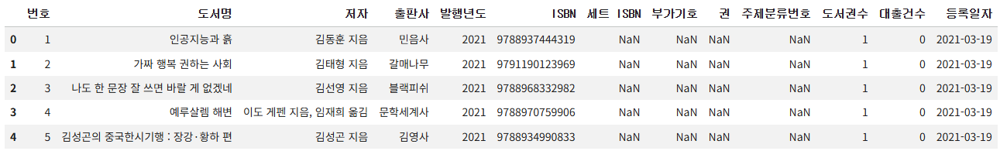

## 2️⃣ 하나의 피겨에 여러 개의 선 그래프 그리기

- 선 그래프와 막대 그래프는 하나의 피겨에 여러 개를 그릴 수 있음

#### 1. 상위 30개 출판사에 해당하는 행을 표시하는 불리언 배열을 만들자

```py
top30_pubs = ns_book7['출판사'].value_counts()[:30]
top30_pubs_idx = ns_book7['출판사'].isin(top30_pubs.index)
```

#### 2. '출판사', '발행년도', '대출건수' 열만 추출해 새 데이터프레임을 만들자

```py
ns_book9 = ns_book7[top30_pubs_idx][['출판사', '발행년도', '대출건수']]
```

#### 3. '출판사', '발행연도' 열을 기준으로 행을 모은 후, '대출건수' 열의 합을 구하자

```py
ns_book9 = ns_book9.groupby(by=['출판사', '발행년도']).sum()
```

#### 4. 인덱스를 초기화한 후, '황금가지' 출판사의 데이터를 확인해보자

```py
ns_book9 = ns_book9.reset_index()
ns_book9[ns_book9['출판사'] == '황금가지'].head()
```

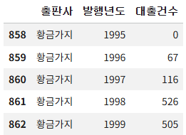

### 선 그래프 2개 그리기

#### 5. '황금가지'와 '비룡소' 출판사의 '발행년도'에 대한 '대출건수' 선 그래프를 그려보자

```py
line1 = ns_book9[ns_book9['출판사'] == '황금가지']
line2 = ns_book9[ns_book9['출판사'] == '비룡소']

fig, ax = plt.subplots(figsize=(8, 6))
ax.plot(line1['발행년도'], line1['대출건수'])
ax.plot(line2['발행년도'], line2['대출건수'])
ax.set_title('년도별 대출건수')
fig.show()
```

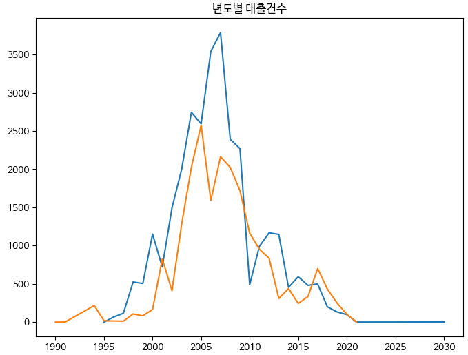

- 선 그래프를 그리는 `plot()` 함수를 여러 번 호출하면 여러 개의 선 그래프를 그릴 수 있음
- `plot()` 함수를 호출할 때 별도로 색을 지정하지 않아도 자동으로 선 그래프마다 다른 색으로 그림
  - 맷플롯립은 기본적으로 10개의 색을 돌아가며 그래프를 그림
  - 만약, 10개 이상의 선을 그리게 되면 처음 색부터 다시 반복해서 사용함

#### 6. 선 그래프에 범례를 추가해보자

```py
fig, ax = plt.subplots(figsize=(8, 6))
ax.plot(line1['발행년도'], line1['대출건수'], label='황금가지')
ax.plot(line2['발행년도'], line2['대출건수'], label='비룡소')
ax.set_title('년도별 대출건수')
ax.legend()
fig.show()
```

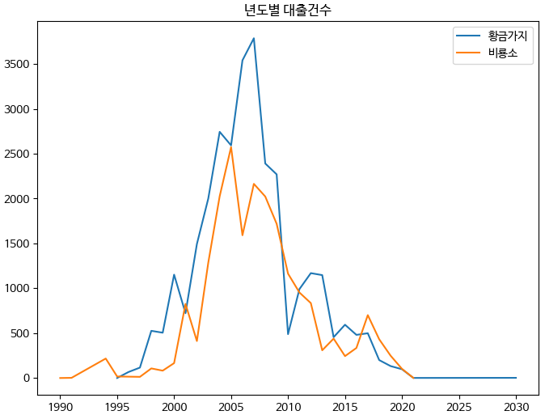

- 범례(legend): 그래프에 그려진 데이터의 이름과 색상을 요약한 표
- 그래프에 범례를 추가하면 그래프를 이해하는 데 아주 도움이 됨
- `plot()` 함수를 호출할 때 각 선 그래프에 `label` 매개변수를 추가하고, 마지막에 `legend()` 메서드를 호출하면 범례가 추가됨

### 선 그래프 5개 그리기

#### 7. 상위 5개 출판사의 '발행년도'에 대한 '대출건수' 선 그래프를 그려보자

```py
fig, ax = plt.subplots(figsize=(8, 6))
for pub in top30_pubs.index[:5]:
    line = ns_book9[ns_book9['출판사'] == pub]
    ax.plot(line['발행년도'], line['대출건수'], label=pub)
ax.set_title('년도별 대출건수')
ax.legend()
ax.set_xlim(1985, 2025)
fig.show()
```

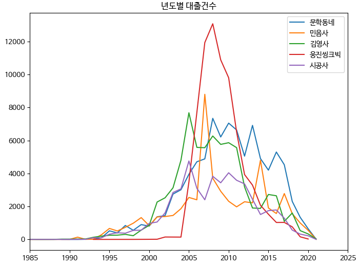

- `set_xlim()` 메서드를 사용해 x축 좌표 범위를 지정할 수 있음
  - 첫 번째 매개변수: x축의 최솟값
  - 두 번째 매개변수: x축의 최댓값
- `set_ylim()` 메서드를 사용해 y축 좌표 범위르 지정할 수 있음
- 이슈) 5개의 선 그래프가 서로 많이 교차하기 때문에 구분하기가 쉽지 않음

### 스택 영역 그래프

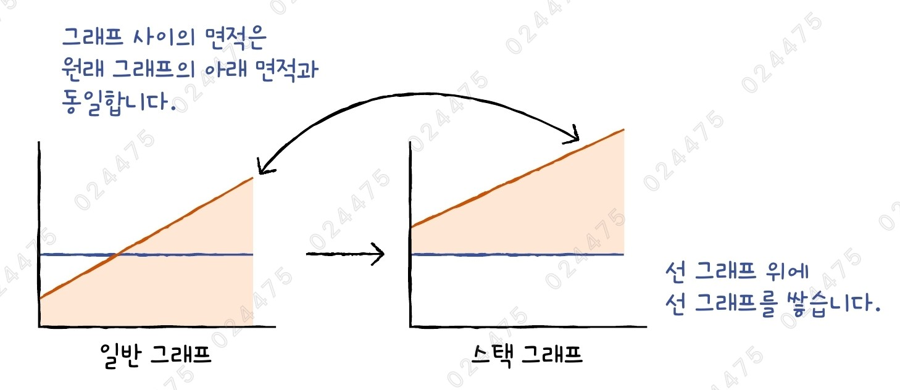

- 스택 영역 그래프는 하나의 선 그래프 위에 다른 선 그래프를 차례대로 쌓는 것을 의미함
- 따라서, 그래프 사이의 간격이 y축 값이 됨
- 맷플롯립의 `stackplot()` 메서드로 스택 영역 그래프를 그릴 수 있음
  - 첫 번째 매개변수: x축의 값 (ex) '발행년도')
  - 두 번째 매개변수: y축의 값을 2차원 배열로 전달 (ex) '출판사' x '발행년도')

#### 8. y축의 값으로 넣을 '출판사'가 행이고 '발행년도'가 열인 2차원 배열 만들자

```py
ns_book10 = ns_book9.pivot_table(index='출판사', columns='발행년도')
ns_book10.head()
```

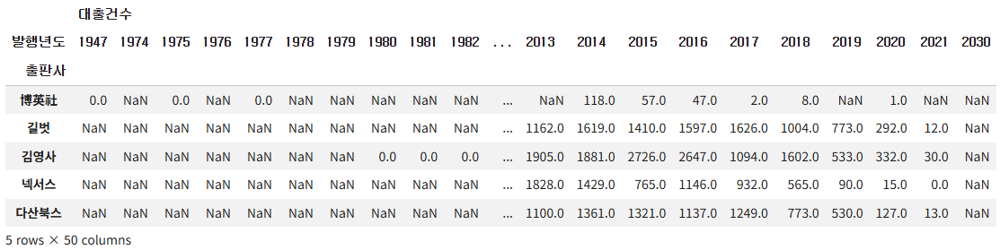

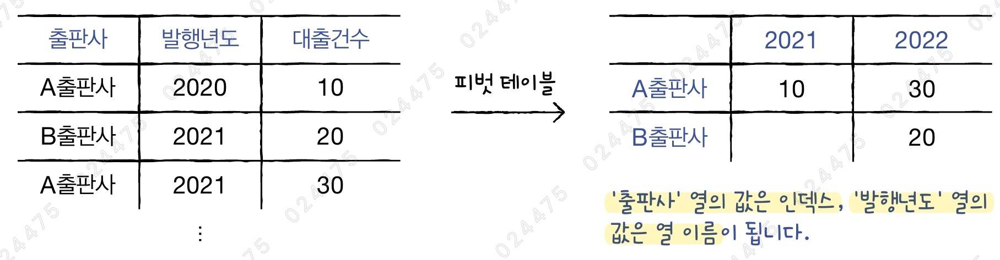

- 피벗 테이블: 테이블 형태의 데이터를 평균, 합 등의 방식으로 집계하여 만든 요약표
- 판다스의 `pivot_table()` 메서드를 사용해 데이터 구조를 바꿀 수 있음
- `index`와 `columns` 매개변수에 원본 데이터프레임의 열을 지정하면, 각 열의 고유한 값이 피벗 테이블로 변환된 데이터프레임의 인덱스와 열이 됨
  - `index` 매개변수: 행 인덱스로 사용할 열 이름 지정
  - `columns` 매개변수: 열 인덱스로 사용할 열 이름 지정

```py
ns_book10.columns[:10]
"""
MultiIndex([('대출건수', 1947),
            ('대출건수', 1974),
            ('대출건수', 1975),
            ('대출건수', 1976),
            ('대출건수', 1977),
            ('대출건수', 1978),
            ('대출건수', 1979),
            ('대출건수', 1980),
            ('대출건수', 1981),
            ('대출건수', 1982)],
           names=[None, '발행년도'])
"""
```

- 이때, 열은 ('대출건수', 1947)처럼 다단으로 구성되어 있음

#### 9. x축의 값으로 넣을 '발행년도' 리스트를 준비하자

```py
year_cols = ns_book10.columns.get_level_values(1)
```

- 판다스 인덱스 객체에서 `get_level_values()` 메서드는 다단으로 구성된 열 이름에서 선택한 항목만 가져올 수 있음
- 따라서, ('대출건수', 1947)로 되어있는 열 이름 중 연도로 구성된 두 번째 항목만 가져옴

#### 10. 상위 10개 출판사의 연도별 대출건수를 스택 영역 그래프로 그려보자

```py
top10_pubs = top30_pubs.index[:10]

fig, ax = plt.subplots(figsize=(8, 6))
ax.stackplot(year_cols, ns_book10.loc[top10_pubs].fillna(0), labels=top10_pubs)
ax.set_title('년도별 대출건수')
ax.legend(loc='upper left')
ax.set_xlim(1985, 2025)
fig.show()
```

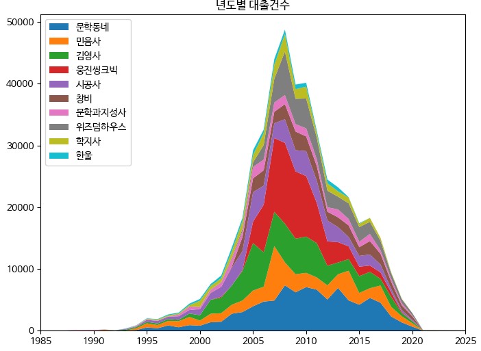

- `legend()` 메서드의 `loc` 매개변수로 범례의 위치를 지정할 수 있음
  - 기본값: `'best'` (최상의 위치를 선택해 출력)
- 맷플롯립은 판다스 데이터프레임의 누락된 값을 제대로 처리하지 못해, 그래프가 이상하게 그려지는 경우가 이따금 있음
  - 따라서, 그래프를 그리기 전에 누락된 값을 0으로 채움
- 2010년 경의 그래프 면적을 보면 '문학동네'와 '웅진씽크빅'의 대출건수가 높다는 것을 알 수 있음

## 3️⃣ 하나의 피겨에 여러 개의 막대 그래프 그리기

#### 1. '황금가지'와 '비룡소' 출판사의 '발행년도'에 대한 '대출건수' 막대 그래프를 그려보자

```py
fig, ax = plt.subplots(figsize=(8, 6))
ax.bar(line1['발행년도'], line1['대출건수'], label='황금가지')
ax.bar(line2['발행년도'], line2['대출건수'], label='비룡소')
ax.set_title('년도별 대출건수')
ax.legend()
fig.show()
```

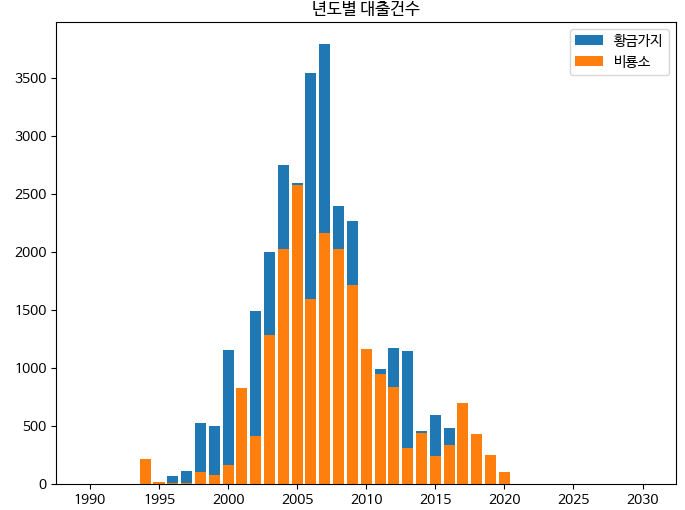

- 막대 그래프를 그리는 `bar()` 함수를 여러 번 호출하면 여러 개의 막대 그래프를 그릴 수 있음
- 이슈) 그냥 `bar()` 함수를 연이어 호출하면 먼저 그린 막대를 덮어쓰게 됨

#### 2. 두 출판사의 막대를 옆으로 나란히 그려보자

```py
fig, ax = plt.subplots(figsize=(8, 6))
ax.bar(line1['발행년도']-0.2, line1['대출건수'], width=0.4, label='황금가지')
ax.bar(line2['발행년도']+0.2, line2['대출건수'], width=0.4, label='비룡소')
ax.set_title('년도별 대출건수')
ax.legend()
fig.show()
```

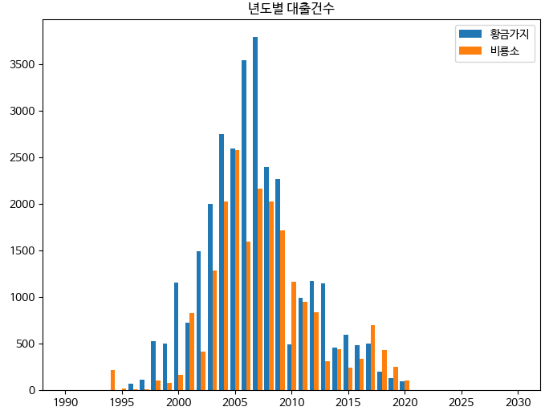

- 막대의 기본 너비인 0.8의 절반인 0.4 너비로 두 막대 그래프를 그린 후, x축에서 막대 하나 너비인 0.4의 절반씩 떨어지도록 그림

### 스택 막대 그래프

- 스택 막대 그래프는 스택 영역 그래프처럼 막대를 위로 쌓는 것을 의미함
- 맷플롯립에는 `stackplot()` 메서드처럼 막대 그래프를 쌓을 수 있는 함수가 없음
- 대신, `bar()` 메서드의 `bottom` 매개변수를 사용해 수동으로 막대를 쌓을 수 있음

#### 3. 간단한 막대 그래프 2개를 쌓아보자

```py
height1 = [5, 4, 7, 9, 8]
height2 = [3, 2, 4, 1, 2]

plt.bar(range(5), height1, width=0.5)
plt.bar(range(5), height2, bottom=height1, width=0.5)
plt.show()
```

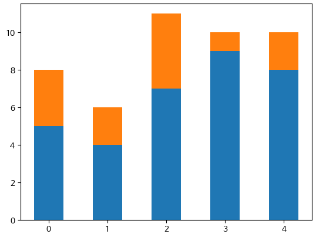

- `bottom` 매개변수는 막대가 시작할 y좌표를 결정함
- 한계점) 막대 그래프를 잘 쌓았지만, 그래프를 그릴 때마다 막대의 시작 위치를 계속 누적해서 보관해야 하기 때문에 조금 번거로움

#### 4. 그래프를 그리기 전에 아예 막대의 길이를 누적해 놓고 이 값으로 막대 그래프를 그려보자

```py
height3 = [a + b for a, b in zip(height1, height2)]

plt.bar(range(5), height3, width=0.5)
plt.bar(range(5), height1, width=0.5)
plt.show()
```

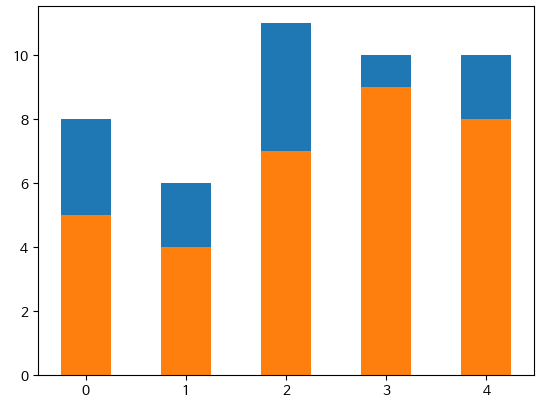

- height1과 height2를 더해 height3를 만든 후, height3를 먼저 그리고 height1을 그림
- `bottom` 매개변수를 사용하지 않고 이전과 동일한 그래프를 그림
- 이처럼 각 출판사의 y축 값을 누적해 놓으면 간단하게 그래프를 그릴 수 있음

### 데이터값 누적하여 그리기

#### 5. 상위 5개 출판사의 2013~2020년 대출건수를 확인해보자

```py
ns_book10.loc[top10_pubs[:5], ('대출건수',2013):('대출건수',2020)]
```

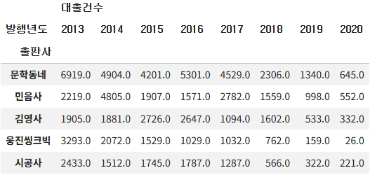

#### 6. 상위 5개 출판사에서 2013~2020년 사이 발행 연도별 대출건수를 누적해보자

```py
ns_book10.loc[top10_pubs[:5], ('대출건수',2013):('대출건수',2020)].cumsum()
```

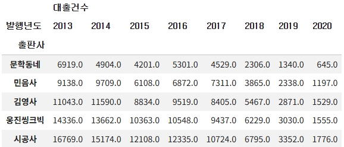

- 판다스 데이터프레임의 `cumsum()` 메서드를 사용하면 값을 누적할 수 있음
- `cumsum()` 메서드는 기본적으로 행을 따라 값을 누적함
  - `axis` 매개변수를 1로 지정하면 열 방향으로 누적할 수 있음

#### 7. 상위 10개 출판사에서 발행 연도별 대출건수를 누적해보자

```py
ns_book12 = ns_book10.loc[top10_pubs].cumsum()
```

#### 8. 상위 10개 출판사의 연도별 대출건수를 스택 막대 그래프로 그려보자

```py
fig, ax = plt.subplots(figsize=(8, 6))
for i in reversed(range(len(ns_book12))):
    bar = ns_book12.iloc[i]     # 행 추출
    label = ns_book12.index[i]  # 출판사 이름 추출
    ax.bar(year_cols, bar, label=label)
ax.set_title('년도별 대출건수')
ax.legend(loc='upper left')
ax.set_xlim(1985, 2025)
fig.show()
```

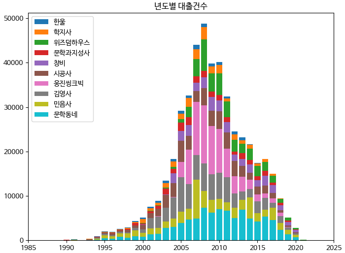

- 가장 큰 막대를 먼저 그려야 하므로, 누적 합계가 가장 큰 마지막 출판사부터 그림
  - 그렇지 않으면 가장 큰 막대가 이전에 그린 막대를 모두 덮어쓰게 됨

## 4️⃣ 원 그래프 그리기

- 원 그래프: 전체 데이터에 대한 비율을 원의 부채꼴로 나타낸 그래프
  - 파이 차트(pie chart)라고도 부름

#### 1. 상위 10개 출판사의 발행 도서 개수와 인덱스를 저장하자

```py
data = top30_pubs[:10]
labels = top30_pubs.index[:10]
```

#### 2. 상위 10개 출판사의 발행 도서 비율을 원 그래프로 그려보자

```py
fig, ax = plt.subplots(figsize=(8, 6))
ax.pie(data, labels=labels)
ax.set_title('출판사 도서비율')
fig.show()
```

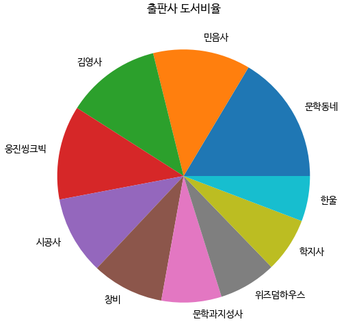

- 맷플롯립의 `pie()` 메서드로 원 그래프를 그릴 수 있음
- 첫 번째 매개변수에 데이터를 전달하면 자동으로 데이터 전체에 대한 비율을 계산해 그래프를 그림
- `labels` 매개변수를 통해 부채꼴 모양 위에 표시할 이름을 전달할 수 있음
- `pie()` 메서드는 기본적으로 3시 방향부터 반시계 방향으로 데이터를 그림

### 원 그래프의 단점

- 선 그래프나 원 그래프와 달리 원 그래프는 시각적으로 어떤 데이터가 더 큰지 한눈에 구분하기 어려움

#### 3. 2개의 데이터를 12시 방향부터 원 그래프로 그려보자

```py
plt.pie([10,9], labels=['A제품', 'B제품'], startangle=90)
plt.title('제품의 매출비율')
plt.show()
```

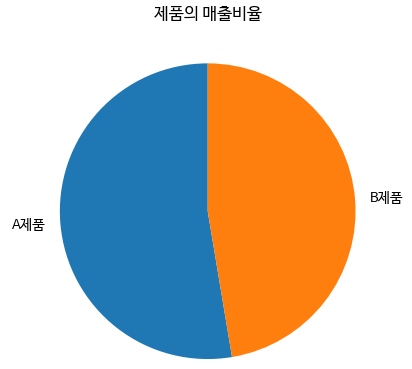

- `startangle` 매개변수를 사용해 원 그래프의 시작 위치를 지정할 수 있음
- 2개의 데이터만 있는 경우라면 원 그래프는 데이터의 차이를 명확하게 나타낼 수 있음

### 비율 표시하고 부채꼴 강조하기

#### 4. 원 그래프의 각 부채꼴에 비율을 명시하고 가장 중요한 항목을 부각시켜 보자

```py
fig, ax = plt.subplots(figsize=(8, 6))
ax.pie(data, labels=labels, startangle=90,
       autopct='%.1f%%', explode=[0.1]+[0]*9)
ax.set_title('출판사 도서비율')
fig.show()
```

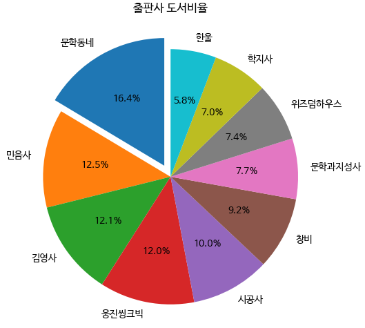

- `pie()` 메서드의 `autopct` 매개변수를 사용해 파이썬의 % 연산자에 적용할 포맷팅 문자열을 전달할 수 있음
  - `%d`를 전달하면 각 부채꼴의 비율이 정수로 표시됨
  - `%.1f%%`를 전달하면 소수점 첫째 자리까지 포함한 실수를 표시하고, 마지막에 퍼센트 기호를 추가하게 됨
- 중요한 항목의 경우, 해당 부채꼴 조각을 원 그래프에서 조금 떨어뜨려 시각적으로 부각시킬 수 있음
- `explode` 매개변수에 떨어뜨리길 원하는 조각의 간격을 반지름의 비율로 지정할 수 있음
  - 전달하는 리스트 길이는 데이터 배열의 길이와 같아야 함

## 5️⃣ 여러 종류의 그래프가 있는 서브플롯 그리기

#### 1. 산점도, 스택 영역 그래프, 스택 막대 그래프, 원 그래프를 하나의 피겨에 모두 그려보자

```py
fig, axes = plt.subplots(2, 2, figsize=(20, 16))

# 산점도
ns_book8 = ns_book7[top30_pubs_idx].sample(1000, random_state=42)
sc = axes[0, 0].scatter(ns_book8['발행년도'], ns_book8['출판사'],
                        linewidths=0.5, edgecolors='k', alpha=0.3,
                        s=ns_book8['대출건수'], c=ns_book8['대출건수'], cmap='jet')
axes[0, 0].set_title('출판사별 발행도서')
fig.colorbar(sc, ax=axes[0, 0])

# 스택 선 그래프
axes[0, 1].stackplot(year_cols, ns_book10.loc[top10_pubs].fillna(0),
                     labels=top10_pubs)
axes[0, 1].set_title('년도별 대출건수')
axes[0, 1].legend(loc='upper left')
axes[0, 1].set_xlim(1985, 2025)

# 스택 막대 그래프
for i in reversed(range(len(ns_book12))):
    bar = ns_book12.iloc[i]     # 행 추출
    label = ns_book12.index[i]  # 출판사 이름 추출
    axes[1, 0].bar(year_cols, bar, label=label)
axes[1, 0].set_title('년도별 대출건수')
axes[1, 0].legend(loc='upper left')
axes[1, 0].set_xlim(1985, 2025)

# 원 그래프
axes[1, 1].pie(data, labels=labels, startangle=90,
               autopct='%.1f%%', explode=[0.1]+[0]*9)
axes[1, 1].set_title('출판사 도서비율')

fig.savefig('all_in_one.png')
fig.show()
```

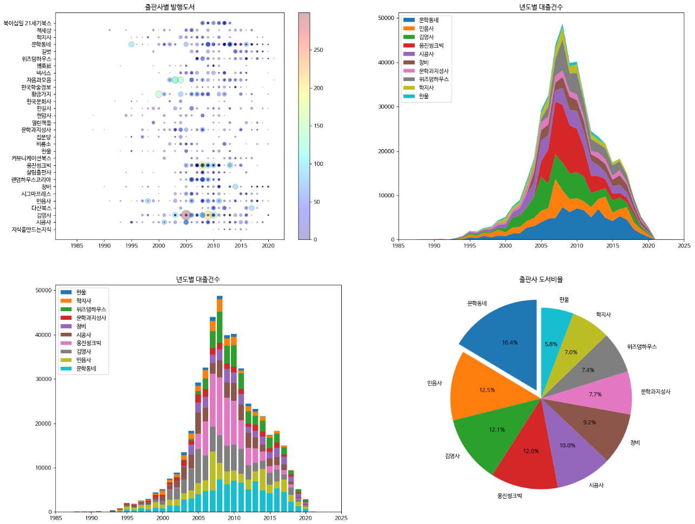

- `subplots()` 함수에서 반환 받은 `Axes` 객체를 사용할 때는 2차원 배열처럼 각 격자의 위치를 지정해야 함

## cf) 판다스로 여러 개의 그래프 그리기

- 판다스도 맷플롯립처럼 다양한 그래프 기능을 제공함
- 하지만, 맷플롯립에서 제공하는 모든 기능을 제공하지는 않기 때문에, 세밀한 제어가 필요하다면 맷플롯립을 사용하는 것이 좋음

### 스택 영역 그래프 그리기

#### 1. '발행년도'가 행이고 '출판사'가 열인 2차원 배열 만들자

```py
ns_book11 = ns_book9.pivot_table(index='발행년도', columns='출판사', values='대출건수')
print(ns_book11.loc[2000:2005])
```

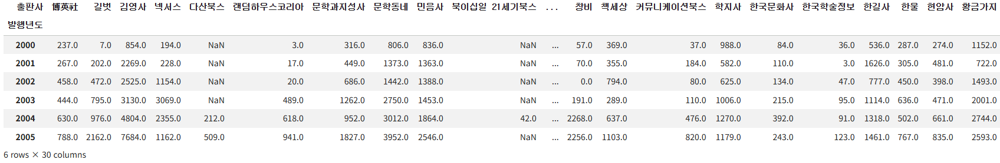

- 이전과 반대로 `index` 매개변수에는 '발행년도' 열, `columns` 매개변수에는 '출판사' 열을 지정해 피벗 테이블로 변환함
- `pivot_table()` 메서드의 `values` 매개변수에 집계할 열을 지정하면 열 이름이 다단으로 구성되지 않음

#### 2. 상위 10개 출판사의 연도별 대출건수를 스택 영역 그래프로 그려보자

```py
fig, ax = plt.subplots(figsize=(8, 6))
ns_book11[top10_pubs].plot.area(ax=ax, title='년도별 대출건수',
                                xlim=(1985, 2025))
ax.legend(loc='upper left')
fig.show()
```

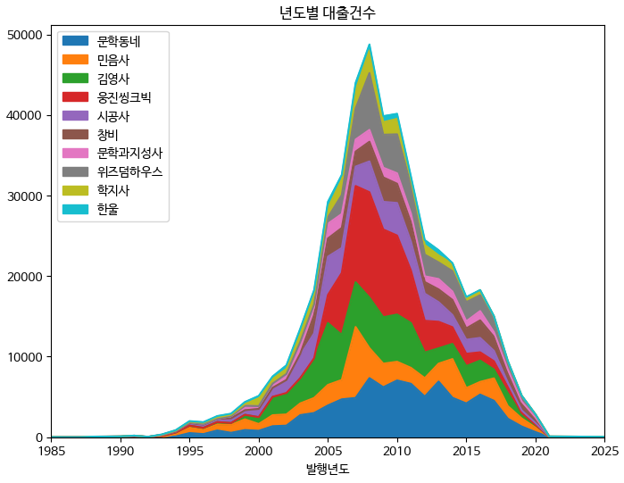

- 판다스 데이터프레임의 `plot.area()` 메서드를 사용해 스택 영역 그래프를 그릴 수 있음
- 서브플롯을 명시적으로 만든 경우, `area()` 메서드의 `ax` 매개변수에 맷플롯립의 `Axes` 객체를 전달해야 함
- `title` 매개변수로 그래프 제목을 지정할 수 있음
- `xlim` 매개변수로 x축의 범위를 설정할 수 있음

### 스택 막대 그래프 그리기

#### 3. 상위 10개 출판사의 연도별 대출건수를 스택 막대 그래프로 그려보자

```py
fig, ax = plt.subplots(figsize=(8, 6))
ns_book11.loc[1985:2025, top10_pubs].plot.bar(
    ax=ax, title='년도별 대출건수', stacked=True, width=0.8)
ax.legend(loc='upper left')
fig.show()
```

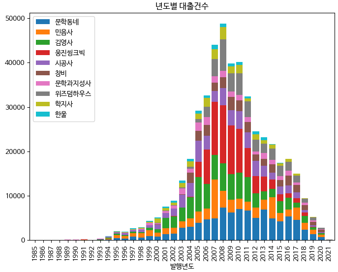

- 판다스 데이터프레임의 `plot.bar()` 메서드를 사용하면 기본적으로 막대를 나란히 출력함
- `stacked` 매개변수를 True로 지정하면 스택 막대 그래프를 그릴 수 있음
- `width` 매개변수로 막대의 두께를 조절할 수 있음
  - 기본값: 0.5

## cf) 핵심 함수와 메서드

| 함수/메서드               | 기능                                |
| ------------------------- | ----------------------------------- |
| `Axes.legend()`           | 그래프의 범례를 추가함              |
| `Axes.set_xlim()`         | x축의 출력 범위를 지정함            |
| `DataFrame.pivot_table()` | 피벗 테이블 기능을 제공함           |
| `Axes.stackplot()`        | 스택 영역 그래프를 그림             |
| `DataFrame.plot.area()`   | 스택 영역 그래프를 그림             |
| `DataFrame.plot.bar()`    | 스택 막대 그래프를 그림             |
| `DataFrame.cumsum()`      | 행이나 열 방향으로 누적 합을 계산함 |
| `Axes.pie()`              | 원 그래프를 그림                    |
