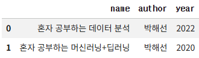
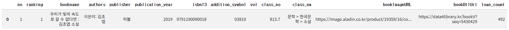

# ✔ API 사용하기

> ['API 사용하기' 구글 코랩](https://colab.research.google.com/github/rickiepark/hg-da/blob/main/02-1.ipynb)

## 1️⃣ API란

- Application Programming Interface
- 두 프로그램이 서로 대화하기 위한 방법을 정의한 것
- 애플리케이션 간의 통신을 위해서는 웹 기반의 API가 널리 사용됨

### 웹 페이지를 전송하기 위한 통신 규약: HTTP

- Hyper Text Transfer Protocol
- 인터넷에서 웹 페이지를 전송하는 기본 통신 방법
- 웹 서버 프로그램은 웹 브라우저와 통신할 때 HTTP 프로토콜을 사용함
  - 대표적인 웹 서버 프로그램: NGINX, Apache 등
- 웹 기반 API는 HTTP 프로토콜을 사용해 API를 만듦

### 웹 페이지 문서: HTML

- Hypertext Markup Language
- 웹 브라우저가 화면에 표시할 수 있는 문서의 한 종류이자 웹 페이지를 위한 표준 언어
- HTTP 프로토콜을 사용해 안정적이고 편리하게 웹 페이지를 구성하는 HTML 데이터를 주고받을 수 있음

### 웹 기반 API

- 웹 기반 API는 HTTP 프로토콜을 사용해 CSV, JSON, XML 파일을 주고 받음
- HTML, CSV, JSON, XML은 텍스트 파일임
- CSV와 달리 JSON, XML은 복잡한 데이터 구조를 표현할 수 있음

## 2️⃣ 파이썬에서 JSON 데이터 다루기

- HTTP 프로토콜에서 데이터를 전송하려면, 먼저 객체를 텍스트로 변환해야 함
- 직렬화(serialization): 프로그램 상의 객체를 읽을 수 있는 형태로 변환하는 것
- 역직렬화(deserialization): 직렬화된 정보를 다시 프로그램에서 실행 가능한 객체로 변환하는 것

### JSON

- JavaScript Object Notation
- 원래는 자바스크립트 언어를 위해 만들어졌지만, 현재는 범용적인 포맷으로 사용함
- 대부분의 프로그래밍 언어는 JSON 형태의 텍스트를 읽고 쓸 수 있음
- JSON은 비교적 읽기 쉽고 간결하기 때문에 최근 웹 기반 API에서 많이 사용함
- JSON 객체는 파이썬의 딕셔너리처럼 중괄호를 사용하고, 키와 값을 콜론으로 연결함
  - 키와 값에 문자열을 쓰려면 항상 큰따옴표로 감싸 줘야 함
  - 값에 정수를 쓰려면 큰따옴표로 감쌀 필요가 없음
- 파이썬 리스트처럼 대괄호 안에 여러 항목을 나열해 배열을 표현할 수도 있음
- JSON 객체를 대괄호 안에 나열하면 JSON 배열로 나타낼 수 있음

### 파이썬 객체를 JSON 문자열로 변환하기: `json.dumps()` 함수

#### 1. 파이썬 딕셔너리를 JSON으로 변환해보자

```py
import json

d = {"name": "혼자 공부하는 데이터 분석"}
d_str = json.dumps(d, ensure_ascii=False)

print(d_str)
# {"name": "혼자 공부하는 데이터 분석"}
print(type(d_str))
# <class 'str'>
```

- json 패키지에서 `json.dumps()` 함수를 사용해 파이썬 객체를 JSON 형식에 맞는 텍스트로 바꿀 수 있음
- 기본적으로 `json.dumps()` 함수sms 아스키 문자 외의 다른 문자를 16진수로 출력함
  - 따라서 한글이 제대로 보이지 않음
- `ensure_ascii` 매개변수를 `False`로 지정하면 원래 저장된 문자가 그대로 출력됨

### JSON 문자열을 파이썬 객체로 변환하기: `json.loads()` 함수

#### 2. JSON 문자열을 파이썬 딕셔너리로 변환해보자

```py
d2 = json.loads(d_str)

print(d2['name'])
# 혼자 공부하는 데이터 분석
print(type(d2))
# <class 'dict'>
```

- `json.loads()` 함수를 사용하면 JSON 문자열을 파이썬 객체로 변환할 수 있음

#### 3. 여러 개의 항목을 가진 JSON 문자열을 파이썬 딕셔너리로 변환해보자

```py
d3 = json.loads('{"name": "혼자 공부하는 데이터 분석", "author": "박해선", "year": 2022}')

print(d3['name'])
# 혼자 공부하는 데이터 분석
```

```py
d3 = json.loads('{"name": "혼자 공부하는 데이터 분석", "author": ["박해선","홍길동"], \
                  "year": 2022}')

print(d3['author'][1])
# 홍길동
```

#### 4. JSON 배열을 파이썬 리스트로 변환해보자

```py
d4_str = """
[
  {"name": "혼자 공부하는 데이터 분석", "author": "박해선", "year": 2022},
  {"name": "혼자 공부하는 머신러닝+딥러닝", "author": "박해선", "year": 2020}
]
"""
d4 = json.loads(d4_str)

print(d4[0]['name'])
# 혼자 공부하는 데이터 분석
```

### JSON 문자열을 데이터프레임으로 변환하기: `read_json()` 함수

#### 1. JSON 문자열을 데이터프레임으로 변환해보자

```py
# 방법 1)
from io import StringIO
import pandas as pd

pd.read_json(StringIO(d4_str))
```



- 판다스에서 `read_json()` 함수를 사용해 JSON 문자열을 데이터프레임으로 변환할 수 있음
- 판다스 v2.1부터는 `read_json()` 함수에 파일 경로나 파일 객체를 전달해야 함
  - 원시 문자열을 넣으면 경고가 발생함
  - 원시 문자열을 `StringIO` 클래스로 감싸면 파일 객체처럼 다룰 수 있음

```py
# 방법 2)
pd.DataFrame(d4)
```


- JSON 문자열을 파이썬 객체로 만든 다음, `DataFrame` 클래스를 사용해 데이터프레임으로 변환할 수도 있음

## 3️⃣ 파이썬에서 XML 데이터 다루기

### XML

```xml
<book>
  <name>혼자 공부하는 데이터 분석</name>
  <author>박해선</author>
  <year>2022</year>
</book>
```

- eXtensible Markup Language
- 컴퓨터와 사람이 모두 읽고 쓰기 편한 문서 포맷을 위해 고안됨
- 태그 이름은 특수 문자, 공백 문자를 포함할 수 없고, `-`, `.`, 숫자로 시작할 수 없음
- `<book>`: 부모 노드
- `<name>`, `<author>`, `<year>`는 `<book>`의 자식 노드 임

### XML 문자열을 파이썬 객체로 변환하기: `fromstring()` 함수

#### 1. XML 문자열을 XML로 변환해보자

```py
x_str = """
<book>
    <name>혼자 공부하는 데이터 분석</name>
    <author>박해선</author>
    <year>2022</year>
</book>
"""
```

```py
import xml.etree.ElementTree as et

book = et.fromstring(x_str)

print(type(book))
# <class 'xml.etree.ElementTree.Element'>

print(book.tag)
# book
```

- `xml` 패키지는 XML 문서를 읽고 쓸 수 있는 간편한 API를 제공함
- `xml.etree.ElementTree` 모듈의 `fromstring()` 함수를 사용하면 XML 문자열을 XML로 변환할 수 있음
  - 반환값: `Element` 객체
- `Element` 객체의 `tag` 속성을 통해 이름을 쉽게 확인할 수 있음

### 자식 엘리먼트 확인하기: `findtext()` 메서드

#### 2. book 엘리먼트의 자식 엘리먼트를 구해보자

```py
book_childs = list(book)

print(book_childs)
# [<Element 'name' at 0x7b24f74d1440>, <Element 'author' at 0x7b24f74d1490>, <Element 'year' at 0x7b24f74d1530>]
```

#### 3. 각 자식 엘리먼트의 텍스트를 출력해보자

```py
name, author, year = book_childs

print(name.text)
# 혼자 공부하는 데이터 분석
print(author.text)
# 박해선
print(year.text)
# 2022
```

- `Element` 객체의 `text` 속성을 통해 텍스트를 확인할 수 있음
- 주의) XML은 자식 엘리먼트 순서가 항상 일정하다는 것을 보장하지 않음
  - 따라서, 위치럼 순서대로 자식 엘리먼트를 찾는 것은 위험함

#### 4. 부모 엘리먼트에서 직접 자식 엘리먼트의 텍스트를 출력해보자

```py
name = book.findtext('name')
author = book.findtext('author')
year = book.findtext('year')

print(name)
# 혼자 공부하는 데이터 분석
print(author)
# 박해선
print(year)
# 2022
```

- `findtext()` 메서드를 사용하면 해당하는 자식 엘리먼트를 탐색해 자동으로 텍스트를 반환할 수 있음
  - 입력값: 찾으려는 태그 이름

### 여러 개의 자식 엘리먼트 확인하기: `findall()` 메서드 + `for` 문

#### 5. 두 개의 book 엘리먼트를 감싸는 books 엘리먼트를 만든 후, XML로 변환해보자

```py
x2_str = """
<books>
    <book>
        <name>혼자 공부하는 데이터 분석</name>
        <author>박해선</author>
        <year>2022</year>
    </book>
    <book>
        <name>혼자 공부하는 머신러닝+딥러닝</name>
        <author>박해선</author>
        <year>2020</year>
    </book>
</books>
"""
```

```py
books = et.fromstring(x2_str)

print(books.tag)
# books
```

#### 6. books 엘리먼트 안에 포함된 두 개의 book 엘리먼트를 찾아, 텍스트를 출력해보자

```py
for book in books.findall('book'):
    name = book.findtext('name')
    author = book.findtext('author')
    year = book.findtext('year')

    print(name)
    print(author)
    print(year)
    print()
"""
혼자 공부하는 데이터 분석
박해선
2022

혼자 공부하는 머신러닝+딥러닝
박해선
2020
"""
```

- `findall()` 메서드를 사용하면 동일한 이름을 가진 여러 개의 자식 엘리먼트를 찾을 수 있음

## 4️⃣ API로 20대가 가장 좋아하는 도서 찾기

- 도서관 정보나루의 '인기대출도서 조회'에서 연령별 데이터를 제공함

### 파이썬으로 API 호출하기: `requests` 패키지

#### 1. '인기대출도서 조회' API를 통해 데이터를 가져와보자

```py
url = "http://data4library.kr/api/loanItemSrch?format=json&startDt=2021-04-01&endDt=2021-04-30&age=20&authKey=인증키"
```

```py
import requests

r = requests.get(url)
data = r.json()

print(data)
"""
{'response': {
    'request': {
        'startDt': '2021-04-01',
        'endDt': '2021-04-30',
        'age': '20',
        'pageNo': 1,
        'pageSize': 200
    },
    'resultNum': 200,
    'numFound': 5000,
    'docs': [
      {
        'doc': {
          'no': 1,
          'ranking': '1',
          'bookname': '우리가 빛의 속도로 갈 수 없다면 :김초엽 소설 ',
          'authors': '지은이: 김초엽',
          'publisher': '허블',
          'publication_year': '2019',
          'isbn13': '9791190090018',
          'addition_symbol': '03810',
          'vol': '',
          'class_no': '813.7',
          'class_nm': '문학 > 한국문학 > 소설',
          'bookImageURL': 'https://image.aladin.co.kr/product/19359/16/cover/s972635417_1.jpg',
          'bookDtlUrl': 'https://data4library.kr/bookV?seq=5430429',
          'loan_count': '492'
        }
      },
      ...
    ]
  }
}
"""
```

- `requests` 패키지를 사용하면 파이썬에서 URL을 호출해 데이터를 받을 수 있음
- HTTP GET 방식으로 파라미터 값을 전달하기 때문에 `requests.get()` 함수를 호출함
  - 반환값: API 호출의 결과를 담고 있는 `requests.Response` 객체
- `Response` 객체의 `json()` 메서드를 통해 JSON 문자열을 파이썬 객체로 변환할 수 있음

#### 2. 데이터를 판다스 데이터프레임으로 손쉽게 변환하기 위해 구조를 변경해보자

```py
books = []
for d in data['response']['docs']:
    books.append(d['doc'])

print(books)
"""
[
  {
    'no': 1,
    'ranking': '1',
    'bookname': '우리가 빛의 속도로 갈 수 없다면 :김초엽 소설 ',
    'authors': '지은이: 김초엽',
    'publisher': '허블',
    'publication_year': '2019',
    'isbn13': '9791190090018',
    'addition_symbol': '03810',
    'vol': '',
    'class_no': '813.7',
    'class_nm': '문학 > 한국문학 > 소설',
    'bookImageURL': 'https://image.aladin.co.kr/product/19359/16/cover/s972635417_1.jpg',
    'bookDtlUrl': 'https://data4library.kr/bookV?seq=5430429',
    'loan_count': '492'
  },
  ...
]
"""
```

#### 3. 데이터를 판단스 데이터프레임으로 변환해보자

```py
books_df = pd.DataFrame(books)

print(books_df)
```



- 결과를 보면 대출을 많이 한 순서대로 정렬되어 있음

#### 4. 판다스 데이터프레임을 JSON 파일로 저장해보자

```py
books_df.to_json('20s_best_book.json')
```

- `to_json()` 메서드를 사용하면 판다스 데이터프레임을 JSON 파일로 저장할 수 있음
- 이 메서드는 기본적으로 유니코드를 16진수로 저장하기 때문에, 나중에 저장된 파일을 열면 한글이 제대로 보이지 않음
- `force_ascii` 매개변수를 `False`로 지정하면 한글을 그대로 저장하게 할 수 있음

## cf) 핵심 함수와 메서드

| 함수/메서드                                | 기능                                                            |
| ------------------------------------------ | --------------------------------------------------------------- |
| `json.dumps()`                             | 파이썬 객체를 JSON 문자열로 변환함                              |
| `json.loads()`                             | JSON 문자열을 파이썬 객체로 변환함                              |
| `pandas.read_json()`                       | JSON 문자열을 판다스 시리즈나 데이터프레임으로 변환함           |
| `xml.etree.ElementTree.fromstring()`       | XML 문자열을 `Element` 객체로 변환함                            |
| `xml.etree.ElementTree.Element.findtext()` | 지정한 태그 이름과 맞는 첫 번째 자식 엘리먼트의 텍스트를 반환함 |
| `xml.etree.ElementTree.Element.findall()`  | 지정한 태그 이름과 맞는 모든 자식 엘리먼트를 반환함             |
| `requests.get()`                           | HTTP GET 방식으로 URL을 호출하고 `Response` 객체를 반환함       |
| `requests.Response.json()`                 | 응답받은 JSON 문자열을 파이썬 객체로 변환함                     |
