# ✔ 불필요한 데이터 삭제하기

> ['불필요한 데이터 삭제하기' 구글 코랩](https://colab.research.google.com/github/rickiepark/hg-da/blob/main/03-1.ipynb)

## 1️⃣ 열 삭제하기

- 데이터 정제 (Data Cleaning): 데이터에서 손상되거나 부정확한 부분을 수정하고, 불필요한 데이터를 삭제하거나 불완전한 값을 교체하는 등의 작업
- 데이터를 정제하는 과정과 데이터 분석 및 머신러닝에 적합한 형태로 데이터를 변환하는 과정을 합쳐서 Data Wragling (또는 Data Munging)이라고 함

#### 1. 구글 드라이브에 저장된 남산도서관 데이터를 다운로드하자

```py
import gdown
import pandas as pd

gdown.download('https://bit.ly/3RhoNho', 'ns_202104.csv', quiet=False)

ns_df = pd.read_csv('ns_202104.csv', low_memory=False)
ns_df.head()
```

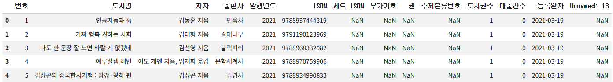

- 판다스에서 `NaN`은 누락된 값, 비어 있는 값을 의미함
- 마지막 'Unnamed: 13' 열은 CSV 파일 각 라인의 끝에 콤마가 있어서 판다스가 자동으로 추가한 것이므로 삭제하는 게 좋음

#### 2. 마지막 'Unnamed: 13' 열은 제외한 '번호'부터 '등록일자' 열까지의 새로운 데이터프레임을 만들자

```py
ns_book = ns_df.loc[:, '번호':'등록일자']
ns_book.head()
```

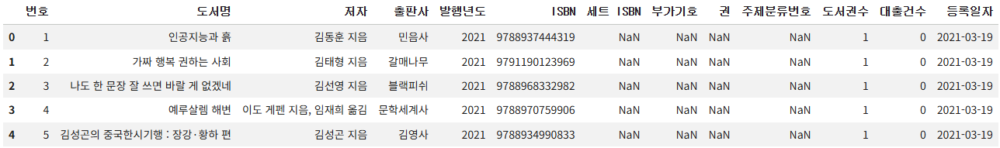

- 단, 슬라이싱을 사용해 중간에 있는 '부가기호' 열을 제외하는 것은 어려움
- boolean 배열을 사용하면 쉽게 원하는 열만 선택할 수 있음

### `loc` 메서드와 boolean 배열

- 데이터프레임의 `columns` 속성은 판다스의 `Index` 객체이고, 이 객체의 원소는 파이썬의 리스트처럼 숫자 인덱스로 참조할 수 있음

  ```py
  print(ns_df.columns)
  """
  Index(['번호', '도서명', '저자', '출판사', '발행년도', 'ISBN', '세트 ISBN', '부가기호', '권',
       '주제분류번호', '도서권수', '대출건수', '등록일자', 'Unnamed: 13'],
      dtype='object')
  """
  ```

  ```py
  print(ns_df.columns[0])
  # 번호
  ```

- `Index` 클래스를 비롯하여 판다스의 배열 성격의 객체는 어떤 값과 비교할 때 자동으로 배열에 있는 모든 원소와 하니씩 비교해줌 (원소별 비교)
- 원소별 비교를 통해 열을 boolean 배열로 나타낼 수 있음
  - 반환값: 넘파이 배열

  ```py
  ns_df.columns != 'Unnamed: 13'
  """
  array([ True,  True,  True,  True,  True,  True,  True,  True,  True,
        True,  True,  True,  True, False])
  """
  ```

#### 3. 데이터프레임 중간에 있는 '부가기호' 열을 제외한 새로운 데이터프레임을 만들자

```py
selected_columns = ns_df.columns != '부가기호'
ns_book = ns_df.loc[:, selected_columns]
ns_book.head()
```

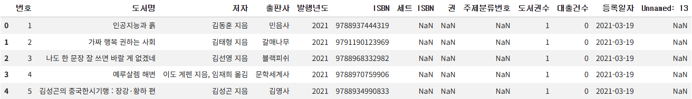

### `drop()` 메서드

- `drop()` 메서드를 통해 데이터프레임의 행이나 열을 삭제할 수 있음
  - 첫 번쨰 매개변수: 삭제할 열/행을 지정
  - `axis` 매개변수: 삭제할 축을 지정
    - `0`: 행을 삭제 (기본값)
    - `1`: 열을 삭제
- `drop()` 메서드를 사용하면 중간에 있는 열을 간단하게 제외할 수 있음

#### 4. 데이터프레임에서 'Unnamed: 13' 열을 삭제해보자

```py
ns_book = ns_df.drop('Unnamed: 13', axis=1)
ns_book.head()
```


- 열을 삭제하려면, 첫 번째 매개변수에 삭제하려는 열 이름을 전달하고 `axis` 매개변수를 1로 지정하면 됨

#### 5. 데이터프레임에서 'Unnamed: 13' 열과 '부가기호' 열을 삭제해보자

```py
ns_book = ns_df.drop(['부가기호','Unnamed: 13'], axis=1)
ns_book.head()
```

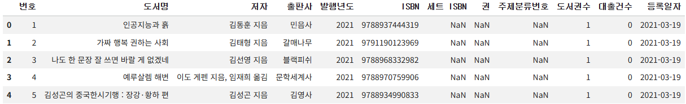

- `drop()` 메서드의 첫 번째 매개변수에 제외할 열 이름을 리스트 형식으로 여러 개 지정할 수도 있음

#### 6. 데이터프레임의 '주제분류번호' 열을 삭제해보자

```py
ns_book.drop('주제분류번호', axis=1, inplace=True)
ns_book.head()
```

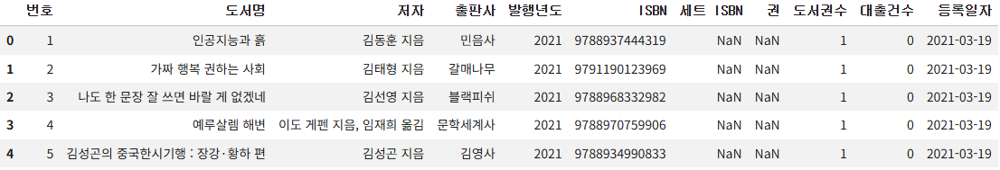

- 지금까지는 새로운 변수를 만들어 데이터프레임 수정 결과를 반환했음
- `drop()` 메서드에 `inplace` 매개변수를 `True`로 지정하면, 현재 선택 데이터프레임을 바로 수정할 수도 있음

### `dropna()` 메서드

- `dropna()` 메서드는 기본적으로 NaN이 하나 이상 포함된 행이나 열을 삭제함

#### 7. 데이터프레임에서 NaN이 하나 이상 포함된 열을 삭제해보자

```py
ns_book = ns_df.dropna(axis=1)
ns_book.head()
```

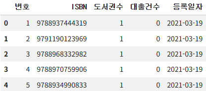

#### 8. 데이터프레임에서 모든 행이 NaN인 열을 삭제해보자

```py
ns_book = ns_df.dropna(axis=1, how='all')
ns_book.head()
```

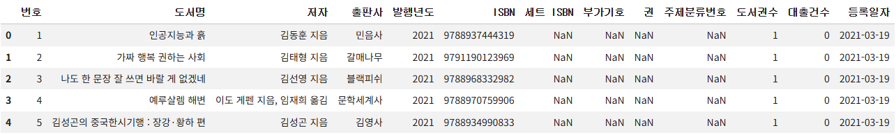

- `dropna()` 메서드에 `how` 매개변수를 `'all'`로 지정하면 모든 값이 NaN인 열을 삭제할 수 있음

## 2️⃣ 행 삭제하기

#### 1. 데이터프레임에서 처음 2개 행을 삭제해보자

```py
ns_book2 = ns_book.drop([0,1])
ns_book2.head()
```

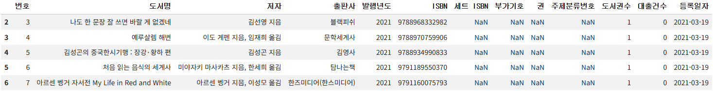

- 열을 삭제할 때와 마찬가지로, 행을 삭제할 때도 `loc` 메서드, `drop()` 메서드, `dropna()` 메서드를 모두 사용할 수 있지만, `[]` 연산자에 슬라이싱이나 불리언 배열을 전달하는 방법을 자주 사용함
- 데이터프레임의 열을 선택하기 위해, `[]` 연산자에 열 이름이나 열 이름 리스트를 전달하면 됨
- 데이터프레임의 행을 선택하기 위해, `[]` 연산자에 슬라이싱이나 불리언 배열을 전달하면 됨

### `[]` 연산자와 슬라이싱

#### 2. 데이터프레임에서 처음 2개 행을 제외한 모든 행을 선택해보자

```py
ns_book2 = ns_book[2:]
ns_book2.head()
```


- `[]` 연산자에 슬라이싱을 사용하면, `loc` 메서드에 슬라이싱을 사용하는 것과 다르게 파이썬의 슬라이싱처럼 마지막 인덱스를 포함하지 않음

### `[]` 연산자와 불리언 배열

#### 3. 데이터프레임에서 출판사가 '한빛미디어'인 행만 선택해보자

```py
selected_rows = ns_df['출판사'] == '한빛미디어'
ns_book2 = ns_book[selected_rows]
ns_book2.head()
```

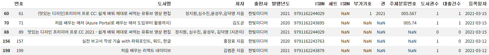

- 비교 연산자를 활용해 원하는 행은 True로 표시하고, 제외할 행은 False로 표시한 불리언 배열을 만들어 `[]` 연산자에 전달하면 됨
- `loc` 메서드에 불리언 배열을 넣어도 됨

#### 4. 데이터프레임에서 대출건수가 1,000이 넘는 행을 선택해보자

```py
ns_book2 = ns_book[ns_book['대출건수'] > 1000]
ns_book2.head()
```

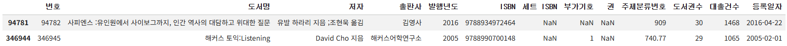

## 3️⃣ 중복된 행 찾기

### `duplicated()` 메서드

- `duplicated()` 메서드를 사용하면, 데이터프레임의 중복된 행을 찾을 수 있음
- 중복된 행 중 처음 행을 제외한 나머지 행은 True로, 그 외에 중복되지 않은 나머지 모든 행은 False로 표시한 불리언 배열을 반환함
- 기본적으로 데이터프레임에 있는 모든 열을 기준으로 중복된 행을 찾음

#### 1. 데이터프레임에서 중복된 행이 있는지 확인해보자

```py
sum(ns_book.duplicated())
# 0
```

- `sum()` 함수를 함께 사용하면, True를 1로 인식하기 때문에 불리언 배열에서 중복된 행의 갯수를 셀 수 있음
- 사실, ns_book 데이터프레임의 모든 행은 '번호' 열에 고유한 값을 가지고 있기 때문에 중복된 행이 나올 수 없음

#### 2. '도서명', '저자', 'ISBN'을 기준으로 중복된 행이 있는지 확인해보자

```py
sum(ns_book.duplicated(subset=['도서명','저자','ISBN']))
# 22096
```

- `duplicated()` 메서드의 `subset` 매개변수에 기준 열을 나열하면, 일부 열을 기준으로 중복된 행을 찾을 수 있음

#### 3. '도서명', '저자', 'ISBN'을 기준으로 어떤 데이터가 중복되었는지 확인해보자

```py
dup_rows = ns_book.duplicated(subset=['도서명','저자','ISBN'], keep=False)
ns_book3 = ns_book[dup_rows]
ns_book3.head()
```

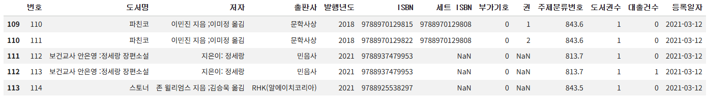

- `duplicated()` 메서드의 `keep` 매개변수를 False로 지정하면 중복된 모든 행을 True로 표시한 불리언 배열을 반환함

## 4️⃣ 그룹별로 모으기

### `groundby()` 메서드

- 특정 열을 기준으로 행을 모음
- `by` 매개변수: 행을 합칠 때 기준이 되는 열

#### 1. '도서명', '저자', 'ISBN', '권'을 기준으로 같은 도서의 대출건수는 하나로 합치자

```py
count_df = ns_book[['도서명','저자','ISBN','권','대출건수']]
group_df = count_df.groupby(by=['도서명','저자','ISBN','권'], dropna=False)
loan_count = group_df.sum()
loan_count.head()
```

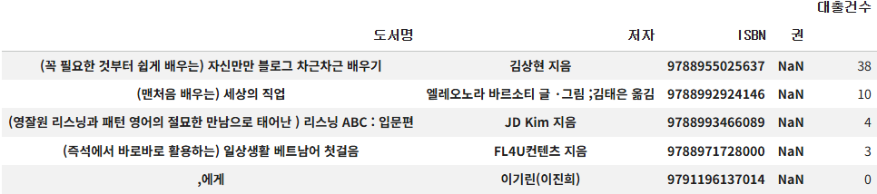

- 기본적으로 `by` 매개변수에 지정된 열에 NaN이 있으면 해당 열을 삭제함
- `dropna` 매개변수: False로 지정하면 NaN이 있는 행을 삭제하지 않음

## 5️⃣ 원본 데이터 업데이트하기

- 목표: 대출건수를 원본 데이터프레임에 업데이트하기

#### 1. '도서명', '저자', 'ISBN', '권'을 기준으로 중복된 행을 제거된 새로운 데이터프레임을 만들자

```py
dup_rows = ns_book.duplicated(subset=['도서명','저자','ISBN','권'])
unique_rows = ~dup_rows
ns_book3 = ns_book[unique_rows].copy()
```

- 판다스의 `~` 연산자를 사용하면, 불리언 배열을 반전시킬 수 있음
- `copy()` 메서드를 사용하면, 데이터프레임의 복사본을 만들 수 있음

### 원본 데이터프레임 인덱스 설정하기

#### 2. ns_book3의 인덱스를 loan_count의 인덱스와 동일하게 만들자

```py
ns_book3.set_index(['도서명','저자','ISBN','권'], inplace=True)
ns_book3.head()
```

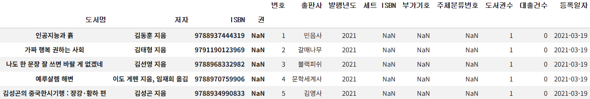

- `set_index()` 메서드를 사용하면, 지정한 열을 인덱스로 설정할 수 있음
- `inplace` 매개변수를 True로 설정하면, 새로운 데이터프레임을 반환하지 않고 기존 데이터프레임을 수정함

### 업데이트하기: `update()` 메서드

#### 3. 대출건수를 원본 데이터프레임에 업데이트해보자

```py
ns_book3.update(loan_count)
ns_book3.head()
```


- `update()` 메서드를 사용하면, 다른 데이터프레임을 사용해 원본 데이터프레임의 값을 업데이트할 수 있음

#### 4. 인덱스 열을 해제하자

```py
ns_book4 = ns_book3.reset_index()
ns_book4.head()
```

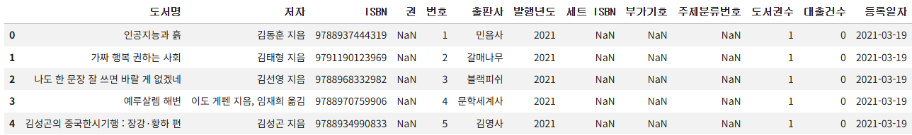

- `reset_index()` 메서드를 사용하면, 데이터프레임의 인덱스를 재설정할 수 있음
- 이슈) 여러 개의 열을 사용해 데이터프레임의 인덱스를 만들었다가 다시 해제했기 때문에, 초기 데이터프레임의 열과 ns_book4 데이터프레임의 열 순서가 달라짐

#### 5. 원본 데이터프레임의 열 순서대로 변경하자

```py
ns_book4 = ns_book4[ns_book.columns]
ns_book4.head()
```

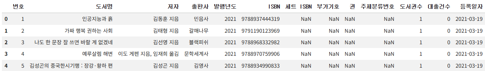

- `[]` 연산자에 원하는 열 이름을 순서대로 전달하면, 쉽게 열의 순서를 바꿀 수 있음

#### 6. 불필요한 데이터를 제거한 ns_book4 데이터프레임을 저장하자

```py
ns_book4.to_csv('ns_book4.csv', index=False)
```

## cf) 불필요한 행/열을 제거하는 함수

```py
def data_cleaning(filename):
    """
    남산 도서관 장서 CSV 데이터 전처리 함수

    :param filename: CSV 파일이름
    """
    # 파일을 데이터프레임으로 읽습니다.
    ns_df = pd.read_csv(filename, low_memory=False)
    # NaN인 열을 삭제합니다.
    ns_book = ns_df.dropna(axis=1, how='all')

    # 대출건수를 합치기 위해 필요한 행만 추출하여 count_df 데이터프레임을 만듭니다.
    count_df = ns_book[['도서명','저자','ISBN','권','대출건수']]
    # 도서명, 저자, ISBN, 권을 기준으로 대출건수를 groupby합니다.
    loan_count = count_df.groupby(by=['도서명','저자','ISBN','권'], dropna=False).sum()
    # 원본 데이터프레임에서 중복된 행을 제외하고 고유한 행만 추출하여 복사합니다.
    dup_rows = ns_book.duplicated(subset=['도서명','저자','ISBN','권'])
    unique_rows = ~dup_rows
    ns_book3 = ns_book[unique_rows].copy()
    # 도서명, 저자, ISBN, 권을 인덱스로 설정합니다.
    ns_book3.set_index(['도서명','저자','ISBN','권'], inplace=True)
    # load_count에 저장된 누적 대출건수를 업데이트합니다.
    ns_book3.update(loan_count)

    # 인덱스를 재설정합니다.
    ns_book4 = ns_book3.reset_index()
    # 원본 데이터프레임의 열 순서로 변경합니다.
    ns_book4 = ns_book4[ns_book.columns]

    return ns_book4
```

```py
new_ns_book4 = data_cleaning('ns_202104.csv')
ns_book4.equals(new_ns_book4)
# True
```

## cf) 핵심 함수와 메서드

| 함수/메서드               | 기능                                                            |
| ------------------------- | --------------------------------------------------------------- |
| `DataFrame.drop()`        | 데이터프레임의 행이나 열을 삭제함                               |
| `DataFrame.dropna()`      | 누락된 값이 포함됨 행이나 열을 삭제함                           |
| `DataFrame.duplicated()`  | 중복된 행을 찾아 불리언 값으로 표시한 배열을 반환함             |
| `DataFrame.groupby()`     | 데이터프레임의 행을 그룹으로 모음                               |
| `DataFrame.sum()`         | 행 또는 열을 기준으로 합계를 계산함                             |
| `DataFrame.set_index()`   | 지정한 열을 인덱스로 설정함                                     |
| `DataFrame.reset_index()` | 데이터프레임의 인덱스를 재설정함                                |
| `DataFrame.update()`      | 다른 데이터프레임을 사용해 원본 데이터프레임의 값을 업데이트 함 |
| `DataFrame.equals()`      | 다른 데이터프레임과 동일한 원소를 가졌는지 비교함               |
