# ✔ 선 그래프와 막대 그래프 그리기

> ['선 그래프와 막대 그래프 그리기' 구글 코랩](https://colab.research.google.com/github/rickiepark/hg-da/blob/main/05-2.ipynb)

## 1️⃣ 연도별 발행 도서 개수 구하기

- 선 그래프: 데이터 포인트 사이를 선으로 이은 그래프
- 막대 그래프: 데이터 포인트 크기를 막대 높이로 나타내는 그래프
- 선 그래프와 막대 그래프는 한 축을 따라 어떤 데이터의 변화를 살펴보는데 용이함

#### 1. 구글 드라이브에 저장된 'ns_book7.csv' 파일을 다운로드하자

```py
import gdown
import pandas as pd

gdown.download('https://bit.ly/3pK7iuu', 'ns_book7.csv', quiet=False)

ns_book7 = pd.read_csv('ns_book7.csv', low_memory=False)
ns_book7.head()
```

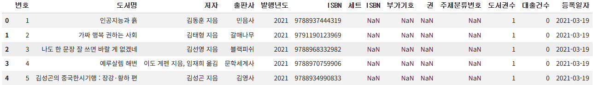

#### 2. 데이터프레임에서 연도별 발행 도서 개수를 구해보자

```py
count_by_year = ns_book7['발행년도'].value_counts()
print(count_by_year)
```

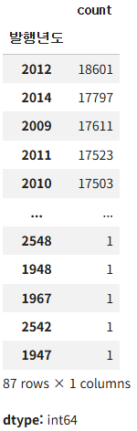

- 데이터프레임의 한 열에서 `value_counts()` 메서드를 호출하면, 고유한 값의 등장 횟수를 계산함
- 이는 `np.unique()` 함수에 `return_counts=True` 매개변수를 지정해 얻은 결과와 동일함
- `value_counts()` 메서드는 판다스 시리즈 객체를 반환하고, 첫 번째 열은 index, 두 번째 열은 value에 해당함
- 기본적으로 값을 기준으로 내림차순 정렬함

#### 3. 발행년도(index)를 기준으로 오름차순 정렬해보자

```py
count_by_year = count_by_year.sort_index()
print(count_by_year)
```

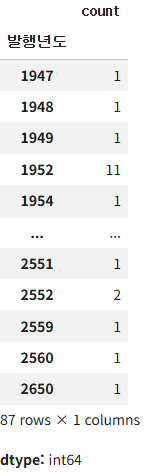

- 시리즈 객체의 `sort_index()` 메서드를 사용하면, 인덱스 순서대로 데이터를 정렬할 수 있음
- 문제점) 2650년까지 발행된 도서가 있음 (미래에 발행될 도서가 대출 데이터에 있으면 안됨)

#### 4. 발행년도(index)가 2030년보다 작거나 같은 데이터만 뽑아보자

```py
count_by_year = count_by_year[count_by_year.index <= 2030]
print(count_by_year)
```

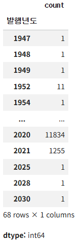

## 2️⃣ 주제별 도서 개수 구하기

- '주제분류번호' 열에는 도서관에서 책을 분류하는 기준인 십진분류 코드가 기입되어 있음
- '주제분류번호' 열의 첫 번째 문자를 기준으로 도서를 카운트하면 주제별 도서 개수를 구할 수 있음

#### 1. 데이터프레임에서 주제별 도서 개수를 구해보자

```py
import numpy as np

def kdc_1st_char(no):
    if no is np.nan:
        return '-1'
    else:
        return no[0]

count_by_subject = ns_book7['주제분류번호'].apply(kdc_1st_char).value_counts()
print(count_by_subject)
```

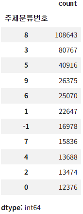

- '주제분류번호' 열의 값이 NaN인 경우 -1을 반환하고, 이외는 첫 번째 문자를 반환함
- 주제별 도서 개수 데이터는 순서에 의미가 있지 않으므로, 인덱스 순서대로 정렬할 필요는 없음

## 3️⃣ 선 그래프 그리기

#### 1. 맷플롯립의 기본 DPI 값을 올려, 그래프 해상도를 높여보자

```py
import matplotlib.pyplot as plt

plt.rcParams['figure.dpi'] = 100
```

#### 2. 선 그래프를 사용해 '연도별 발행 도서 개수'를 그려보자

```py
plt.plot(count_by_year.index, count_by_year.values)
plt.title('Books by year')
plt.xlabel('year')
plt.ylabel('number of books')
plt.show()
```

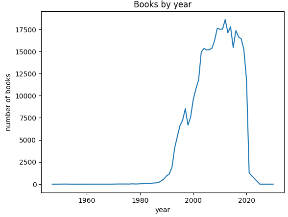

- 맷플롯립의 `plot()` 함수를 사용해 선 그래프를 그릴 수 있음
  - 첫 번째 매개변수: x축의 값
  - 두 번쨰 매개변수: y축의 값
- `title()` 함수를 통해 그래프 제목을 넣을 수 있음
- `xlabel()` 함수를 통해 x축 이름을 지정할 수 있음
- `ylabel()` 함수를 통해 y축 이름을 지정할 수 있음

### 선 모양과 색상 바꾸기

- `plot()` 함수의 `linestyle` 매개변수를 통해 선 모양을 지정할 수 있음
  - 실선(solid line): `'-'` (기본값)
  - 점선(dotted line): `':'`
  - 쇄선(dash dot line): `-.`
  - 파선(dashed line): `'--'`

- `plot()` 함수의 `color` 매개변수를 통해 색상을 지정할 수 있음
- `plot()` 함수의 `marker` 매개변수를 통해 데이터 포인트 위치를 명확히 나타낼 수 있음
- `plot()` 함수의 매개변수에 지정한 `linestyle`, `color`, `marker`를 하나의 문자열로 합쳐서 선 그래프의 포맷으로 나타낼 수도 있음

#### 3. 점 모양 마커와 점선을 사용한 선 그래프를 빨간색으로 그려보자

```py
plt.plot(count_by_year, marker='.', linestyle=':', color='red')
plt.title('Books by year')
plt.xlabel('year')
plt.ylabel('number of books')
plt.show()
```

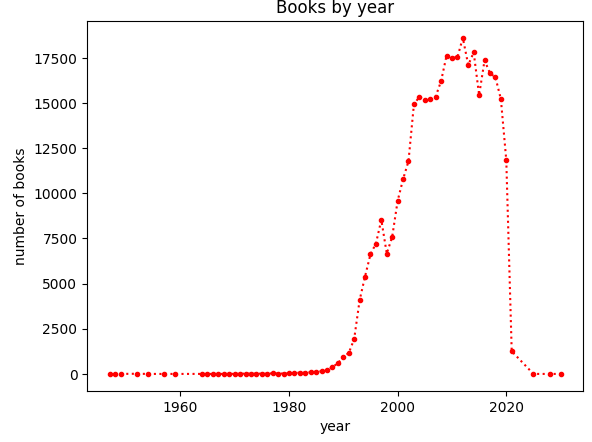

#### 4. 별 모양 마커와 실선을 사용한 선 그래프를 녹색으로 그려보자

```py
plt.plot(count_by_year, '*-g')
plt.title('Books by year')
plt.xlabel('year')
plt.ylabel('number of books')
plt.show()
```

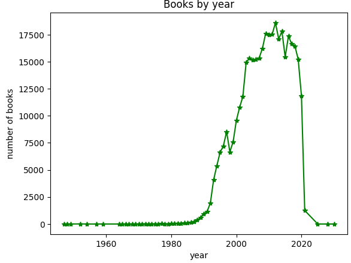

### 선 그래프 눈금 개수 조절 및 마커에 텍스트 표시하기

#### 5. 10년씩 건너뛰면서 x축의 눈금을 표시하고, 발행년도(index)를 5개씩 건너뛰면서 텍스트를 표시하자

```py
plt.plot(count_by_year, '*-g')
plt.title('Books by year')
plt.xlabel('year')
plt.ylabel('number of books')
plt.xticks(range(1947, 2030, 10))
for idx, val in count_by_year[::5].items():
    plt.annotate(val, (idx, val))
plt.show()
```

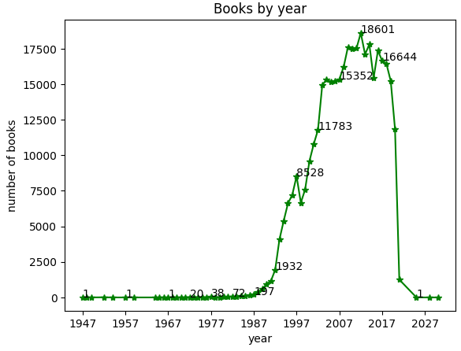

- `xticks()` 함수를 사용해 x축 눈금을 지정할 수 있음
- `annotate()` 함수를 사용해 그래프에 값을 표시할 수 있음
  - 첫 번째 매개변수: 그래프에 나타낼 문자열을 지정
  - 두 번째 매개변수: 문자열이 나타날 x,y 좌표를 튜플로 지정

#### 6. 마커 위치에서 x축으로 1만큼, y축으로 10만큼 떨어진 위치에 텍스트를 표시해보자

```py
plt.plot(count_by_year, '*-g')
plt.title('Books by year')
plt.xlabel('year')
plt.ylabel('number of books')
plt.xticks(range(1947, 2030, 10))
for idx, val in count_by_year[::5].items():
    plt.annotate(val, (idx, val), xytext=(idx+1, val+10))
plt.show()
```

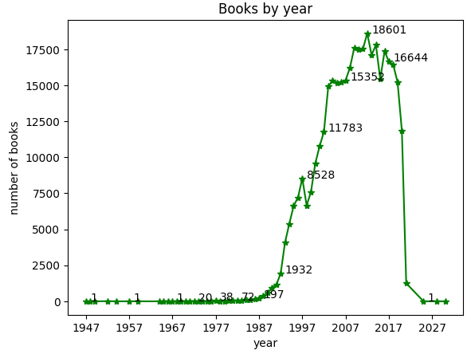

- `annotate()` 함수는 기본적으로 마커와 동일한 좌표 시스템을 사용함
- `xytext` 매개변수를 사용해 텍스트 위치를 조절할 수 있음
- 이슈) y축의 스케일이 x축보다 훨씬 크기 때문에, x축과 달리 y축으로 10만큼 떨어뜨린 것은 거의 차이가 없음

#### 7. 좌표 대신 상대적 위치를 지정해, 마커에서 텍스트를 떨어뜨려보자

```py
plt.plot(count_by_year, '*-g')
plt.title('Books by year')
plt.xlabel('year')
plt.ylabel('number of books')
plt.xticks(range(1947, 2030, 10))
for idx, val in count_by_year[::5].items():
    plt.annotate(val, (idx, val), xytext=(2, 2), textcoords='offset points')
plt.show()
```

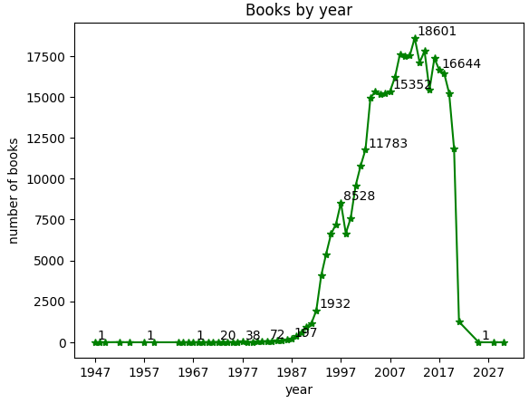

- `xytext`와 `textcoords` 매개변수를 함께 사용해 상대적 위치를 포인트나 픽셀 단위로 지정할 수 있음
  - `'offset points'`: 포인트 단위의 상대 위치
  - `'offset pixels'`: 픽셀 단위의 상대 위치
  - 1 포인트 = 1/72 인치

## 4️⃣ 막대 그래프 그리기

#### 1. 막대 그래프를 사용해 '주제별 도서 개수'를 그려보자

```py
plt.bar(count_by_subject.index, count_by_subject.values)
plt.title('Books by subject')
plt.xlabel('subject')
plt.ylabel('number of books')
for idx, val in count_by_subject.items():
    plt.annotate(val, (idx, val), xytext=(0, 2), textcoords='offset points')
plt.show()
```

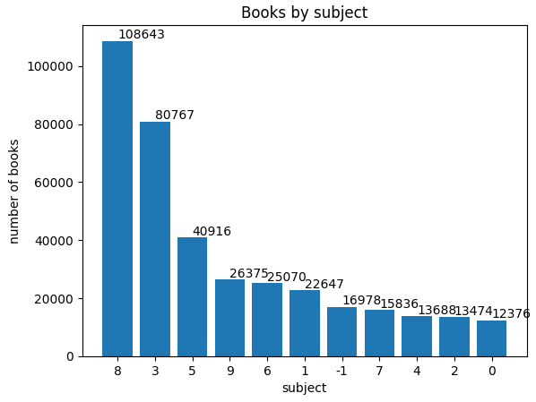

- 맷플롯립의 `bar()` 함수를 사용해 막대 그래프를 그릴 수 있음
  - 첫 번째 매개변수: x축의 값
  - 두 번째 매개변수: 막대 높이에 해당하는 y축의 값

### 텍스트 정렬, 막대 조절 및 색상 바꾸기

#### 2. 텍스트를 중앙 정렬/크기 축소/녹색으로 출력하고, 막대를 두께 축소/파란색으로 출력해보자

```py
plt.bar(count_by_subject.index, count_by_subject.values, width=0.7, color='blue')
plt.title('Books by subject')
plt.xlabel('subject')
plt.ylabel('number of books')
for idx, val in count_by_subject.items():
    plt.annotate(val, (idx, val), xytext=(0, 2), textcoords='offset points',
                 fontsize=8, ha='center', color='green')
plt.show()
```


- `annotate()` 함수에서 `ha` 매개변수를 통해 텍스트의 위치를 조절할 수 있음
  - `'center'`: 중앙 정렬
  - `'left'`: 왼쪽으로 정렬
  - `'right'`: 오른쪽으로 정렬
- `annotate()` 함수에서 `fontsize` 매개변수를 통해 텍스트 크기를 조절할 수 있음
- `annotate()` 함수에서 `color` 매개변수를 통해 텍스트 색상을 지정할 수 있음
- `bar()` 함수에서 `width` 매개변수를 통해 막대의 두께를 조절할 수 있음
- `bar()` 함수에서 `color` 매개변수를 통해 막대의 색상을 지정할 수 있음

### 가로 막대 그래프 그리기

#### 3. 가로 막대 그래프를 사용해 '주제별 도서 개수'를 그려보자

```py
plt.barh(count_by_subject.index, count_by_subject.values, height=0.7, color='blue')
plt.title('Books by subject')
plt.xlabel('number of books')
plt.ylabel('subject')
for idx, val in count_by_subject.items():
    plt.annotate(val, (val, idx), xytext=(2, 0), textcoords='offset points',
                 fontsize=8, va='center', color='green')
plt.show()
```

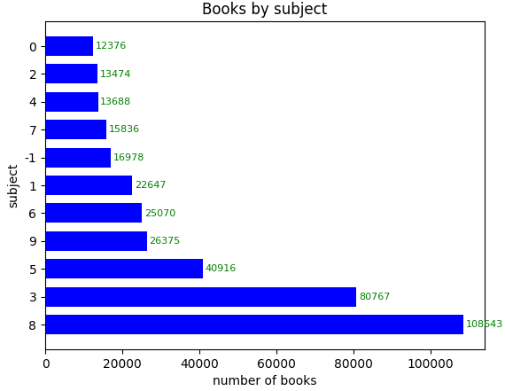

- 맷플롯립의 `barh()` 함수를 사용해 가로 막대 그래프를 그릴 수 있음
- `barh()` 함수에서 `height` 매개변수를 사용해 막대의 두께를 조절할 수 있음
- `annotate()` 함수에서 `va` 매개변수를 통해 텍스트의 위치를 조절할 수 있음
  - `'baseline'`: 텍스트 밑면을 막대 중앙에 정렬 (기본값)
  - `'center'`: 텍스트 중앙을 막대 중앙에 정렬
  - `'top'`: 위로 정렬
  - `'bottom'`: 아래로 정렬

## cf) 이미지 출력하고 저장하기

#### 1. 샘플 이미지를 다운로드하자

```py
# 노트북이 코랩에서 실행 중인지 체크합니다.
import sys
if 'google.colab' in sys.modules:
    # 샘플 이미지를 다운로드합니다.
    !wget https://bit.ly/3wrj4xf -O jupiter.png
```

### 이미지 읽기

#### 2. 샘플 이미지를 읽어오자

```py
img = plt.imread('jupiter.png')
print(img.shape)
# (1561, 1646, 3)
```

- 맷플롯립에서 `imread()` 함수를 사용해 이미지를 읽을 수 있음
  - 입력값: 파일 이름
  - 반환값: 넘파이 배열 (이미지의 높이, 너비, 채널)
- `imread()` 함수는 사실 파이썬의 `Pillow` 패키지를 사용해 이미지를 로드함
  - Pillow 패키지는 이미지를 분석하거나 처리할 수 있는 유용한 기능을 제공함

### 이미지를 화면에 출력하기

#### 3. 샘플 이미지를 화면에 출력하자

```py
plt.imshow(img)
plt.show()
```

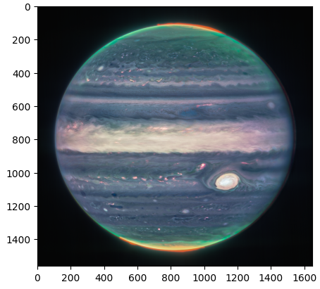

- `imshow()` 함수를 사용해 이미지를 화면에 표시할 수 있음

#### 4. 이미지에서 축과 눈금을 제외하고 화면에 출력하자

```py
plt.figure(figsize=(8, 6))
plt.imshow(img)
plt.axis('off')
plt.show()
```


- `imshow()` 함수는 기본적으로 피겨 크기에 상관없이 원본 이미지의 가로세로 비율을 유지함
- 만약, 가로세로 비율이 달라지더라도 피겨 크기에 맞추어 이미지를 출력하고 싶다면, `imshow()` 함수의 `aspect` 매개변수를 `'auto'`로 설정하면 됨
- `axis()` 함수를 `'off'`로 지정하면 이미지에 포시된 축과 눈금을 출력하지 않음

### 이미지 저장하기

#### 5. 샘플 이미지를 JPEG 포맷으로 저장하자

```py
plt.imsave('jupiter.jpg', arr_img)
```

- 맷플롯립의 `imsave()` 함수를 사용해 넘파이 배열로 읽은 이미지를 저장할 수 있음
  - 첫 번째 매개변수: 저장할 파일 이름
  - 두 번째 매개변수: 이미지가 저장된 넘파이 배열
- `imsave()` 함수는 파일 이름의 확장자를 사용해 자동으로 이미지를 변환해 줌

## cf) 그래프를 이미지로 저장하기

#### 1. 가로 막대 그래프를 이미지로 저장해보자

```py
plt.barh(count_by_subject.index, count_by_subject.values, height=0.7, color='blue')
plt.title('Books by subject')
plt.xlabel('number of books')
plt.ylabel('subject')
for idx, val in count_by_subject.items():
    plt.annotate(val, (val, idx), xytext=(2, 0), textcoords='offset points',
                 fontsize=8, va='center', color='green')
plt.savefig('books_by_subject.png')
plt.show()
```


- 맷플롯립의 `savefig()` 함수를 사용해 그래프를 이미지로 저장할 수 있음
  - 첫 번쨰 매개변수: 저장할 이미지의 파일 이름
- `dpi` 매개변수나 `rcParams['savefig.dpi']`를 통해 그래프를 저장할 때 사용할 DPI를 따로 지정할 수 있음
  - 기본값: `'figure'` (피겨에서 설정한 DPI)
- `show()` 함수가 호출되면 피겨 객체가 자동으로 소멸되므로, `show()` 함수 이전에 `savefig()` 함수를 호출해야 함

#### 2. 저장한 이미지 파일을 다시 불러와 출력해보자

```py
from PIL import Image

pil_img = Image.open('books_by_subject.png')

plt.figure(figsize=(8, 6))
plt.imshow(pil_img)
plt.axis('off')
plt.show()
```


## cf) 핵심 함수와 메서드

| 함수/메서드                    | 기능                                 |
| ------------------------------ | ------------------------------------ |
| `matplotlib.pyplot.plot()`     | 선 그래프를 그림                     |
| `matplotlib.pyplot.title()`    | 그래프 제목을 설정함                 |
| `matplotlib.pyplot.xlabel()`   | x축 이름을 지정함                    |
| `matplotlib.pyplot.ylabel()`   | y축 이름을 지정함                    |
| `matplotlib.pyplot.xticks()`   | x축의 눈금 위치와 레이블을 지정함    |
| `matplotlib.pyplot.annotate()` | 지정한 좌표에 텍스트를 출력함        |
| `matplotlib.pyplot.bar()`      | 세로 막대 그래프를 그림              |
| `matplotlib.pyplot.barh()`     | 가로 막대 그래프를 그림              |
| `matplotlib.pyplot.imread()`   | 이미지 파일을 넘파이 배열로 읽어들임 |
| `matplotlib.pyplot.imshow()`   | 이미지 파일을 출력함                 |
| `matplotlib.pyplot.imsave()`   | 넘파이 배열을 이미지 파일로 저장함   |
| `matplotlib.pyplot.savefig()`  | 그래프를 이미지로 저장함             |
