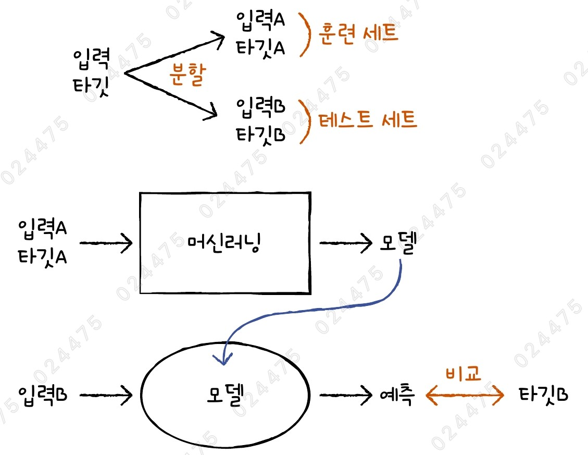
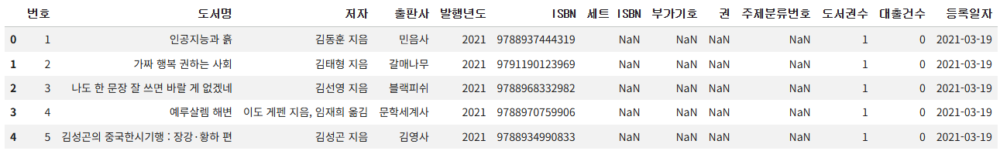
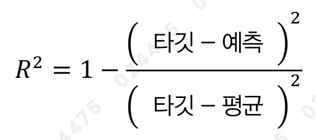
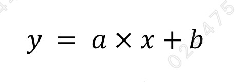
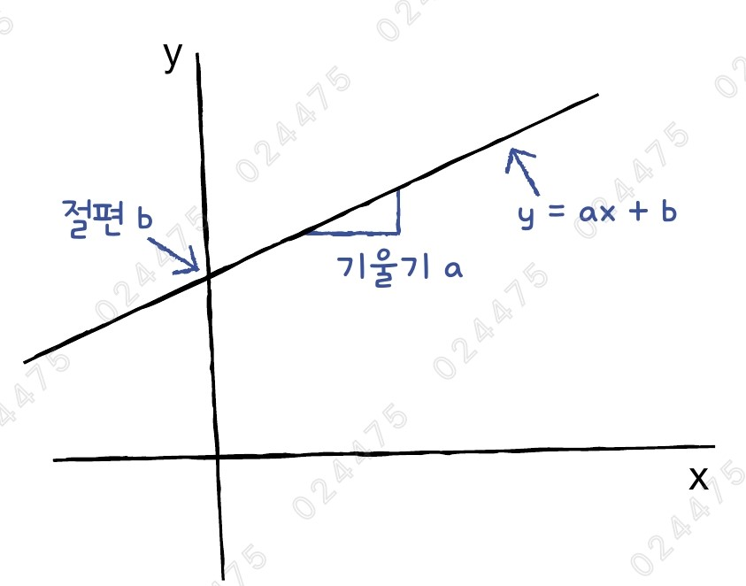
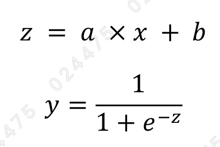
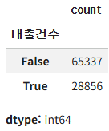
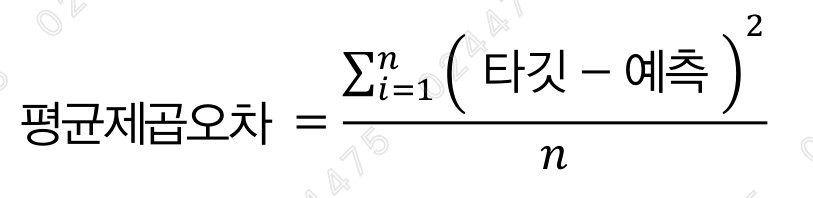
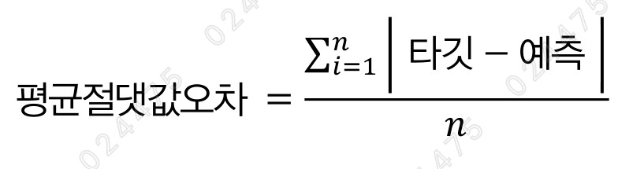

# ✔ 머신러닝으로 예측하기

> ['머신러닝으로 예측하기' 구글 코랩](https://colab.research.google.com/github/rickiepark/hg-da/blob/main/07-2.ipynb)

## 1️⃣ 알아 두면 좋은 머신러닝 용어

### 머신러닝

- 컴퓨터 프로그램을 사용해 데이터에서 패턴을 학습하는 방법
- 학습된 패턴을 사용해 새로운 데이터에 대해 빠르고 유용한 결정을 내릴 수 있을 것임
- ex) 구글 지메일의 스팸 메일 감지기는 스팸 메일과 스팸이 아닌 메일로 훈련한 다음, 새로 도착한 메일이 스팸 메일인지 아닌지 예측함
- 머신러닝은 더 커다란 인공지능(artificial intelligence)의 하위 분야임
- 머신러닝은 지도 학습(supervised learning)과 비지도 학습(unsupervised learning)으로 나눔
- 사이킷런(scikit-learn): 파이썬의 대표적인 머신러닝 패키지

### 모델

- 머신러닝으로 학습된 패턴을 저장하는 소프트웨어 객체
- ex) 사이킷런에 있는 어떤 클래스의 인스턴스 객체가 모델이 됨

### 지도 학습

- supervised learning
- 데이터에 있는 각 샘플에 대한 정답을 알고 있는 문제에 적용하는 방법
- 입력과 타깃이 들어있는 데이터를 사용해 어떤 머신러닝 모델을 훈련한 후, 타깃을 모르는 새로운 입력에 모델을 적용해 타깃을 예측하는 것
  - 타깃(target): 정답
  - 입력(input): 타깃을 맞추기 위해 모델이 재료로 사용하는 데이터
  - 훈련: 데이터에 있는 패턴을 학습시키는 과정

### 비지도 학습

- unsupervised learning
- 입력 데이터는 있지만 타깃이 없는 문제에 적용하는 방법
- ex) 군집 알고리즘 (clustering algorithm)

### 딥러닝

- 딥러닝은 머신러닝의 부분 집합에 해당함
- 신경망(neural network) 알고리즘을 사용하는 경우를 딥러닝이라고 부름
- 일부 머신러닝 알고리즘은 지도 학습이나 비지도 학습 한쪽에만 사용할 수 있음
  - ex) 선형 회귀 알고리즘은 지도 학습임
- 하지만, 신경망 알고리즘은 지도 학습이나 비지도 학습에 모두 사용할 수 있음

## 2️⃣ 모델 훈련하기

### 훈련 세트, 테스트 세트

- 훈련할 때 사용했던 데이터로 모델을 평가하는 것은 바람직하지 않음
- 새로운 데이터를 사용해 훈련된 모델을 평가해야 함
- 따라서, 전체 데이터를 훈련 세트(training set)와 테스트 세트(test set)로 나누어야 함
  - 훈련 세트로 모델을 훈련하고, 테스트 세트로 모델을 평가함

  

- 일반적으로 훈련 데이터가 테스트 데이터보다 큼
  - 보통 테스트 데이터는 전체 데이터의 20~25% 정도를 사용함
- 데이터의 처음 20%를 덜어내서 테스트 세트로 그냥 사용할 수 있지만, 데이터 첫 부분에 특정 성향을 띠는 샘플들이 몰리면 모델이 데이터 전반에 걸친 패턴을 잘 학습하지 못할 수 있음
  - 따라서, 일반적으로 데이터를 무작위로 섞은 후 샘플을 훈련 세트와 테스트 세트로 나누어야 함

### 훈련 세트와 테스트 세트로 나누기

#### 1. 구글 드라이브에 저장된 'ns_book7.csv' 파일을 다운로드하자

```py
import gdown
import pandas as pd

gdown.download('https://bit.ly/3pK7iuu', 'ns_book7.csv', quiet=False)

ns_book7 = pd.read_csv('ns_book7.csv', low_memory=False)
ns_book7.head()
```



#### 2. 데이터를 훈련 세트와 테스트 세트로 나누어 보자

```py
from sklearn.model_selection import train_test_split

train_set, test_set = train_test_split(ns_book7, random_state=42)

print(len(train_set), len(test_set))
# 282577 94193
```

- 사이킷런의 `tran_test_split()` 함수를 사용하면 쉽게 훈련 세트와 테스트 세트로 나눌 수 있음
- 기본적으로 입력된 데이터를 무작위로 섞은 후, 75%를 훈련 세트로 25%를 테스트 세트로 나눔
- `test_size` 매개변수를 0~1 사이의 값으로 지정해 분할 비율을 조정할 수 있음

#### 3. '도서권수' 열을 사용해 '대출건수'를 예측하기 위해, 각각 입력과 타깃으로 지정해보자

```py
X_train = train_set[['도서권수']]
y_train = train_set['대출건수']

print(X_train.shape, y_train.shape)
# (282577, 1) (282577,)
```

- 입력(input): 도서권수
- 타깃(target): 대출권수
- 사이킷런은 입력으로 2차원 배열, 타깃으로 1차원 배열을 기대함
  - '도서권수' 열을 선택할 때 리스트로 감싸, 282,577개 행과 1개의 열로 이루어진 데이터프레임(2차원 배열)이 됨
  - 반면, '대출권수'는 282,577개의 원소를 가진 1차원 배열임
- 2차원 배열인 입력은 행 방향으로 샘플이 나열되고, 열 방향으로 샘플의 속성(특성, feature)이 나열됨

### 선형 회귀 모델 훈련하기

#### 4. 훈련 세트로 선형 회귀 모델을 훈련해보자

```py
from sklearn.linear_model import LinearRegression

lr = LinearRegression()
lr.fit(X_train, y_train)
```

- 사이킷런의 `linear_model` 모듈 아래에 있는 `LinearRegression` 클래스를 사용해 선형 회귀 모델을 훈련할 수 있음
- `fit()` 메서드에 훈련 세트(입력과 타깃)을 전달하면 모델을 훈련시킬 수 있음

## 3️⃣ 훈련된 모델을 평가하기: 결정계수

### 결정계수



- coefficient of determination
- 회귀 모델을 평가하는 가장 대표적인 방법
- 여기서 평균은 타깃의 평균을 의미함
- 예측이 평균에 가까워지면, 분모와 분자가 같아져 $R^2$ 점수는 0이 됨
- 타깃에 정확히 맞는 예측을 하면, 분자가 0에 가까워져 $R^2$ 점수는 1이 됨
- 드물게 예측이 평균보다 나쁘면 $R^2$ 점수는 음수가 될 수도 있음

#### 1. 테스트 세트를 사용해 훈련된 모델을 평가해보자

```py
X_test = test_set[['도서권수']]
y_test = test_set['대출건수']

lr.score(X_test, y_test)
# 0.10025676249337112
```

- 기본적으로 사이킷런의 머신러닝 모델은 모두 `score()` 메서드를 제공함
- `score()` 메서드를 사용해 훈련된 머신러닝 모델이 얼마나 유용한지 평가할 수 있음
  - 반환값: 0~1 사이의 값 (결정계수, $R^2$ 점수)
- 결정계수가 1에 가까울수록 도서권수와 대출건수 간에 관계가 깊다고 볼 수 있음
- 평가 결과, 결정계수가 0.1이므로 평균보다 조금 나은 정도의 예측을 했음
  - 따라서, 이 모델은 그다지 유용하지 않음
  - 도서권수로 대출건수를 예측하는 것은 어려울 것 같음

#### 2. '대출건수'로 '대출건수'를 예측하는 선형 회귀 모델을 만든 후 평가해보자

```py
lr.fit(y_train.to_frame(), y_train)
lr.score(y_test.to_frame(), y_test)
# 1.0
```

- 사실, '대출건수'로 '대출건수'를 예측하는 일은 의미 없는 일이지만, 결정계수가 어떤 의미인지 이해하기 위해 진행함
- `to_frame()` 메서드를 사용해 시리즈 객체를 2차원 배열인 데이터프레임으로 만들 수 있음
- 입력과 타깃 두 값이 동일하므로, 입력 그대로 예측값으로 사용하면 되기 때문에 결정계수가 1.0이 나옴

## 4️⃣ 연속적인 값 예측하기: 선형 회귀

### 선형 회귀





- linear regression
- 연속적인 타깃에 적용하는 회귀 알고리즘
- 선형 함수(linear function)를 사용해 모델을 만드는 알고리즘
- 위처럼 간단한 직선의 방정식을 사용할 수 있음
  - `x`: 입력
  - `y`: 타깃
- 선형 회귀 알고리즘이 `fit()` 메서드를 호출했을 때 데이터에서 학습한 것이 바로 이 기울기 `a`와 절편 `b` 임

#### 1. '대출건수'로 '대출건수'를 예측하는 선형 회귀 모델의 기울기와 절편 값을 확인해보자

```py
print(lr.coef_, lr.intercept_)
# [1.] -3.907985046680551e-14
```

- `coef_` 속성에 학습된 기울기가 저장되어 있음
- `intercept_` 속성에 학습된 절편이 저장되어 있음
- 기울기가 1이고 절편은 0에 가까운 매우 음수이므로, 이 선형 회귀 모델이 학습한 함수는 $y = 1 * x + 0$ 임
  - 따라서, x에 어떤 값을 입력하더라도 y는 x와 동일한 값이 됨

## 5️⃣ 카테고리 예측하기: 로지스틱 회귀

### 회귀

- regression
- 지도 학습 중에서 타깃이 실수인 문제에 적용
- 대표적인 알고리즘: 선형 회귀

### 분류

- classification
- 지도 학습 중에서 연속적이지 않은 타깃 값을 가진 문제에 적용
- 대표적인 알고리즘: 로지스틱 회귀
- 이진 분류(binary classification): 2개의 카테고리로 구분하는 경우
- 다중 분류(multiclass classification): 3개 이상의 카테고리로 구분하는 경우
- 클래스(class): 분류 알고리즘에서 타깃 카테고리를 의미
- 일반적으로 이진 분류의 타깃은 0과 1임
  - 음성 클래스(negative class): 0
  - 양성 클래스(positive class): 1
  - 모델이 찾으려는 대상을 보통 양성 클래스로 놓게 됨
- 주의) 클래스 간의 비율이 균일하지 않으면, 모델 성능을 자칫 잘못 해석할 수 있음

### 로지스틱 회귀

- logistic regression
- 선형 회귀처럼 선형 함수를 사용하지만, 예측을 만들기 전에 특정 함수를 거치는 과정이 있음
- 사이킷런의 `LogisticRegression` 클래스는 이진 분류와 다중 분류를 모두 지원함

#### 로지스틱 함수



- logistic function
- 시그모이드 함수(sigmoid function)라고도 부름
- 이중 분류를 지원함
- 로지스틱 함수를 사용해 연속적인 실수 출력값을 1 또는 0으로 변환함
- 선형 함수의 결과값 실수 z를 로지스틱 함수에 통과시키면 y는 0~1 사이의 값이 됨
- 이때, y가 0.5보다 크면 양성 클래스로 예측하고, 0.5보다 작으면 음성 클래스로 예측함

#### 소프트맥스 함수

- softmax function
- 다중 분류를 지원함

### 로지스틱 회귀 모델 훈련하기

- 사실, '대출건수'는 3.5와 같은 실수 값이 아니고 3과 같은 정수이기 때문에 이를 어떤 종류의 카테고리로 볼 수도 있음
- ex) 전체 대출건수 평균보다 높으면 양성 클래스로, 그렇지 않으면 음성 클래스로 만들 어 간단하게 이진 분류를 할 수 있음

#### 1. 훈련 세트와 테스트 세트의 타깃(대출건수)을 이진 분류에 맞게 바꿔보자

```py
borrow_mean = ns_book7['대출건수'].mean()
y_train_c = y_train > borrow_mean
y_test_c = y_test > borrow_mean
```

- 사실, y_train_c와 y_test_c는 0, 1이 아닌 False, True로 이루어진 불리언 시리즈 객체임
- 사이킷런은 False, True를 자동으로 0, 1로 인식하므로, 또 다른 변환 없이 이 값을 그대로 모델 훈련에 사용할 수 있음

#### 2. '도서권수'로 '대출건수'가 평균보다 높은지 아닌지 예측하는 이진 분류 모델을 만들어보자

```py
from sklearn.linear_model import LogisticRegression

logr = LogisticRegression()
logr.fit(X_train, y_train_c)
logr.score(X_test, y_test_c)
# 0.7106154385145393
```

- 사이킷런의 `linear_model` 모듈 아래에 있는 `LinearRegression` 클래스를 사용해 로지스틱 회귀 모델을 훈련할 수 있음
- 사이킷런의 분류 모델의 경우, `score()` 메서드가 출력하는 점수는 정확도(accuracy) 임
  - 정확도: 입력 데이터 중 정답을 맞힌 비율
- 양성 클래스와 음성 클래스만 있으므로 무작위로 예측하면 정확도가 50% 정도가 나올 테니, 정확도 71%면 나름 괜찮은 결과 아닐까? 추측 가능함
  - 하지만, 여기에는 숨겨진 다른 문제가 있음
- 이슈) y_test_c에 있는 음성 클래스와 양성 클래스의 비율이 비슷하지 않음
  - 실제로, 음성 클래스가 훨씬 많음

### 양성 클래스와 음성 클래스 분포 확인하기

#### 3. 테스트 세트의 타깃 데이터(y_test_c)에서 값의 분포를 확인해보자

```py
y_test_c.value_counts()
```



- 시리즈 객체의 `value_counts()` 메서드를 사용하면 시리즈의 고유한 값의 개수를 세어 반환함
- 확인 결과, 음성 클래스가 69% 정도이고 양성 클래스는 31% 임
  - 즉, X_test에 있는 샘플을 무조건 음성 클래스로 예측해도 69%는 맞추게 됨
- 따라서, 이런 불균형한 데이터에서는 71%의 정확도가 그다지 높은 값은 아님

#### 4. 더미 모델을 사용해 이진 분류 모델을 훈련하고 평가해보자

```py
from sklearn.dummy import DummyClassifier

dc = DummyClassifier()
dc.fit(X_train, y_train_c)
dc.score(X_test, y_test_c)
# 0.6936502712515792
```

- 사이킷런은 가장 많은 클래스로 무조건 예측을 수행하는 더미(dummy) 모델을 제공함
  - `DummyRegressor` 모델: 무조건 타깃의 평균을 예측함
  - `DummyClassifier` 모델: 기본적으로 가장 많은 클래스를 예측으로 출력함
- 더미 모델을 사용해 훈련하고 평가하니, 예상대로 69%의 정확도가 출력됨
  - 이 값이 모델을 만들 때 기준점이 됨
  - 적어도 이 점수보다 낫지 않다면 유용한 모델이라고 말하기 어려움
- 결국, 머신러닝으로 대출건수를 예측해 보았지만, 아쉽게도 썩 좋은 결과를 얻지 못함

## cf) 평균제곱오차와 평균절댓값오차로 모델 평가하기

- 훈련된 모델을 평가할 때, 결정계수 대신 다른 측정 방법도 있음

### 평균제곱오차



- mean squared error
- 실제 타깃과 모델이 예측한 값 사이의 차이를 제곱한 후 모두 더해 평균을 계산함
- 제곱을 하므로 두 값의 차이가 클수록 오차가 급격히 커짐

### 평균절댓값오차



- mean absolute error
- 실제 타깃과 모델이 예측한 값 사이의 차이를 절댓값을 씌워 평균을 계산함

#### 1. '도서권수'로 '대출건수'를 예측하는 선형 회귀 모델을 만들어보자

```py
lr.fit(X_train, y_train)
```

#### 2. 테스트 세트의 입력 데이터에 대한 예측을 출력해보자

```py
y_pred = lr.predict(X_test)
```

- 사이킷런 모델의 `predict()` 메서드를 사용하면 입력 데이터에 대한 예측을 알 수 있음

#### 3. 평균절댓값오차로 모델을 평가해보자

```py
from sklearn.metrics import mean_absolute_error

mean_absolute_error(y_test, y_pred)
# 10.35809175285386
```

- 사이킷런의 `metrics` 모듈 아래 `mean_squared_error()` 함수, `mean_absolute_error()` 함수를 사용해 각각 평균제곱오차, 평균절댓값오차를 구할 수 있음
- 평과 결과, 예측이 평균적으로 10이나 차이가 남
  - y_test에 담긴 대출건수 평균이 약 11이므로, 예측과 타깃이 10이나 차이 나는 것은 좋은 결과가 아님
- 따라서, 여기서도 '도서권수'가 '대출건수'를 예측하는 데 좋은 특성이 아니라는 것을 알 수 있음

## cf) 핵심 함수와 메서드

| 함수/메서드                                 | 기능                                                             |
| ------------------------------------------- | ---------------------------------------------------------------- |
| `sklearn.model_selection.tran_test_split()` | 입력된 데이터를 훈련 세트와 테스트 세트로 나눔                   |
| `sklearn.linear_model.LinearRegression()`   | 선형 회귀를 수행                                                 |
| `LinearRegression.fit()`                    | 모델을 훈련함                                                    |
| `LinearRegression.score()`                  | 모델의 성능을 평가함                                             |
| `LinearRegression.predict()`                | 샘플에 대한 예측을 만듦                                          |
| `sklearn.linear_model.LogisticRegression()` | 로지스틱 회귀를 수행                                             |
| `sklearn.dummy.DummyClassifier()`           | 입력값을 고려하는 대신, 타깃에서 다수의 클래스를 예측으로 사용함 |
