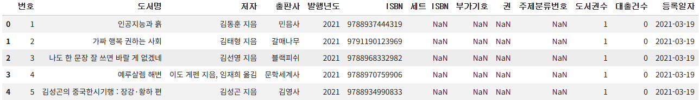
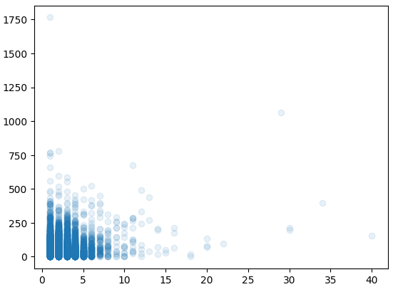
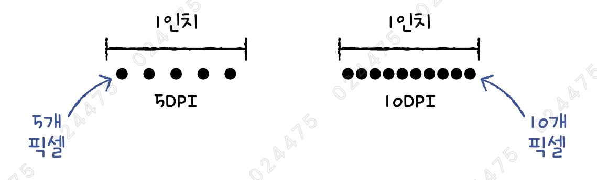
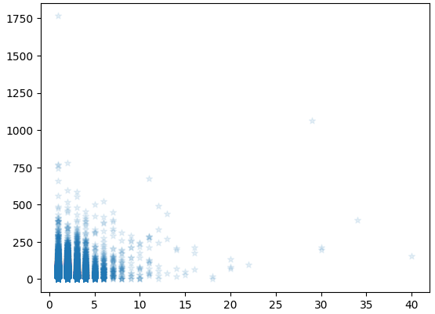
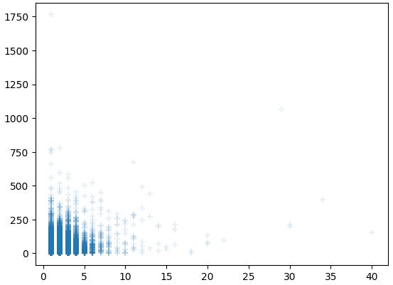
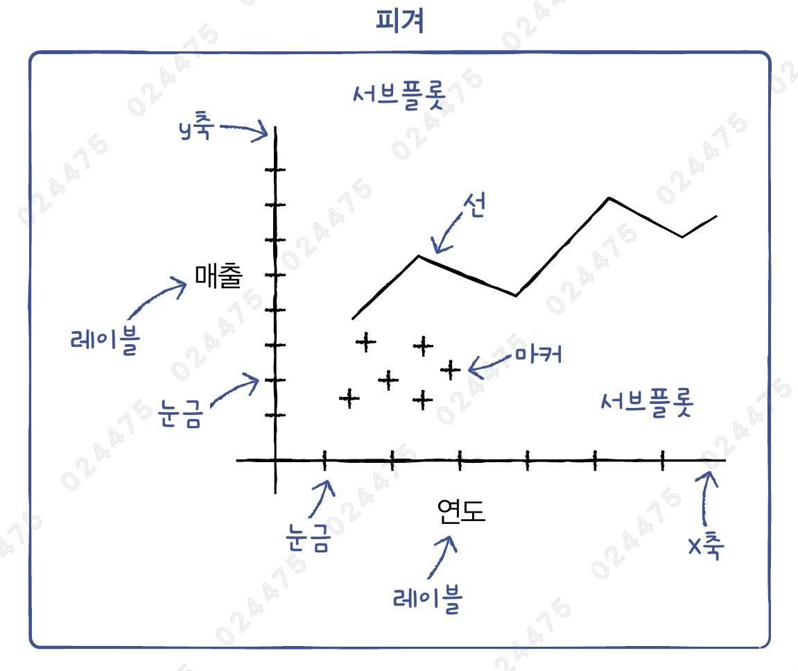
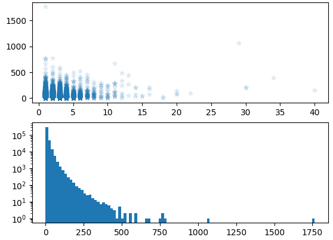
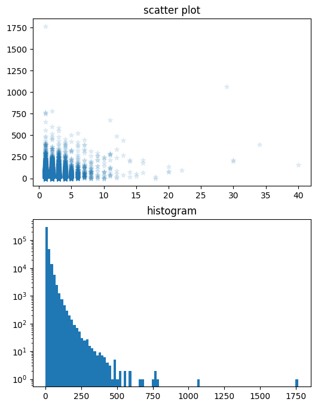
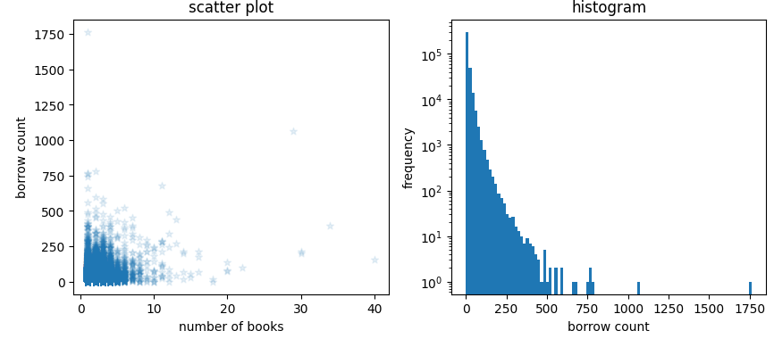

# ✔ 맷플롯립 기본 요소 알아보기

> ['맷플롯립 기본 요소 알아보기' 구글 코랩](https://colab.research.google.com/github/rickiepark/hg-da/blob/main/05-1.ipynb)

## 1️⃣ `Figure` 객체

- `Figure` 객체: 맷플롯립에서 모든 그래프 구성 요소를 담고 있는 최상위 객체
- 맷플롯립으로 그래프를 그릴 때 자동으로 피겨가 생성되고, 그래프가 그려진 후 삭제됨
- `figure()` 함수로 명시적으로 피겨 객체를 만들어 활용하면, 다양한 그래프 옵션을 조절할 수 있음

#### 1. 구글 드라이브에 저장된 'ns_book7.csv' 파일을 다운로드하자

```py
import gdown
import pandas as pd

gdown.download('https://bit.ly/3pK7iuu', 'ns_book7.csv', quiet=False)

ns_book7 = pd.read_csv('ns_book7.csv', low_memory=False)
ns_book7.head()
```



#### 2. 투명도가 반영된 '도서권수'와 '대출건수' 열의 산점도를 그려보자

```py
plt.scatter(ns_book7['도서권수'], ns_book7['대출건수'], alpha=0.1)
plt.show()
```



### 그래프 크기 바꾸기: `figsize` 매개변수

- `figure()` 함수를 사용해 피겨 객체를 만들면 그래프 옵션을 조절할 수 있음
- `figsize` 매개변수에 그래프의 크기를 튜플(너비, 높이)로 지정할 수 있음 (단위: inch)
  - 기본값: `(6,4)`
  - 사실, 기본 그래프의 크기는 맷플롯립의 버전과 플랫폼에 따라 달라질 수 있음
  - 아래 명령어를 통해 현재 설치된 맷플롯립의 기본 그래프 크기를 확인할 수 있음

  ```py
  print(plt.rcParams['figure.figsize'])
  # [6.4, 4.8]
  ```

#### 3. 9 x 6 인치 크기의 산점도를 그려보자

```py
plt.figure(figsize=(9, 6))
plt.scatter(ns_book7['도서권수'], ns_book7['대출건수'], alpha=0.1)
plt.show()
```

- `plt.show()` 함수가 호출되면, `figure()` 함수로 만들어진 피겨 객체는 자동으로 소멸됨
- 이슈) 모니터 화면에 실제 자를 대고 그래프 크기를 확인해보니, 처음 그린 그래프보다 그래프가 훨씬 커졌지만 예상한 크기의 그래프가 그려지진 않았음
- 원인) DPI에 따라 화면에 그려지는 그래프 크기가 달라짐

### 그래프 실제 크기 확인하기

- 화면의 해상도를 말할 때 픽셀 수와 DPI를 사용함
- DPI (Dot Per Inch): 1인치를 몇 개의 점(픽셀)로 표현하는지 나타내는 단위

  

- 맷플롯립의 기본 DPI는 `72`로 노트북의 DPI보다 작기 때문에, `figure` 매개변수에 지정한 것보다 그래프가 작게 그려진 거였음
  - 사실, 맷플롯립의 기본 DPI 값은 버전과 플랫폼에 따라 달라질 수 있음
  - 아래 명령어를 통해 현재 설치된 맷플롯립의 기본 DPI 값을 확인할 수 있음

  ```py
  print(plt.rcParams['figure.dpi'])
  # 100
  ```

- 사실, 화면 상의 이미지 크기를 다룰 때는 익숙하지 않은 단위인 인치를 사용하는 대신, 픽셀 크기로 다루는 것이 훨씬 편리함
  - 원하는 픽셀 값을 정한 다음, 픽셀 값을 DPI로 나누면 인치 값을 구할 수 있음

#### 4. 900 x 600 픽셀 크기의 산점도를 그려보자

```py
plt.figure(figsize=(900/72, 600/72))
plt.scatter(ns_book7['도서권수'], ns_book7['대출건수'], alpha=0.1)
plt.show()
```

- 그래프 이미지를 저장한 후, [속성]에서 픽셀 크기를 확인할 수 있음
- 이슈) 확인 결과, 900 x 600 픽셀보다 조금 작음
- 원인) 코랩 노트북은 기본적으로 맷플롯립 그래프를 출력할 때, 그래프 주변에 공백을 최소화하는 `tight` 레이아웃을 사용하기 때문

#### 5. `tight` 레이아웃을 사용하지 않고 산점도를 다시 그려보자

```py
%config InlineBackend.print_figure_kwargs = {'bbox_inches': None}
plt.figure(figsize=(900/72, 600/72))
plt.scatter(ns_book7['도서권수'], ns_book7['대출건수'], alpha=0.1)
plt.show()
```

- `bbox_inches` 옵션을 `None`으로 지정하면, `tight` 레이아웃을 사용하지 않아 그래프 주변에 공백이 많아짐
- 확인 결과, 그래프가 정확히 900 x 600 픽셀임

### 그래프 크기 바꾸기: `dpi` 매개변수

#### 6. `dpi`를 기본값의 2배인 144로 늘려 보자

```py
plt.figure(dpi=144)
plt.scatter(ns_book7['도서권수'], ns_book7['대출건수'], alpha=0.1)
plt.show()
```

- `dpi` 매개변수를 2배로 늘리면, 인치당 픽셀 수가 2배로 늘어나기 때문에 그래프가 2배로 커짐
- 또한, 그래프 안의 모든 구성 요소도 함께 커짐
  - x축, y축의 숫자가 커지고, 동그라미 마커의 크기도 커짐
- 쉽게 말해, `figsize` 매개변수는 그래프를 그리는 캔버스 크기, `dpi` 매개변수는 그래프를 확대해서 보는 돋보기처럼 생각하면 됨

## 2️⃣ `rcParams` 객체

- `rcParams` 객체: 맷플롯립 그래프의 기본값을 관리하는 객체
- `rcParams` 객체는 객체에 담긴 값을 출력하는 것뿐만 아니라 새로운 값으로 바꿀 수도 있음
- 이후에 그려지는 모든 그래프에 바뀐 설정이 적용됨

### DPI 기본값 바꾸기

#### 1. DPI 기본값으로 100으로 변경해주자

```py
plt.rcParams['figure.dpi'] = 100
```

### 산점도 마커 모양 바꾸기

#### 2. 산점도의 마커를 별 모양으로 바꾸자

```py
plt.rcParams['scatter.marker'] = '*'

plt.scatter(ns_book7['도서권수'], ns_book7['대출건수'], alpha=0.1)
plt.show()
```



- `rcParams` 객체의 `scatter.marker` 속성을 통해 마커 모양을 변경할 수 있음
  - 기본값: `'o'` (동그라미 모양)

#### 3. 산점도의 마커를 + 모양으로 바꾸자

```py
plt.scatter(ns_book7['도서권수'], ns_book7['대출건수'], alpha=0.1, marker='+')
plt.show()
```



- 산점도마다 마커를 다르게 그려야 한다면, 기본값을 수정하는 대신 `scatter()` 함수의 `marker` 매개변수로 마커의 모양을 지정하면 됨
- 이러면 `rcParams` 객체의 `scatter.marker` 속성에 지정된 기본값을 무시하고, `scatter()` 함수의 `marker` 매개변수에 지정된 값을 이용함

## 3️⃣ 여러 개의 서브플롯 출력하기



- 하나의 피겨 객체 안에는 여러 개의 서브플롯을 담을 수 있음
- 서브플롯 (subplot): 맷플롯립의 `Axes` 클래스의 객체
- 하나의 서브플롯은 2개 이상의 축(Axis)를 포함함
  - 각 축에는 눈금 또는 틱(tick)이 표시됨
  - 축의 이름을 나타내는 레이블(label)이 있음

### 서브플롯 그리기: `subplots()` 함수

#### 1. 하나의 피겨 객체에 산점도, 히스토그램 총 2개의 서브플롯을 추가해보자

```py
fig, axs = plt.subplots(2)

axs[0].scatter(ns_book7['도서권수'], ns_book7['대출건수'], alpha=0.1)

axs[1].hist(ns_book7['대출건수'], bins=100)
axs[1].set_yscale('log')

fig.show()
```



- `subplots()` 함수에 원하는 서브플롯 개수를 지정해 서브플롯을 정의할 수 있음
  - 첫 번째 매개변수: 서브플롯의 행의 갯수
  - 두 번째 매개변수: 서브플롯의 열의 갯수
- `subplots()` 함수는 피겨 객체와 각 서브플롯을 나타내는 `Axes` 객체의 배열을 반환함

#### 2. 피겨 크기를 조절하고, 각 그래프에 제목을 넣어보자

```py
fig, axs = plt.subplots(2, figsize=(6, 8))

axs[0].scatter(ns_book7['도서권수'], ns_book7['대출건수'], alpha=0.1)
axs[0].set_title('scatter plot')

axs[1].hist(ns_book7['대출건수'], bins=100)
axs[1].set_title('histogram')
axs[1].set_yscale('log')

fig.show()
```



- `subplots()` 함수도 피겨 크기를 지정할 수 있는 `figsize` 매개변수를 제공함
- `set_title()` 메서드를 통해 서브플롯에 제목을 넣을 수 있음

### 서브플롯을 가로로 나란히 출력하기

#### 3. 1개의 행에 2개의 열을 가진 피겨를 만들어 보자

```py
fig, axs = plt.subplots(1, 2, figsize=(10, 4))

axs[0].scatter(ns_book7['도서권수'], ns_book7['대출건수'], alpha=0.1)
axs[0].set_title('scatter plot')
axs[0].set_xlabel('number of books')
axs[0].set_ylabel('borrow count')

axs[1].hist(ns_book7['대출건수'], bins=100)
axs[1].set_title('histogram')
axs[1].set_yscale('log')
axs[1].set_xlabel('borrow count')
axs[1].set_ylabel('frequency')

fig.show()
```



- `set_xlabel()` 메서드를 사용해 서브플롯의 x축 이름을 지정할 수 있음
- `set_ylabel()` 메서드를 사용해 서브플롯의 y축 이름을 지정할 수 있음

## cf) 핵심 함수와 메서드

| 함수/메서드                    | 기능                          |
| ------------------------------ | ----------------------------- |
| `matplotlib.pyplot.figure()`   | 피겨 객체를 만들어 반환       |
| `matplotlib.pyplot.subplots()` | 피겨와 서브플롯을 만들어 반환 |
| `Axes.set_xscale()`            | 서브플롯의 x축 스케일을 지정  |
| `Axes.set_yscale()`            | 서브플롯의 y축 스케일을 지정  |
| `Axes.set_title()`             | 서브플롯의 제목을 지정        |
| `Axes.set_xlabel()`            | 서브플롯의 x축 이름을 지정    |
| `Axes.set_ylabel()`            | 서브플롯의 y축 이름을 지정    |
