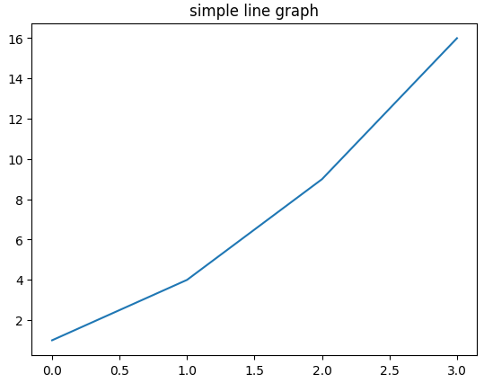
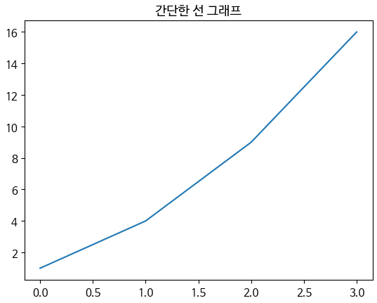
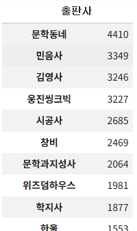
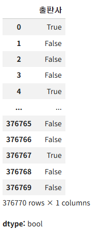
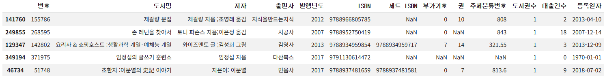
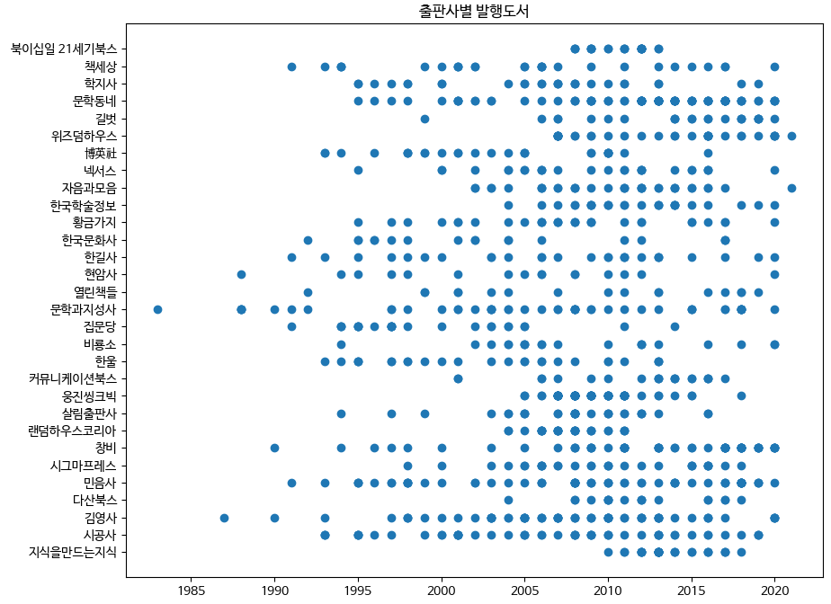
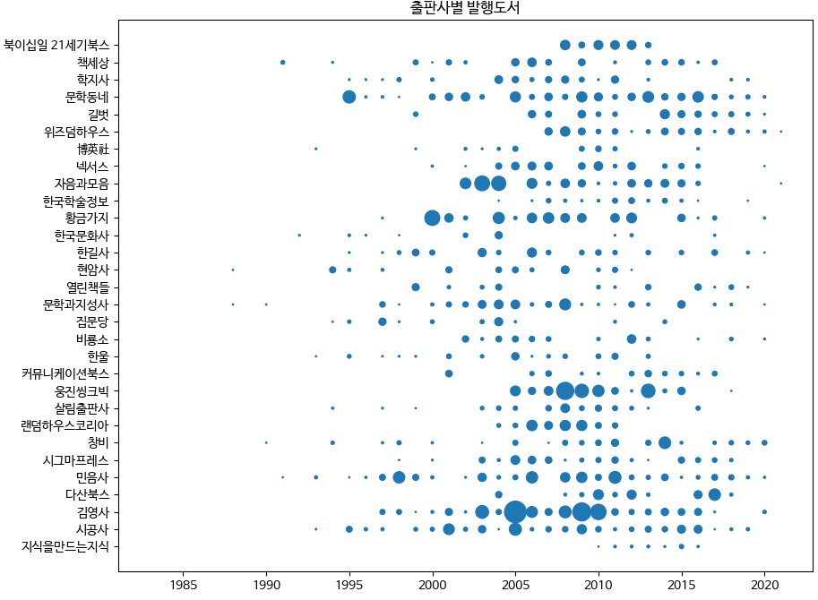
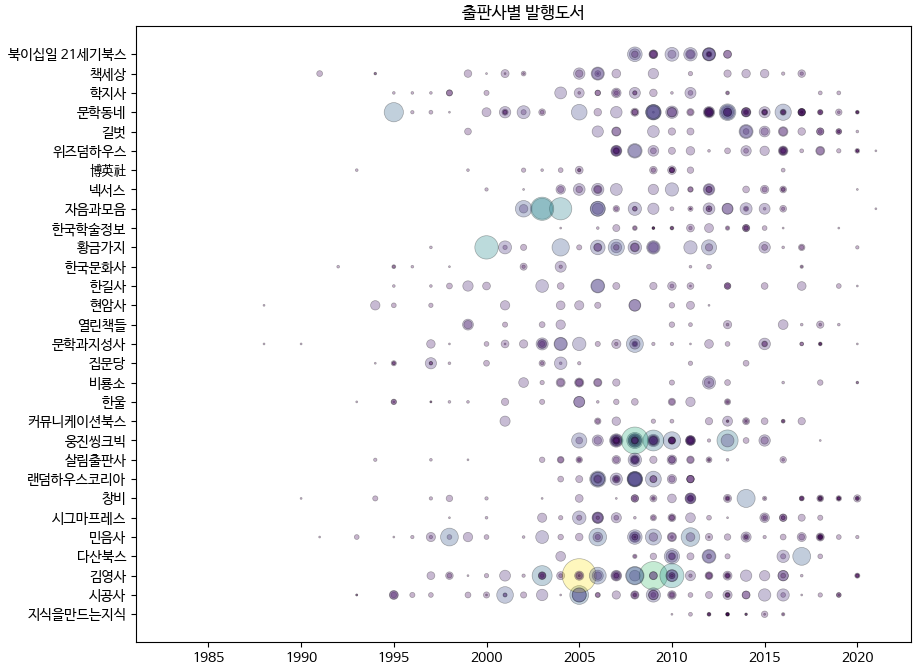
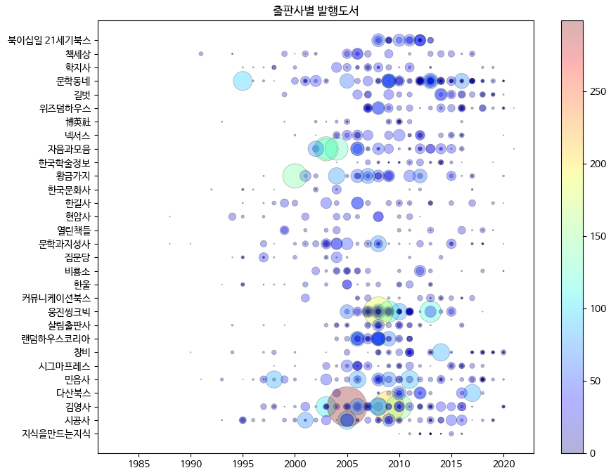

# ✔ 객체지향 API로 그래프 꾸미기

> ['객체지향 API로 그래프 꾸미기' 구글 코랩](https://colab.research.google.com/github/rickiepark/hg-da/blob/main/06-1.ipynb)

## 1️⃣ `pyplot` 방식과 객체지향 API 방식

- 맷플롯립에서 그래프 그리는 방법은 아래 2가지가 있음

1. `pyplot` 방식
   - `matplotlib.pyplot`에 있는 함수를 사용
2. 객체지향 API 방식
   - 명시적으로 피겨 객체와 서브플롯 객체를 만들고 이 객체의 메서드를 사용
   - 복잡한 그래프를 표현하기엔 이 방식이 좋음

### `pyplot` 방식으로 그래프 그리기

#### 1. 그래프 제목을 넣어 선 그래프를 그려보자

```py
plt.plot([1, 4, 9, 16])
plt.title('simple line graph')
plt.show()
```



- `matplotlib.pyplot`에 있는 함수를 사용하면, 함수들이 하나의 피겨 객체에 대한 상태를 공유함
- 즉, 위에서 `plot()` 함수와 `title()` 함수는 동일한 피겨 객체에 적용됨
- `plot()` 함수에 하나의 리스트를 전달하면, 인덱스가 x축, 원소가 y축인 선 그래프가 그려짐

### 객체지향 API 방식으로 그래프 그리기

#### 2. 객체지향 API 방식으로 동일한 선 그래프를 다시 그려보자

```py
fig, ax = plt.subplots()
ax.plot([1, 4, 9, 16])
ax.set_title('simple line graph')
fig.show()
```


- 하나의 그래프를 간단하게 그릴 때는 `pyplot` 방식, 그래프를 여러 개 그리거나 꾸미려면 객체지향 API를 사용하면 좋음

## 2️⃣ 그래프에 한글 출력하기

- 앞서 그래프 제목이나 축 이름을 한글로 작성했을 때 제대로 출력되지 않는 문제가 있었음
  - 이유) 맷플롯립의 기본 폰트가 한글을 지원하지 않기 때문
- 그래프에 한글을 출력하려면 폰트를 설치해 지정해줘야 함

#### 1. 코랩에서 '나눔바른고딕' 폰트를 설치해보자

```py
# 노트북이 코랩에서 실행 중인지 체크합니다.
import sys
if 'google.colab' in sys.modules:
    !echo 'debconf debconf/frontend select Noninteractive' | debconf-set-selections
    # 나눔 폰트를 설치합니다.
    !sudo apt-get -qq -y install fonts-nanum
    import matplotlib.font_manager as fm
    font_files = fm.findSystemFonts(fontpaths=['/usr/share/fonts/truetype/nanum'])
    for fpath in font_files:
        fm.fontManager.addfont(fpath)
```

- 맷플롯립은 시스템에 설치된 폰트를 자동으로 감지해 사용함
- `findSystemFonts()` 함수를 사용하면 맷플롯립이 찾은 폰트 목록을 볼 수 있음

### 폰트 지정하기(1): `font.family` 속성

#### 2. 팻플롯립의 기본 폰트를 '나눔고딕' 폰트로 변경해보자

```py
plt.rcParams['font.family'] = 'NanumGothic'
```

- `rcParams` 객체의 `'font.family'` 속성을 통해 새 폰트를 지정할 수 있음
  - 기본값: `'sans-serif'`

### 폰트 지정하기(2): `rc()` 함수

#### 3. 팻플롯립의 기본 폰트를 '나눔바른고딕' 폰트로 변경해보자

```py
plt.rc('font', family='NanumBarunGothic')
```

- `rc()` 함수를 사용해 새 폰트를 지정할 수 있음
  - 첫 번째 매개변수: 설정할 그룹 (ex) `'font'`)
  - 두 번째 매개변수: 그룹 하위 속성 (ex) `'family'`, `'size'`)

#### 4. 폰트 패밀리와 동시에 폰트 크기도 함께 설정해보자

```py
plt.rc('font', family='NanumBarunGothic', size=11)

print(plt.rcParams['font.family'], plt.rcParams['font.size'])
# ['NanumBarunGothic'] 11.0
```

- `rc()` 함수를 사용하면 한 그룹 내의 여러 설정을 동시에 지정할 수 있음
- 바뀐 내용은 `rcParams` 객체로 다시 확인해볼 수 있음

#### 5. 그래프를 그려 그래프 제목을 한글로 출력해보자

```py
plt.plot([1, 4, 9, 16])
plt.title('간단한 선 그래프')
plt.show()
```



## 3️⃣ 출판사별 발행 도서 개수 산점도 그리기

#### 1. 구글 드라이브에 저장된 'ns_book7.csv' 파일을 다운로드하자

```py
import gdown
import pandas as pd

gdown.download('https://bit.ly/3pK7iuu', 'ns_book7.csv', quiet=False)

ns_book7 = pd.read_csv('ns_book7.csv', low_memory=False)
ns_book7.head()
```


### 고유한 출판사 목록 만들기

#### 2. 상위 30개 출판사를 선택해보자

```py
top30_pubs = ns_book7['출판사'].value_counts()[:30]
print(top30_pubs)
```



- `value_counts()` 메서드를 통해 고유한 출판사 목록을 만들 수 있음
- 이 메서드는 결과를 내림차순 정렬함

#### 3. 상위 30개 출판사에 해당하는 행을 표시하는 불리언 인덱스를 만들자

```py
top30_pubs_idx = ns_book7['출판사'].isin(top30_pubs.index)
print(top30_pubs_idx)
```



- `isin()` 메서드를 사용하면 목록에 있는 출판사 중 하나에 해당하는지 검사할 수 있음

#### 4. 상위 30개 출판사의 발생 도서 개수가 총 몇 개인지 세어 보자

```py
top30_pubs_idx.sum()
# np.int64(51886)
```

- 상위 30개 출판사의 데이터가 5만 개가 넘는데, 이를 산점도로 그리기에는 너무 많음

#### 5. 상위 30개 출판사의 발생 도서들 중 무작위로 1,000개만 선택해보자

```py
ns_book8 = ns_book7[top30_pubs_idx].sample(1000, random_state=42)
ns_book8.head()
```



- `sample()` 메서드를 사용하면 데이터프레임의 행을 무작위로 선택할 수 있음
  - 첫 번째 매개변수: 무작위로 선택할 행 개수
- `random_state` 매개변수에 동일한 숫자를 전달하면 항상 같은 결과를 얻을 수 있음
  - 넘파이의 `seed()` 함수와 비슷한 역할임

### 산점도 그리기

#### 6. 해당 연도에 어떤 출판사의 도서가 발행되었는지 산점도를 그려보자

```py
fig, ax = plt.subplots(figsize=(10, 8))
ax.scatter(ns_book8['발행년도'], ns_book8['출판사'])
ax.set_title('출판사별 발행도서')
fig.show()
```



### 값에 따라 마커 크기를 다르게 나타내기

#### 7. 어떤 연도에 얼마나 많은 도서가 대출되었는지 마커의 크기를 조절해보자

```py
fig, ax = plt.subplots(figsize=(10, 8))
ax.scatter(ns_book8['발행년도'], ns_book8['출판사'], s=ns_book8['대출건수'])
ax.set_title('출판사별 발행도서')
fig.show()
```



- 선 그래프와 산점도의 마커 크기는 `rcParams['lines.markersize']`로 지정함
  - 기본값: 6
- `scatter()` 함수의 `s` 매개변수를 통해 마커의 크기를 지정할 수 있음
  - 하나의 실수로 설정하면, 산점도의 모든 마커 크기가 동일하게 바뀜
  - 입력 데이터와 동일한 길이의 배열을 지정하면, 각 데이터마다 마커의 크기가 다른 산점도를 그릴 수 있음
  - 기본값: `rcParams['lines.markersize']`의 제곱
- 그래프 확인 결과, '자음과 모음' 출판사는 2000년대 초반 발생한 책의 대출건수가 높음

### 마커 꾸미기

#### 8. 산점도의 마커를 개선해보자

```py
fig, ax = plt.subplots(figsize=(10, 8))
ax.scatter(ns_book8['발행년도'], ns_book8['출판사'],
           linewidths=0.5, edgecolors='k', alpha=0.3,
           s=ns_book8['대출건수']*2, c=ns_book8['대출건수'])
ax.set_title('출판사별 발행도서')
fig.show()
```



- `alpha` 매겨변수는 마커의 투명도를 결정함
  - 출간 도서가 많은 경우 마커가 많이 겹치기 때문에 상대적으로 진하게 나타날 것임
  - 따라서, 마커의 진하기에 따라 해당 연도에 출간된 도서가 얼마나 많은지 가늠할 수 있음
- `edgecolor` 매개변수는 마커 테두리의 색을 결정함
  - 기본값: `'face'` (마커의 색)
  - `'k'`: 검은색
- `linewidths` 매개변수는 마커 테두리 선의 두께를 결정함
  - 기본값: 1.5
- `c` 매개변수는 산점도의 색을 결정함
  - 데이터 개수와 동일한 길이의 배열을 전달하면 각 데이터를 다른 색깔로 그릴 수 있음
  - 큰 값은 밝은 노랑색, 낮은 값은 진한 녹색으로 그림 (`viridis` 컬러맵)
- 그래프 확인 결과, '황금가지'에서 발행한 도서 중에 높은 대출건수를 기록한 것은 2000년에 발행한 도서지만, 다른 도서들은 대부분 2005년 이후에 출간된 도서임

### 값에 따라 색상 표현하기: 컬러맵

#### 9. 산점도를 jet 컬러맵으로 다시 그려보자

```py
fig, ax = plt.subplots(figsize=(10, 8))
sc = ax.scatter(ns_book8['발행년도'], ns_book8['출판사'],
                linewidths=0.5, edgecolors='k', alpha=0.3,
                s=ns_book8['대출건수']**1.3, c=ns_book8['대출건수'], cmap='jet')
ax.set_title('출판사별 발행도서')
fig.colorbar(sc)
fig.show()
```



- 컬러맵: 그래프를 그리는데 사용하기 위해 사전에 정의한 색상 리스트
  - 컬러맵을 사용해 값에 따른 색상을 다르게 표현할 수 있음
- 컬러 막대: 데이터 포인트에 적용된 색상의 범위를 보여주는 막대
  - 컬러 막대를 사용해 컬러맵의 색깔이 어떤 대출건수 값에 대응하는지 참조 정보를 제공할 수 있음
- `scatter()` 함수의 `cmap` 매개변수를 통해 컬러맵을 지정 가능함
  - `'viridis'`: 낮은 값일수록 진한 녹색이고, 높은 값으로 갈수록 밝은 노랑색이 됨 (기본값)
  - `'jet'`: 낮은 값일수록 짙은 파란색이고, 높은 값으로 갈수록 점차 노란색으로 바뀌었다가 붉은색이 됨
- `scatter()` 함수가 반환하는 객체를 `figure.colorbar()` 메서드에 전달하면 컬러 막대를 추가할 수 있음

## cf) 핵심 함수와 메서드

| 함수/메서드              | 기능                          |
| ------------------------ | ----------------------------- |
| `matplotlib.pyplot.rc()` | `rcParams` 객체의 값을 설정함 |
| `Figure.colorbar()`      | 그래프에 컬러 막대를 추가함   |
