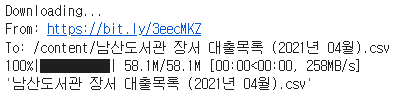
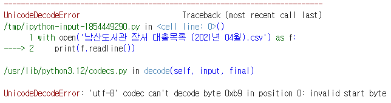
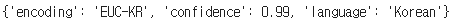
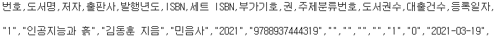
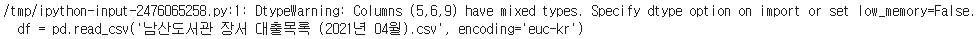
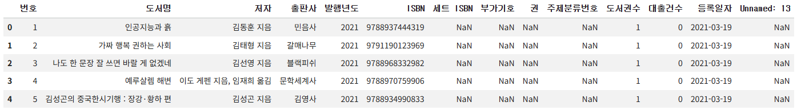

# ✔ 이 도서가 얼마나 인기가 좋을까요?

> ['이 도서가 얼마나 인기가 좋을까요?' 구글 코랩](https://colab.research.google.com/github/rickiepark/hg-da/blob/main/01-3.ipynb)

## 1️⃣ 도서 데이터 찾기

- 질문) '이번에 출간된 도서가 잘 팔릴까요?'
- 만약, 대형 서점에서 도서 판매 데이터를 받을 수 있다면 분석에 도움이 될 것임
- 받을 수 없다면, 어느 정도 비슷한 데이터를 찾을 수 없는지 생각해 봐야 함
- 공개 데이터 세트를 찾아보거나, 데이터 과학과 관련된 온라인 포럼에 질문을 올려 도움을 요청할 수도 있음

### 공공데이터포털

- 원하는 판매 데이터는 없지만 도서관 데이터는 있음
- 만약, 도서관 대출 데이터가 충분하다면 서점의 도서 판매 데이터를 대신할 수도 있을 것임
  - 도서관에서 대출이 많이 된 도서라면 인기가 높은 도서일거라 추측

### 도서관 정보나루

- 공공 도서관에서 발생하는 다양한 데이터를 제공하는 서비스
- 국립중앙도서관이 운영하고 있음
- 보유 도서가 많은 남산도서관의 대출 데이터만을 제공받고자 함
  - 이 도서 대출 데이터는 CSV, Excel, API 포맷으로 제공됨

## 2️⃣ 코랩에서 데이터 확인하기

### CSV 파일

- Comma-Separated Values
- 콤마(,)로 구분된 텍스트 파일
- 한 줄이 하나의 레코드/행(record/row)이며, 레코드는 콤마로 구분된 여러 필드/열(field/column)로 구성됨
- 레크드에 있는 필드 개수는 모두 동일함
- CSV 파일은 메모장과 같은 일반 텍스트 편집기에서도 열어 볼 수 있음
- 데이터 과학 분야에서는 엑셀보다는 단순한 텍스트 파일인 CSV 파일을 더 선호함

### 코랩에서 데이터 다운로드하기: gdown 패키지

#### 1. 구글 드라이브에서 코랩으로 CSV 파일을 다운로드 해보자

```python
import gdown

gdown.download('https://bit.ly/3eecMKZ',
              '남산도서관 장서 대출목록 (2021년 04월).csv', quiet=False)
```



- `gdown` 패키지를 사용하면 구글 드라이브에서 코랩으로 다운로드 할 수 있음
- 다운로드 코드가 노트북에 저장되기 때문에, 노트북을 다시 열 때 이 코드 셀을 실행해 주기만 하면 CSV 파일이 자동으로 준비됨

### 내 컴퓨터 파일을 업로드하기

- 왼쪽 [파일] 아이콘을 클릭해 파일 창을 연 후, 내 컴퓨터에 있는 CSV 파일을 드래그하여 파일 창 안에 놓으면 업로드 됨
- 코랩을 일정 시간동안 사용하지 않으면 자동으로 런타임과 연결이 끊어지는데 이때 업로드한 파일도 함께 삭제됨
- 따라서, 나중에 코랩에서 이 파일을 사용하려면 다시 업로드해야 함

## 3️⃣ 파이썬으로 CSV 파일 출력하기

#### 1. gdown 패키지로 다운로드한 파일을 읽어보자

```python
with open('남산도서관 장서 대출목록 (2021년 04월).csv') as f:
    print(f.readline())
```



- CSV 파일은 텍스트 파일이므로 파이썬의 `open()` 함수로 읽을 수 있음
- `with` 문으로 파일을 연 다음, `readline()` 메서드로 파일에서 한 줄씩 읽을 수 있음
- UnicodeDecodeError 오류 발생
  - 파이썬의 `open()` 함수는 기본적으로 텍스트 파일이 UTF-8 형식으로 저장되어 있다고 가정함
  - 하지만, 한글 텍스트는 여전히 완성형 인코딩인 EUC-KR을 사용하는 일이 잦음

### 파일 인코딩 형식 확인하기: `chardet.detect()` 함수

#### 2. CSV 파일의 인코딩 방식을 확인해보자

```py
import chardet

with open('남산도서관 장서 대출목록 (2021년 04월).csv', mode='rb') as f:
    d = f.readline()

print(chardet.detect(d))
```



- `chardet` 패키지의 `chardet.detect()` 함수를 사용하면 문자 인코딩 방식을 알아낼 수 있음
- `open()` 함수로 텍스트 파일을 열 때, `mode` 매개변수를 바이너리 읽기 모드인 'rb'로 지정함 (기본값: 'r')
  - 바이너리 모드로 지정하면 문자 인코딩 형식에 상관없이 파일을 열 수 있으므로 오류가 발생하지 않음
- 확인 결과, CSV 파일이 EUC-KR로 인코딩되어 있어서 `open()` 함수에서 오류가 발생했음을 알 수 있음

### 인코딩 형식 지정하기

#### 3. `open()` 함수로 파일을 읽을 때, `encoding` 매개변수로 'EUC-KR'을 지정해보자

```py
with open('남산도서관 장서 대출목록 (2021년 04월).csv', encoding='euc-kr') as f:
    print(f.readline())
    print(f.readline())
```



- 사실 CSV 파일은 판다스 같은 도구로 읽는 것이 조금 더 편리함
- 하지만, 아주 큰 파일을 열 때는 오랜 시간이 걸릴 수 있음
- 그럴 때는 파이썬의 `open()` 함수와 `readline()` 메서드로 처음 몇 줄을 출력해 보는 것이 빠르게 파일의 내용을 확인할 수 있는 좋은 방법임

## 4️⃣ 데이터프레임 다루기: 판다스

### 판다스의 데이터 구조

#### 시리즈 (Series)

- 프로그래밍 언어에서 1차원 배열과 매우 비슷함
- 시리즈에 담긴 데이터는 모두 동일한 종류여야 함
  - ex) 모두 정수이거나 문자열
- 만약, 시리즈에 다른 종류의 데이터를 섞어서 사용하면 모두 object 타입으로 바뀜

#### 데이터프레임 (DataFrame)

- 데이터를 가로 세로 나열한 2차원 배열과 비슷함
- 표 형식 데이터(tabular data): 행과 열로 구성된 데이터 구조
  - ex) CSV, Excel, 판다스의 데이터프레임
- 열마다 다른 데이터 타입을 사용할 수 있음
- 대신, 같은 열에 있는 데이터는 모두 같은 종류여야 함
- 따라서, 데이터프레임의 한 열을 따로 선택하면 시리즈 객체라고 할 수 있음

### CSV 파일을 데이터프레임으로 읽기: `read_csv()` 함수

#### 1. 판다스로 CSV 파일을 읽어오자

```py
import pandas as pd

df = pd.read_csv('남산도서관 장서 대출목록 (2021년 04월).csv', encoding='euc-kr')
```



- 판다스의 `read_csv()` 함수를 사용하면 CSV 파일을 읽어 데이터프레임으로 저장할 수 있음
- 남산도서관 데이터가 EUC-KR로 저장되어 있으므로, `encoding` 매개변수를 'EUC-KR'로 지정함
- 경고 원인)
  - 판단스는 CSV 파일을 읽을 때 열에 어떤 종류의 데이터가 저장되어 있는지 자동으로 파악함
  - 이때, 메모리를 효율적으로 사용하기 위해 CSV 파일을 조금씩 나누어 읽음
  - 만약 여기서 자동으로 파악한 데이터 타입이 달라지면 경고가 발생함
- 해결 방법)
  1.  `low_memory` 매개변수를 False로 지정하여 파일을 나누어 읽지 않고 한 번에 읽으면 됨
      - 다만, 이 방법은 CSV 파일을 한번에 모두 읽기 때문에 많은 메모리를 사용함
  2.  열의 데이터 타입을 자동으로 찾지 않도록 아예 `dtype` 매개변수로 데이터 타입을 지정하면 됨

#### 2. 데이터프레임의 처음 다섯 개 행을 확인해보자

```py
df = pd.read_csv('남산도서관 장서 대출목록 (2021년 04월).csv', encoding='euc-kr',
                 low_memory=False)
df.head()
```



- `head()` 메서드를 사용하면 데이터프레임의 처음 다섯 개 행을 확인할 수 있음
- 판다스는 데이터프레임을 표 형식으로 행과 열을 맞추어 출력함
- 첫 번째 열은 데이터프레임의 인덱스(index) 임
  - 판다스는 행마다 0부터 시작하는 인덱스 번호를 자동으로 붙여줌
- CSV의 첫 번째 행은 열 이름으로 인식함
- 만약, CSV의 첫 행이 열 이름이 아니라면, `header` 매개변수를 None으로 지정해서 데이터 첫 행에 열 이름이 없다는 것을 알리고, `names` 매개변수에 열 이름 리스트를 따로 전달해주면 됨
- 이슈) 마지막 열에 원래 CSV 파일에는 없던 'Unnamed:13' 열이 생김
  - CSV 파일을 열어봤을 때 각 라인의 끝에 콤마가 있음
  - 이로 인해, 마지막에 하나의 열이 더 있다고 판단해 'Unnamed:13' 열을 표시한 것임

### 데이터프레임을 CSV 파일로 저장하기: `to_csv()` 메서드

#### 3. 데이터프레임을 CSV 파일로 저장해보자

```py
df.to_csv('ns_202104.csv')
```

- `to_csv()` 메서드를 사용하면 판다스의 데이터프레임을 CSV로 저장할 수 있음
- 이 메서드는 기본적으로 UTF-8 형식으로 저장하기 때문에, 나중에 파일의 내용을 읽을 때 따로 encoding 매개변수를 사용하지 않아도 됨

#### 4. 방금 저장한 CSV 파일을 다시 `open()` 함수로 확인해보자

```py
with open('ns_202104.csv') as f:
    for i in range(3):
        print(f.readline(), end='')
```


- 이슈) 앞서 출력했던 CSV 파일 결과와 다르게 CSV 파일 맨 왼쪽에 데이터프레임에 있던 행 인덱스가 함께 저장됨

#### 5. 방금 저장한 CSV 파일을 다시 데이터프레임으로 확인해보자

```py
ns_df = pd.read_csv('ns_202104.csv', low_memory=False)
ns_df.head()
```


- 이슈) 인덱스가 다시 생성되면서 'Unnamed: 0'이라는 첫 번째 열과 중복됨
- 해결 방법)
  1. CSV 파일을 읽을 때 인덱스가 이미 있다는 것을 알려주면 됨
  2. 데이터프레임을 CSV 파일로 저장할 때 인덱스를 빼고 저장하면 됨

#### 6. CSV 파일을 읽을 때 인덱스 열을 지정해주자

```py
ns_df = pd.read_csv('ns_202104.csv', index_col=0, low_memory=False)
ns_df.head()
```

- `index_col` 매개변수를 사용해 CSV 파일 내 인덱스 열을 지정할 수 있음

#### 7. 데이터프레임을 CSV 파일로 저장할 때 인덱스 열을 제외해주자

```py
df.to_csv('ns_202104.csv', index=False)
```

- `index` 매개변수를 False로 지정해 인덱스 열을 빼고 저장할 수 있음

## cf) 공개 데이터 세트 대표 사이트와 유명 포럼

### 국내 사이트

#### [공공데이터포털](https://www.data.go.kr/)

- 행정안전부에서 운영
- 공공 데이터 통합 제공 시스템

#### [통합 데이터 지도](https://www.nabis.go.kr/termsDetailView.do?menucd=189&gbnCode=S51&eventNo=354)

- 과학기술정보통신부, 한국지능정보사회진흥원에서 운영
- 국가와 민간 분야에서 운영 중인 여러 빅테이터 플랫폼의 데이터를 한곳에서 검색할 수 있는 서비스

#### [AI 허브](https://aihub.or.kr/)

- 한국지능정보사회진흥원에서 운영
- AI 통합 플랫폼으로 다양한 AI 학습용 데이터를 제공

#### [국가통계포털](https://kosis.kr/index/index.do)

- 통계청이 운영
- 경제, 사회, 환경 등 30개 분야의 국내외 통계 데이터를 한 번에 찾을 수 있는 통계 포털 사이트

#### [서울 열린 데이터 광장](https://data.seoul.go.kr/)

- 연구, 관리, 서비스 제공 등 서울시 시정활동 과정에서 수집된 다양한 데이터가 존재함

#### [서울 빅데이터 캠퍼스](https://bigdata.seoul.go.kr/main.do)

- 서울시가 확보한 유용한 빅데이터를 시민·시민사회가 활용할 수 있도록 제공하여 사회문제를 함께 해결하기 위하여 함께 참여하고 협력하는 캠퍼스

### 해외 사이트

#### [구글 데이터 세트 검색](https://datasetsearch.research.google.com/)

- 무료로 사용할 수 있는 데이터를 검색할 수 있는 검색 엔진
- 데이터 세트를 사용한 논문을 손쉽게 찾을 수 있음

#### [캐글 데이터 세트](https://www.kaggle.com/datasets)

- 캐글: 데이터 과학자를 위한 머신러닝 경진 대회 플랫폼
- 캐글에서는 경진 대회에서 사용된 데이터 세트를 포함하여 많은 자료가 공개되어 있음

#### [허깅 페이스 데이터 세트](https://huggingface.co/docs/datasets/index)

- 허깅 페이스: 트랜스포머 기반 오픈 소스 모델을 호스팅
- 자연어 처리와 컴퓨터 비전 작업 등에 활용할 수 있는 다양한 데이터셋을 제공

#### [Data.gov](https://data.gov/)

- 미국 정부에서 운영하는 공개 데이터 포털
- 다양한 주제에 걸쳐 30만 개 이상의 데이터셋을 제공

#### [위키피디아 머신러닝 데이터 세트](https://en.wikipedia.org/wiki/List_of_datasets_for_machine-learning_research)

- 머신러닝 연구에 널리 사용되는 데이터 세트가 주제별로 정리됨

#### [UCI 머신러닝 데이터 저장소](https://archive.ics.uci.edu/)

- UC Irvine 대학교에서 운영
- 머신러닝 데이터 저장소

### 온라인 포럼

#### [데이터 분석 커뮤니티](https://www.facebook.com/groups/datacommunity/)

- 페이스북 그룹
- 데이터 분석과 관련된 유용한 자료와 좋은 팁을 공유

#### [캐글 코리아](https://www.facebook.com/groups/KaggleKoreaOpenGroup/?locale=ko_KR)

- 페이스북 그룹
- 캐글 대회 참여한 경험과 아이디어를 공유

#### [AGI 코리아](https://www.facebook.com/groups/TensorFlowKR)

- 페이스북 그룹
- 머신러닝과 딥러닝에 관련한 다양한 이야기를 나눌 수 있음

#### [파이토치 코리아](https://www.facebook.com/groups/pytorchkr)

- 페이스북 그룹
- 파이토치: 오픈소스 머신러닝 라이브러리

#### [사이킷런 코리아](https://www.facebook.com/groups/scikitlearnkr)

- 페이스북 그룹
- 사이킷런에 대한 소식과 질문/답변을 올릴 수 있음

## cf) 핵심 함수와 메서드

| 함수/메서드          | 기능                                        |
| -------------------- | ------------------------------------------- |
| `pandas.read_csv()`  | CSV 파일을 읽어 데이터프레임을 만듦         |
| `DataFrame.head()`   | 데이터프레임에서 처음 다섯 개의 행을 반환함 |
| `DataFrame.to_csv()` | 데이터프레임을 CSV 파일로 저장함            |
