# ✔ 웹 스크래핑 사용하기

> ['웹 스크래핑 사용하기' 구글 코랩](https://colab.research.google.com/github/rickiepark/hg-da/blob/main/02-2.ipynb)

## 1️⃣ 도서 쪽수를 찾아서

- Yes24 온라인 서점 사이트에서 특정 도서의 쪽수 추출 과정
  1. ISBM을 사용해 검색 결과 페이지 가져오기
  2. 검색 결과 페이지에서 도서 상세 페이지 URL 찾기
  3. 도서 상세 페이지 가져오기
  4. 도서 상세 페이지에서 쪽수 찾기

### 웹 스크래핑 (Web Scraping)

- 웹 크롤링 (Web Crawling)
- 프로그램으로 웹사이트의 페이지를 옮겨 가면서 데이터를 추출하는 작업

## 2️⃣ 검색 결과 페이지 가져오기

#### 1. 구글 드라이브에 저장된 '20대가 가장 좋아하는 도서 목록' 파일을 다운로드하자

```py
import gdown
import pandas as pd

gdown.download('https://bit.ly/3q9SZix', '20s_best_book.json', quiet=False)

books_df = pd.read_json('20s_best_book.json')
books_df.head()
```

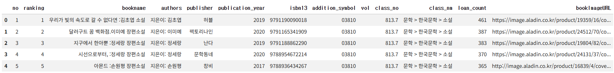

#### 2. 데이터프레임에서 'no'열부터 'isbn13'열까지 선택해 새로운 데이터프레임을 만들자

```py
books = books_df[['no','ranking','bookname','authors','publisher',
                 'publication_year','isbn13']]
books.head()
```

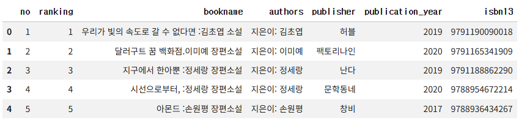

- 원하는 열 이름을 리스트로 만들어 전달하면, 데이터프레임에서 특정 열만 선택할 수 있음

### 데이터프레임 행과 열 선택하기: `loc` 메서드

- 판다스의 `loc` 메서드를 사용하면 원하는 행과 열을 좀 더 쉽게 선택 가능함
- 메서드지만 대괄호를 사용해 행의 목록과 열의 목록을 받음
  - 첫 번째 매개변수: **행 인덱스**를 리스트 (또는 슬라이스 연산자 `:`)로 전달
  - 두 번째 매개변수: **열 이름**을 리스트 (또는 슬라이스 연산자 `:`)로 전달
  - `loc` 메서드의 슬라이싱은 파이썬의 슬라이싱과 다르게 마지막 항목도 포함함

  ```py
  # 방법1) 리스트로 전달
  books_df.loc[[0,1], ['bookname','authors']]
  # 방법2) 슬라이스 연산자로 전달
  books_df.loc[0:1, 'bookname':'authors']
  ```

  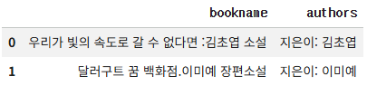

#### 3. `loc` 메서드를 사용해 데이터프레임에서 'no'열부터 'isbn13'열까지 선택하자

```py
books = books_df.loc[:, 'no':'isbn13']
books.head()
```


### 검색 결과 페이지 HTML 가져오기: `requests.get()` 함수

#### 4. 첫 번째 도서에 대한 검색 결과 페이지 HTML을 가져와 보자

```py
import requests

isbn = 9791190090018      # '우리가 빛의 속도로 갈 수 없다면'의 ISBN
url = 'http://www.yes24.com/Product/Search?domain=BOOK&query={}'

r = requests.get(url.format(isbn))
print(r.text)
"""
<!DOCTYPE html >
	...
  <body>
    ...
    <a href="/product/goods/74261416" class="lnk_img" ...>
      <em class="img_bdr">
        
      </em>
    </a>
    ...
  </body>
</html>
"""
```

## 3️⃣ HTML에서 데이터 추출하기: 뷰티풀수프

### Beautiful Soup

- HTML 문서를 파싱하는데 사용하는 대표적인 파이썬 패키지
- HTML에서 원하는 태그나 텍스트를 찾는 기능을 제공함

### 크롬 개발자 도구로 HTML 태그 찾기

#### 1. 크롬 개발자 도구를 열어 상세 페이지 링크가 담긴 HTML 태그 위치를 찾자

```html
<a class="gd_name" href="/product/goods/74261416" ...>
  우리가 빛의 속도로 갈 수 없다면
</a>
```

- 크롬 브라우저의 개발자 도구를 사용하면 전체 HTML에서 상세 페이지 링크가 들어간 위치를 쉽게 찾을 수 있음

### 태그 위치 찾기: `find()` 메서드

#### 2. `BeautifulSoup` 객체를 생성하자

```py
from bs4 import BeautifulSoup

soup = BeautifulSoup(r.text, 'html.parser')
```

- 첫 번째 매개변수: 파싱할 HTML 문서
- 두 번째 매개변수: 파싱에 사용할 파서 (ex) `html.parser`, `lxml`)
  - 파서(parser): 입력 데이터를 받아 데이터 구조를 만드는 소프트웨어 라이브러리
  - `html.parser`: 파이썬에 기본 내장된 HTML 파서
  - `lxml`: XML과 HTML 파싱 기능을 제공하는 패키지

#### 3. 도서 상세 페이지 링크가 있는 `<a>` 태그를 추출하자

```py
prd_link = soup.find('a', attrs={'class':'gd_name'})
print(prd_link)
"""
<a class="gd_name" href="/product/goods/74261416" ...>
  우리가 빛의 속도로 갈 수 없다면
</a>
"""
```

- soup 객체의 `find()` 메서드를 사용하면 태그 위치를 쉽게 찾을 수 있음
  - 첫 번째 매개변수: 찾을 태그 이름
  - `attrs` 매개변수: 찾으려는 태그의 속성을 딕셔너리로 지정
  - 반환값: 뷰티플수프의 `Tag` 객체

#### 4. 링크 주소인 `href` 속성의 값을 얻자

```py
print(prd_link['href'])
# /product/goods/74261416
```

- `Tag` 객체를 딕셔너리처럼 사용해 태그 안의 속성을 참조할 수 있음

### 도서 상세 페이지 HTML 가져오기

#### 5. 도서 상세 페이지 HTML을 가져와 보자

```py
# '우리가 빛의 속도로 갈 수 없다면'의 상세 페이지 가져오기
url = 'http://www.yes24.com'+prd_link['href']

r = requests.get(url)
print(r.text)
"""
<!DOCTYPE html >
	...
  <body>
    ...
    <table class="tb_nor tb_vertical" summary="품목정보 국내도서, 외국도서 ">
      ...
      <tbody class="b_size">
       ...
        <tr>
          <th class="txt" scope="row">쪽수, 무게, 크기</th>
          <td class="txt lastCol">344쪽 | 496g | 130*198*30mm</td>
        </tr>
        ...
      </tbody>
    </table>
    ...
  </body>
</html>
"""
```

#### 6. 크롬 개발자 도구를 열어 쪽수가 담긴 HTML 태그 위치를 찾자

```html
<div class="gd_infoSet infoSet_noLine" id="infoset_specific">
  <div class="tm_infoSet">
    <h4 class="tit_txt">품목정보</h4>
  </div>
  ...
</div>
```

#### 7. 품목정보가 있는 `<div>` 태그를 추출하자

```py
soup = BeautifulSoup(r.text, 'html.parser')

prd_detail = soup.find('div', attrs={'id':'infoset_specific'})
print(prd_detail)
"""
<div class="gd_infoSet infoSet_noLine" id="infoset_specific">
  ...
  <table class="tb_nor tb_vertical" summary="품목정보 국내도서, 외국도서 ">
  ...
    <tbody class="b_size">
      ...
      <tr>
        <th class="txt" scope="row">쪽수, 무게, 크기</th>
        <td class="txt lastCol">344쪽 | 496g | 130*198*30mm</td>
      </tr>
      ...
    </tbody>
  </table>
</div>
"""
```

### 테이블 태그를 리스트로 가져오기: `find_all()` 메서드

#### 8. `<table>` 태그 안에 있는 `<tr>` 태그를 모두 찾자

```py
prd_tr_list = prd_detail.find_all('tr')
print(prd_tr_list)
"""
[
  <tr>
  <th class="txt" scope="row">발행일</th>
  <td class="txt lastCol">2019년 06월 24일</td>
  </tr>,
  ...
]
"""
```

- `find_all()` 메서드를 사용하면 특정 HTML 태그를 모두 찾아서 리스트로 반환해 줌

### 태그 안의 텍스트 가져오기: `get_text()` 메서드

#### 9. '쪽수, 무게, 크기'에 해당하는 `<tr>` 태그를 찾은 후, `<td>` 태그 안의 텍스트를 출력해보자

```py
for tr in prd_tr_list:
    if tr.find('th').get_text() == '쪽수, 무게, 크기':
        page_td = tr.find('td').get_text()
        break

print(page_td)
# 344쪽 | 496g | 130*198*30mm
```

#### 10. 쪽수 정보만 추출하자

```py
print(page_td.split()[0])
# 344쪽
```

## 4️⃣ 전체 도서의 쪽수 구하기

#### 1. ISBN 값을 받아 쪽수를 반환해주는 `get_page_cnt()` 함수를 만들어보자

```py
def get_page_cnt(isbn):
    # Yes24 도서 검색 페이지 URL
    url = 'http://www.yes24.com/Product/Search?domain=BOOK&query={}'
    # URL에 ISBN을 넣어 HTML 가져옵니다.
    r = requests.get(url.format(isbn))
    soup = BeautifulSoup(r.text, 'html.parser')   # HTML 파싱
    # 검색 결과에서 해당 도서를 선택합니다.
    prd_info = soup.find('a', attrs={'class':'gd_name'})
    if prd_info == None:
        return ''
    # 도서 상세 페이지를 가져옵니다.
    url = 'http://www.yes24.com'+prd_info['href']
    r = requests.get(url)
    soup = BeautifulSoup(r.text, 'html.parser')
    # 상품 상세정보 div를 선택합니다.
    prd_detail = soup.find('div', attrs={'id':'infoset_specific'})
    # 테이블에 있는 tr 태그를 가져옵니다.
    prd_tr_list = prd_detail.find_all('tr')
    # 쪽수가 들어 있는 th를 찾아 td에 담긴 값을 반환합니다.
    for tr in prd_tr_list:
        if tr.find('th').get_text() == '쪽수, 무게, 크기':
            return tr.find('td').get_text().split()[0]
    return ''
```

```py
get_page_cnt(9791190090018)
# 344쪽
```

### 데이터프레임 행 혹은 열에 함수 적용하기: `apply()` 메서드

- 판다스 데이터프레임은 한 행씩 순차적으로 처리하는데 최적화되어 있지 않음
- 따라서, 데이터프레임을 for 문으로 반복하는 것은 아주 비효율적임
- 대신, 데이터프레임은 각 행 또는 각 열에 원하는 함수를 자동으로 적용해 주는 여러 가지 방법을 제공함

#### 2. 가장 인기 있는 10권의 도서의 쪽수를 가져와보자

```py
def get_page_cnt2(row):
    isbn = row['isbn13']
    return get_page_cnt(isbn)
```

```py
top10_books = books.head(10)
page_count = top10_books.apply(get_page_cnt2, axis=1)
print(page_count)
"""
0    344쪽
1    300쪽
...
9    296쪽
dtype: object
"""
```

- 데이터프레임의 `apply()` 메서드를 통해 각 행/열의 반복 작업을 수행할 수 있음
  - 첫 번쨰 매개변수: 실행할 함수
  - `axis` 매개변수: 행 또는 열
    - `0`: 열에 대해 함수를 적용 (기본값)
    - `1`: 행에 대해 함수를 적용
  - 반환값: 판다스 시리즈 객체

### 데이터프레임과 시리즈 합치기: `merge()` 함수

#### 3. 추출한 시리즈 객체에 이름을 지정해주자

```py
page_count.name = 'page_count'
print(page_count)
"""
0    344쪽
1    300쪽
...
9    296쪽
Name: page_count, dtype: object
"""
```

- 시리즈 객체의 `name` 속성을 사용하면 이름을 지정할 수 있음
- 이 이름은 데이터프레임에 추가될 때 열 이름으로 사용됨

#### 4. 시리즈 객체를 데이터프레임의 열로 합쳐 보자

```py
top10_with_page_count = pd.merge(top10_books, page_count,
                                 left_index=True, right_index=True)
print(top10_with_page_count)
```

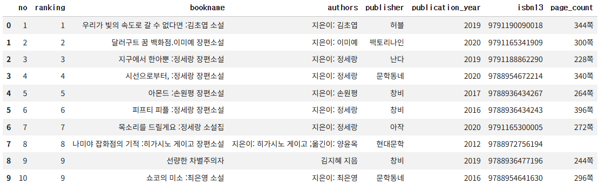

- `merge()` 함수를 사용하면 두 데이터프레임을 합치거나 데이터프레임과 시리즈를 합칠 수 있음
  - 첫 번째/두 번째 매개변수: 합칠 데이터프레임이나 시리즈 객체
- 두 객체의 인덱스를 기준으로 합칠 경우, `left_index`와 `right_index` 매개변수를 `True`로 지정하면 됨

## 5️⃣ 웹 스크래핑할 때 주의할 점

1. 웹사이트에서 스크래핑을 허락했는지 확인하자
   - 어떤 웹사이트는 한 컴퓨터에서 짧은 시간 동안 많은 양의 요청을 발생시키는 경우, 일정 기간 접속하지 못하게 막기도 함
   - 대부분의 웹사이트는 검색 엔진이나 스크래핑 프로그램이 접근해도 좋은 페이지와 그렇지 않은 페이지를 명시한 `robots.txt` 파일을 가지고 있음

2. HTML 태그를 특정할 수 있는지 확인하자
   - 태그 이름이나 속성 등 필요한 HTML 태그를 특정할 수 없다면 웹 스크래핑으로 데이터를 가져오는데 어려움이 있음
   - 일부 웹 페이지는 웹 브라우저에서 로딩된 후 HTML 대신 JavaScript를 사용해 웹 서버로부터 데이터를 가져와 화면을 채움
   - 이런 데이터는 Selenium 같은 고급 도구를 사용해야 가능함

## cf) `merge()` 함수의 매개변수

- 데이터프레임이나 시리즈를 합칠 때는 매개변수에 합칠 기준을 다양하게 지정해 데이터를 원하는 형태로 만들 수 있음
- 예를 들어, 아래 두 개의 데이터프레임이 있다고 가정해보자

  ```py
  df1 = pd.DataFrame({'col1': ['a','b','c'], 'col2': [1,2,3]})
  df2 = pd.DataFrame({'col1': ['a','b','d'], 'col3': [10,20,30]})
  ```

  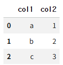
  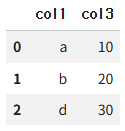

### `on` 매개변수

- 합칠 때 기준이 되는 열을 지정함
- 이 열은 두 데이터프레임에 모두 존재해야 함

  ```py
  pd.merge(df1, df2, on='col1')
  ```

  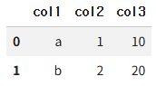

### `how` 매개변수

- 합쳐질 방식을 지정
- `inner`: 두 데이터프레임의 값이 같은 행만 합침 (기본값)
- `left`: 첫 번째 데이터프레임을 기준으로 두 번째 데이터프레임을 합침
  ```py
  pd.merge(df1, df2, how='left', on='col1')
  ```
  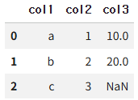
- `right`: 두 번째 데이터프레임을 기준으로 첫 번째 데이터프레임을 합침

  ```py
  pd.merge(df1, df2, how='right', on='col1')
  ```

  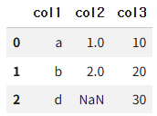

- `outer`: 두 데이터프레임의 모든 행을 유지하면서 합침

  ```py
  pd.merge(df1, df2, how='outer', on='col1')
  ```

  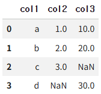

### `left_on`, `right_on` 매개변수

- 합칠 기준이 되는 열의 이름이 서로 다를 경우, `left_on`과 `right_on` 매개변수에 각기 지정할 수 있음

  ```py
  pd.merge(df1, df2, left_on='col1', right_on='col1')
  ```

  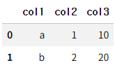

### `left_index`, `right_index` 매개변수

- 합칠 기준이 열이 아니라 인덱스일 경우, `left_index`와 `right_index`로 왼쪽과 오른쪽 인덱스를 지정할 수 있음
- 두 데이터프레임에 동일한 이름의 열이 존재할 경우, 첫 번째 데이터프레임의 열 이름에는 `_x` 접미사가 붙고, 두 번째 데이터프레임의 열 이름에는 `_y` 접미사가 붙음

  ```py
  pd.merge(df1, df2, left_on='col2', right_index=True)
  ```

  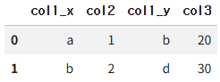

## cf) 핵심 함수와 메서드

| 함수/메서드                | 기능                                                                                                                                                                                         |
| -------------------------- | -------------------------------------------------------------------------------------------------------------------------------------------------------------------------------------------- |
| `loc`                      | - 레이블 또는 boolean 배열로 데이터프레임의 행과 열을 선택함<br>- 정수로 지정하면 인덱스의 레이블로 간주함<br>- boolean 배열로 지정할 경우, 배열의 길이는 행 또는 열의 전체 길이와 같아야 함 |
| `BeautifulSoup.find()`     | 자식 태그 중에서 지정된 이름에 맞는 첫 번째 태그를 찾음                                                                                                                                      |
| `BeautifulSoup.find_all()` | 자식 태그 중에서 지정된 이름에 맞는 모든 태그를 찾음                                                                                                                                         |
| `BeautifulSoup.get_text()` | 태그 안의 텍스트를 반환함                                                                                                                                                                    |
| `DataFrame.apply()`        | 데이터프레임의 행 또는 열에 지정한 함수를 적용함                                                                                                                                             |
| `pandas.merge()`           | 데이터프레임이나 시리즈 객체를 합침                                                                                                                                                          |
