# ✔ 통계적으로 추론하기

> ['통계적으로 추론하기' 구글 코랩](https://colab.research.google.com/github/rickiepark/hg-da/blob/main/07-1.ipynb)

## 1️⃣ 모수검정이란

- 모수검정(Parametric test): 모집단에서 추출한 샘플을 사용해, 모집단의 파라미터(평균, 분산 등)를 추정하여 가설을 테스트하는 방법
  - 모집단(population): 관심 대상이 되는 전체 데이터
  - 표본(sample): 모집단에서 선택한 일부 샘플
- 모수검정은 모집단의 데이터에 대해 어떤 가정을 전제로 하고 수행되는 경우가 많음
  - ex) 전체 청소년의 몸무게는 정규분포를 따른다고 가정
  - 정규분포: 평균을 중심으로 대칭인 분포

## 2️⃣ 표준점수 구하기

- 표준점수(standard score): 데이터가 정규분포를 따른다고 가정하고, 각 값이 평균에서 얼마나 떨어져 있는지 표준편차를 사용해 변환한 점수
  - z 점수(z-score) 라고도 함
- z 점수 = 평균까지 거리를 표준편차로 나눈 것

  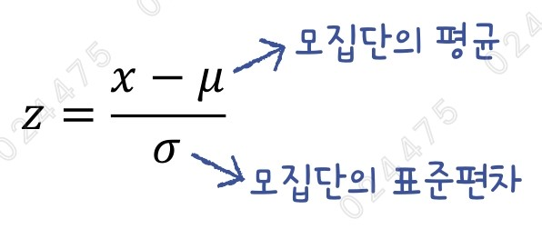

### z 점수 구하기

#### 1. 넘파이를 사용해 5개의 숫자에서 숫자 7에 대한 z 점수를 계산해보자

```py
import numpy as np

x = [0, 3, 5, 7, 10]

s = np.std(x)
m = np.mean(x)
z = (7 - m) / s
print(z)
# 0.5872202195147035
```

#### 2. 사이파이를 사용해 z 점수를 계산해보자

```py
from scipy import stats

stats.zscore(x)
# array([-1.46805055, -0.58722022,  0.        ,  0.58722022,  1.46805055])
```

- 사이파이(scipy): 많은 수학 및 과학 알고리즘을 제공
- `stats.zscore()` 함수를 사용해 배열에 대한 모든 z 점수를 계산할 수 있음

### 누적분포 이해하기

- 표준정규분포: 평균이 0이고 표준편차가 1인 정규분포
- 표준정규분포에서 z 점수 = x
- 따라서, 표준정규분포는 z 점수를 사용해 전체 데이터가 어떻게 분포되어 있는지 알 수 있음
  - z 점수가 1.0 이내에 위치한 샘플은 전체의 약 68%에 해당함
  - z 점수가 2.0 이내에 위치한 샘플은 전체의 약 95%에 해당함

  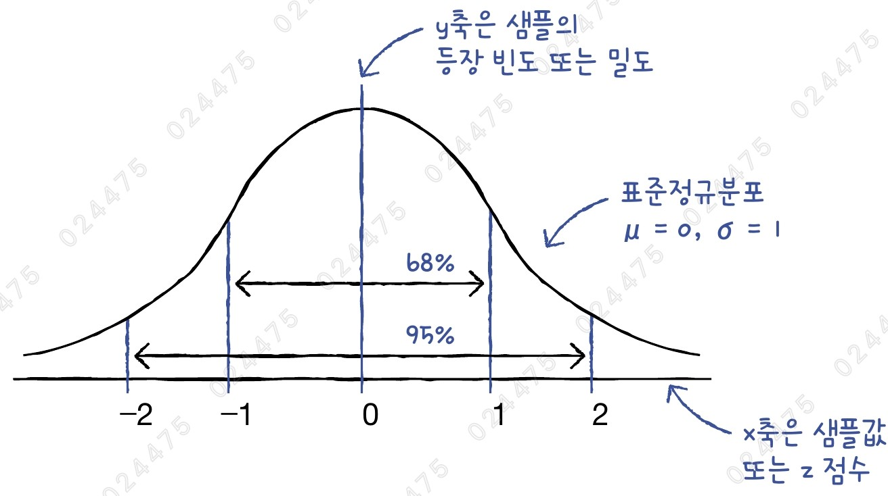

### 누적분포 구하기

#### 3. 표준정규분포에서 평균 0까지 누적분포를 구해보자

```py
stats.norm.cdf(0)
# np.float64(0.5)
```

- `stats` 모듈의 `norm.cdf()` 메서드를 사용하면 누적된 분포(어떤 z 점수 이내의 샘플 비율)를 알 수 있음

#### 4. 표준정규분포에서 z 점수가 1 이내의 비율을 구하자

```py
stats.norm.cdf(1.0) - stats.norm.cdf(-1.0)
# np.float64(0.6826894921370859)
```

#### 5. 표준정규분포에서 z 점수가 2 이내의 비율을 구하자

```py
stats.norm.cdf(2.0) - stats.norm.cdf(-2.0)
# np.float64(0.9544997361036416)
```

#### 6. 표준정규분포에서 90% 누적분포에 해당하는 z 점수를 구하자

```py
stats.norm.ppf(0.9)
# np.float64(1.2815515655446004)
```

- `stats` 모듈의 `norm.ppf()` 메서드를 사용하면 전체에서 특정 비율에 해당하는 z 점수를 알 수 있음

## 3️⃣ 중심극한정리 알아보기

- central limit theorem
- '무작위로 샘플을 뽑아 만든 표본의 평균은 정규분포에 가깝다'는 이론

  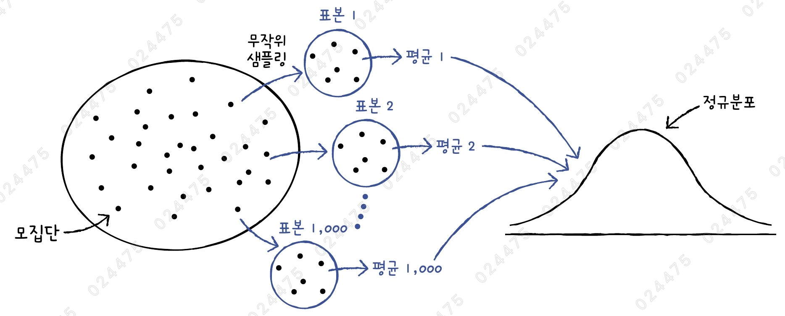

### 추론 목표) 도서 제목에 '파이썬'을 넣으면 도서가 더 잘 팔릴까?

- 실제 판매 데이터를 얻기 어려우니, 대출 데이터가 판매 실적과 연관성 있다고 가정

#### 1. 구글 드라이브에 저장된 'ns_book7.csv' 파일을 다운로드하자

```py
import gdown
import pandas as pd

gdown.download('https://bit.ly/3pK7iuu', 'ns_book7.csv', quiet=False)

ns_book7 = pd.read_csv('ns_book7.csv', low_memory=False)
ns_book7.head()
```

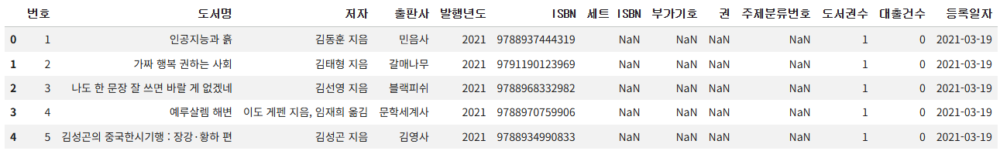

#### 2. 데이터프레임의 '대출건수' 열로 히스토그램을 그리자

```py
import matplotlib.pyplot as plt

plt.hist(ns_book7['대출건수'], bins=50)
plt.yscale('log')
plt.show()
```

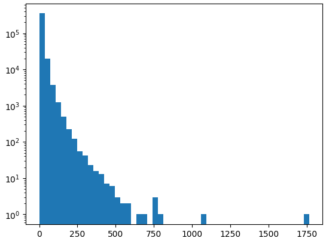

- 확인 결과, '대출건수' 열의 분포는 정규분포와는 상당히 거리가 있어 보임

### 샘플링하기

#### 3. 무작위로 1,000개의 표본을 샘플링해 각 평균을 리스트로 저장해보자

```py
np.random.seed(42)
sample_means = []
for _ in range(1000):
    m = ns_book7['대출건수'].sample(30).mean()
    sample_means.append(m)
```

- 샘플링: 표본을 추출하는 것
- 판다스 데이터프레임의 `sample()` 메서드를 사용하면 무작위 샘플링이 가능함
  - 첫 번째 매개변수: 샘플링할 개수

#### 4. 무작위로 샘플링한 표본의 평균을 히스토그램으로 그려보자

```py
plt.hist(sample_means, bins=30)
plt.show()
```

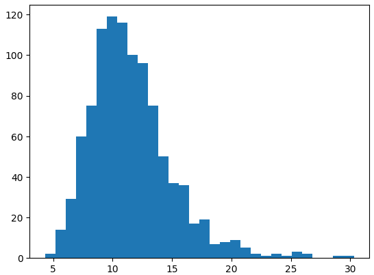

- 좌우 대칭이 완벽하지는 않지만, 종 모양과 유사한 분포를 형성하고 있음
- 정규분포의 형태라면 z 점수 개념을 접목할 수 있음

### 샘플링 크기와 정확도

- 무작위로 뽑은 표본의 평균은 정규분포에 가깝고, 이 정규분포의 평균은 모집단의 평균과 매우 가까움
- 일반적으로 중심극한정리를 따르려면 샘플링의 크기가 30보다 클수록 좋음
- 표본 평균의 표준편차는 모집단의 표준편차를 표본 크기의 제곱근으로 나눈 것에 가까움
  - 표준오차(standard error): 표본 평균의 표준편차

  

- 사실, 모집단이 정규분포를 따르지 않으면 위 공식이 잘 맞지 않을 수 있음

#### 5. 무작위로 뽑은 표본의 평균과 실제 모집단의 평균을 비교해보자

```py
np.mean(sample_means)
# np.float64(11.539900000000001)

ns_book7['대출건수'].mean()
# np.float64(11.593438968070707)
```

- 두 평균은 소수점 첫째 자리까지 같음

#### 6. 샘플링 크기를 20으로 낮춘 후, 평균을 계산해보자

```py
np.random.seed(42)
sample_means = []
for _ in range(1000):
    m = ns_book7['대출건수'].sample(20).mean()
    sample_means.append(m)
np.mean(sample_means)
# np.float64(11.39945)
```

- 표본의 평균이 실제 모집단의 평균에서 더 멀어짐

#### 7. 샘플링 크기를 40으로 높인 후, 평균을 계산해보자

```py
np.random.seed(42)
sample_means = []
for _ in range(1000):
    m = ns_book7['대출건수'].sample(40).mean()
    sample_means.append(m)
np.mean(sample_means)
# np.float64(11.5613)
```

- 표본의 평균이 실제 모집단의 평균과 더욱 가까워짐

#### 8. 표본 평균의 표준편차와 실제 모집단의 표준편차를 샘플링 개수로 나눈 값을 비교해보자

```py
np.std(sample_means)
# np.float64(3.0355987564235165)

np.std(ns_book7['대출건수']) / np.sqrt(40)
# np.float64(3.048338251813498)
```

- 두 값이 아주 비슷함

## 4️⃣ 모집단의 평균 범위 추정하기: 신뢰구간

- 실전에서는 표본을 수집하는 데 시간과 비용이 많이 들기 때문에, 이렇게 많은 횟수의 표본을 만들기 어려운 경우가 많음
- 게다가 모집단에 대한 정보를 구할 수 없는 경우도 많음
- 신뢰구간(confidence interval): 알려지지 않은 모집단의 파라미터를 추정한 범위
  - = 이 구간 안에 모집단의 평균이 포함되어 있을 것이라 확신하는 범위
  - 일반적으로 95% 신뢰구간을 널리 사용함

#### 1. 데이터프레임에서 컴퓨터 관련 도서 중 '파이썬' 도서만 골라내보자

```py
# 컴퓨터 관련 도서는 주제분류번호 003, 004, 005로 시작함
python_books_index = ns_book7['주제분류번호'].str.startswith('00') & \
                     ns_book7['도서명'].str.contains('파이썬')
python_books = ns_book7[python_books_index]
python_books.head()
```

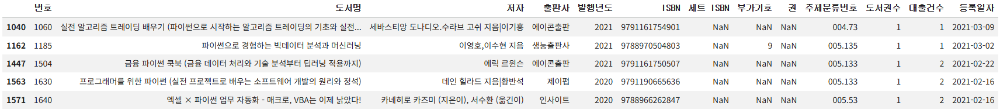

#### 2. 파이썬 도서의 갯수와 대출건수 평균을 계산해보자

```py
len(python_books)
# 251

python_mean = np.mean(python_books['대출건수'])
print(python_mean)
# np.float64(14.749003984063744)
```

- 표본: 남산도서관의 파이썬 도서 대출건수
- 모집단: 우리나라의 모든 도서관의 파이썬 도서 대출건수
- 모집단의 평균을 알 수 없고, 표본의 평균만 알 때 표본의 평균에 대한 z 점수
  - `μ`: 모집단의 평균
  - `s`: 표본 평균의 표준편차
  - `σ`: 모집단의 표준편차

  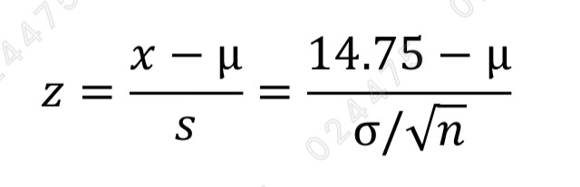

  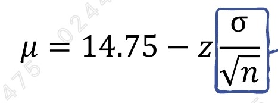

- 모든 도서관 데이터를 구하긴 어려우니, 모집단의 표준편차가 표본의 표준편차와 비슷하다고 가정해보자

#### 3. 모집단의 표준편차 대신 표본의 표준편차를 구한 다음, 표준오차를 계산해보자

```py
python_std = np.std(python_books['대출건수'])
python_se = python_std / np.sqrt(len(python_books))
print(python_se)
# np.float64(0.8041612072427442)
```

- 이제, 표준오차에 곱할 적절한 z 점수를 결정해야 함
- 표본의 평균이 모집단의 평균을 중심으로 95% 이내 구간에 포함된다고 확신하고 싶음
  - 평균을 중심으로 95% 영역을 차지하면 좌우에는 각각 2.5%가 남음

  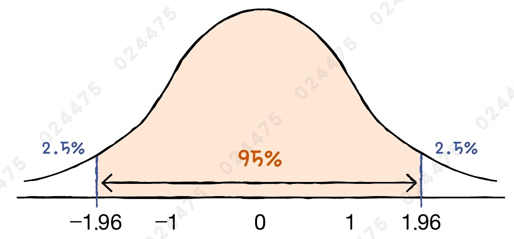

#### 4. 95%에 해당하는 z 점수를 구해보자

```py
stats.norm.ppf(0.975)
# np.float64(1.959963984540054)

stats.norm.ppf(0.025)
# np.float64(-1.9599639845400545)
```

#### 5. 표준오차와 z 점수를 곱해, 파이썬 도서의 대출건수 평균이 속할 범위를 구해보자

```py
print(python_mean-1.96*python_se, python_mean+1.96*python_se)
# 13.172848017867965 16.325159950259522
```

- 해석) 모집단의 평균이 13.2에서 16.3 사이에 놓여 있을 거라 95%로 확신함
  - = 95% 신뢰구간에서 파이썬 도서의 모집단 평균이 13.2에서 16.3 사이에 놓임

## 5️⃣ 통계적 의미 확인하기: 가설검정

- 가설검정: 표본의 통계치를 기반으로, 모집단에 대한 가설을 받아들일지 기각할지 결정하는 방법
  - 모수검정 방법 중 하나임
  - 모수검정: 모집단에 대한 가정을 전제로 하는 방법
- 영가설(null hypothesis): 표본 사이에 통계적으로 의미가 없다고 예상되는 가설
  - 귀무가설이라고도 함
- 대립가설(alternative hypothesis): 표본 사이에 통계적인 차이가 있다는 가설

### 추론 목표) '파이썬' 도서와 'C++' 도서의 평균에 의미 있는 차이가 있는지?

- 파이썬 도서와 C++ 도서의 평균 대출건수가 같다고 가정했을 때, 파이썬과 C++ 도서의 표본을 각각 추출해 이 가정이 맞는지 검정할 수 있음
- 영가설: 파이썬과 C++ 도서의 평균 대출건수가 같다는 가설
  - $H_{0}: μ_{python} - μ_{C++} = 0$

- 대립가설: 파이썬과 C++ 도서의 평균 대출건수가 같지 않다는 가설
  - $H_{0}: μ_{python} - μ_{C++} ≠ 0$

- 두 모집단의 평균에 대한 z 점수 공식
  - $x_{1}$, $x_{2}$: 파이썬과 C++ 도서 표본의 평균
  - $μ_{1}$, $μ_{2}$: 파이썬과 C++ 도서 모집단의 평균
  - $n_{1}$, $n_{2}$: 파이썬과 C++ 도서 표본의 크기
  - $σ_{1}$, $σ_{2}$: 파이썬과 C++ 도서 모집단의 표준편차

  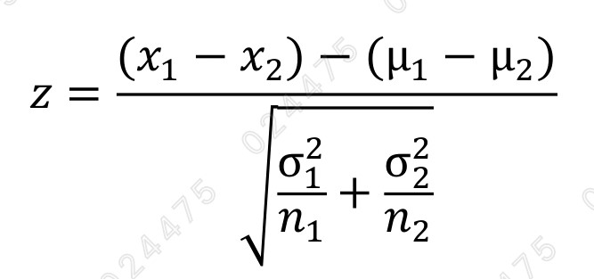

- 모집단의 표준편차는 알지 못하므로, 대신 표본의 표준편차를 사용할 것임
- 영가설의 경우, 두 모집단의 평균에 차이가 없을 것이라 가정하므로 $μ_{1} - μ_{2} = 0$이 됨
  - 이렇게 계산한 z 점수가 일정 수준 이하이면, 영가설이 맞는다고 했을 때 이런 데이터가 관측될 가능성이 매우 낮다는 의미임
  - 따라서, 영가설을 기각하고 두 모집단의 평균에 차이가 있다는 대립가설을 채택할 수 있음
- 유의수준(significance level): z 점수에 대한 기준
  - 일반적으로 많이 사용하는 기준은 정규분포의 양쪽 꼬리 면적을 더해 5%가 되는 지점임
  - 유의수준이 정규분포의 양쪽 꼬리 면적을 더해 5%가 되는 지점일 때, p-값이 0.05 미만이면 영가설을 기각함

### z 점수로 가설 검증하기

#### 1. 데이터프레임에서 컴퓨터 관련 도서 중 'C++' 도서만 골라내보자

```py
cplus_books_index = ns_book7['주제분류번호'].str.startswith('00') & \
                    ns_book7['도서명'].str.contains('C++', regex=False)
cplus_books = ns_book7[cplus_books_index]
cplus_books.head()
```

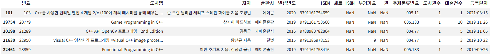

#### 2. C++ 도서의 갯수와 대출건수 평균을 계산해보자

```py
len(cplus_books)
# 89

cplus_mean = np.mean(cplus_books['대출건수'])
print(cplus_mean)
# np.float64(11.595505617977528)
```

- 파이썬 도서의 평균 대출건수는 약 14.75이므로, 두 도서의 평균에 차이가 있음
- 과연 두 표본의 평균 차이에 의미가 있는 것일까? 가설검증을 통해 확인이 필요함

#### 3. C++ 도서에 대한 표준오차를 계산해보자

```py
cplus_se = np.std(cplus_books['대출건수'])/ np.sqrt(len(cplus_books))
print(cplus_se)
# np.float64(0.9748405650607012)
```

#### 4. 가설검정 공식에 두 표본의 파라미터를 대입해 z 점수를 계산해보자

```py
(python_mean - cplus_mean) / np.sqrt(python_se**2 + cplus_se**2)
# np.float64(2.4954081951407074)
```

#### 5. z 점수를 사용해 누적분포를 확인해보자

```py
stats.norm.cdf(2.50)
# np.float64(0.9937903346742238)
```

- z 점수 2.5에 해당하는 누적분포는 0.994이므로, 정규분포의 양쪽 끝 면적은 각각 1 - 0.994 = 0.006이 됨
- p-값은 (1 - 0.994) \* 2 = 0.01로 유의수준에 해당하는 0.05(5%)보다 작음
- 따라서, 영가설을 기각하며 '파이썬과 C++ 도서의 평균에 차이가 있다'는 대립가설이 지지됨

### t-검정으로 가설 검증하기

- t-검정(t-test): t-분포인 두 표본을 비교
- t-분포(t-distribution): 정규분포와 비슷하지만, 중앙은 조금 더 낮고 꼬리가 더 두꺼운 분포
- 표본의 크기가 30 이하일 때 t-분포를 사용하는 것이 좋으며, 표본 크기가 30보다 크면 t-분포는 정규분포와 비슷해짐

#### 6. 파이썬과 C++ 도서 표본을 t-검정으로 가설 검증해보자

```py
t, pvalue = stats.ttest_ind(python_books['대출건수'], cplus_books['대출건수'])
print(t, pvalue)
# 2.1390005694958574 0.03315179520224784
```

- 사이파이의 `ttest_ind()` 함수를 사용하면 손쉽게 두 표본의 평균을 비교할 수 있음
  - t 점수와 p-값을 반환함
  - t 점수: 정규분포의 z 점수에 해당하는 통계치
- 앞서 z 점수와 값이 다르지만 비슷한 값을 얻음
- 여기서도 p-값이 0.03으로 영가설의 기각 기준인 0.05보다 작음
- 즉, 두 도서의 대출건수 평균의 차이는 우연이 아니라고 말할 수 있음

## 6️⃣ 정규분포가 아닐 때 가설검증하기: 순열검정

- 가설검정은 여러 가지 가정을 바탕으로 하는데, 대표적으로 '모집단이 정규분포의 형태를 따른다'고 가정함 (모수검정 방법)
- 하지만, 실제 데이터 과학 분야에서는 모수검정의 근간이 되는 정규분포를 가정하기 어려운 상황이 종종 발생함
- 순열검정(permutation test): 표본을 무작위로 섞은 뒤 통계치를 비교하는 방법
  - 모집단의 분포가 정규분포를 따르지 않거나, 모집단의 분포를 알 수 없을 때 사용할 수 있는 방법
  - 비모수검정 방법 중 하나임
  - 비모수검정(nonparametric test): 모집단의 파라미터를 추정하지 않는 방법

### 순열검정 방법

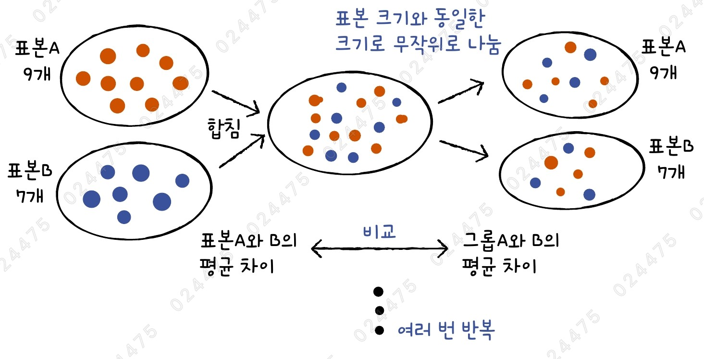

1. 두 표본의 평균의 차이를 계산함
2. 두 표본을 섞고 무작위로 두 그룹으로 나눔
   - 이때, 두 그룹은 원래 표본의 크기와 동일하게 나눔
3. 두 그룹에서 다시 평균의 차이를 계산함
4. 위 1~3번 과정을 반복함
5. 원래 표본의 평균 차이가 무작위로 나눈 그룹의 평균 차이보다 크거나 작은 경우를 헤아려 p-값을 계산함

### 도서 대출건수 평균 비교하기(1): 파이썬 vs C++

#### 1. 두 개의 배열을 받아 평균 차이를 구하는 함수를 만들자

```py
def statistic(x, y):
    return np.mean(x) - np.mean(y)
```

#### 2. 두 개의 배열을 받아 순열검정을 실행하는 함수를 만들자

```py
def permutation_test(x, y):
    # 표본의 평균 차이를 계산합니다.
    obs_diff = statistic(x, y)
    # 두 표본을 합칩니다.
    all = np.append(x, y)
    diffs = []
    np.random.seed(42)
    # 순열 검정을 1000번 반복합니다.
    for _ in range(1000):
        # 전체 인덱스를 섞습니다.
        idx = np.random.permutation(len(all))
        # 랜덤하게 두 그룹으로 나눈 다음 평균 차이를 계산합니다.
        x_ = all[idx[:len(x)]]
        y_ = all[idx[len(x):]]
        diffs.append(statistic(x_, y_))
    # 원본 표본보다 작거나 큰 경우의 p-값을 계산합니다.
    less_pvalue = np.sum(diffs < obs_diff)/1000
    greater_pvalue = np.sum(diffs > obs_diff)/1000
    # 둘 중 작은 p-값을 선택해 2를 곱하여 최종 p-값을 반환합니다.
    return obs_diff, np.minimum(less_pvalue, greater_pvalue) * 2
```

- 사실 사이파이 1.8 버전 이상일 경우, 순열검정을 위한 `permutation_test()` 함수를 제공함
- 넘파이의 `permutation()` 함수는 무작위로 섞인 배열을 만들어줌
- 일반적으로 영가설을 기각하는 것이 목적이므로, 둘 중에 작은 값을 선택하는 2를 곱해 양쪽 꼬리에 해당하는 비율을 얻음
- 이 값이 바로 '영가설이 옳다고 가정했을 때 이런 데이터가 관측될 확률' 임

#### 3. 파이썬과 C++ 도서의 대출건수를 전달해, 순열검정의 결과를 확인해보자

```py
permutation_test(python_books['대출건수'], cplus_books['대출건수'])
# (np.float64(3.1534983660862164), np.float64(0.022))
```

- 여기서도 p-값이 5%에 해당하는 유의수준에 미치지 못하기 때문에, 영가설을 기각하고 두 도서의 평균 대출건수에는 차이가 있다고 결론을 내릴 수 있음

### 도서 대출건수 평균 비교하기(2): 파이썬 vs 자바스크립트

#### 4. 데이터프레임에서 컴퓨터 관련 도서 중 '자바스크립트' 도서만 골라내보자

```py
java_books_indx = ns_book7['주제분류번호'].str.startswith('00') & \
                  ns_book7['도서명'].str.contains('자바스크립트')
java_books = ns_book7[java_books_indx]
java_books.head()
```

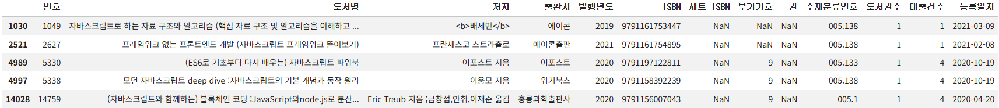

#### 5. 자바스크립트 도서의 갯수와 대출건수 평균을 계산해보자

```py
print(len(java_books), np.mean(java_books['대출건수']))
# 105 15.533333333333333
```

- 파이썬 도서의 평균 대출건수(약 14.75)보다 조금 더 높음

#### 6. 파이썬과 자바스크립트 도서 표본의 평균 차이가 의미가 있는 차이인지 순열검정으로 확인해보자

```py
permutation_test(python_books['대출건수'], java_books['대출건수'])
# np.float64(-0.7843293492695889), np.float64(0.566))
```

- p-값이 0.05보다 훨씬 크므로 영가설을 기각할 수 없으며, 파이썬과 자바스크립트 도서 사이의 평균 대출건수 차이는 큰 의미가 없다고 볼 수 있음

## cf) 핵심 함수와 메서드

| 함수/메서드                      | 기능                                            |
| -------------------------------- | ----------------------------------------------- |
| `scipy.stats.zscore()`           | z 점수를 계산함                                 |
| `scipy.stats.norm.cdf()`         | 정규분포의 누적분포 비율을 계산함               |
| `scipy.stats.norm.ppf()`         | 누적분포의 비율을 입력하면 해당 z 점수를 반환함 |
| `Series.sample()`                | 데이터프레임에서 무작위로 값을 추출함           |
| `scipy.stats.ttest_ind()`        | 두 표본의 평균에 대한 t-검정을 수행함           |
| `scipy.stats.permutation_test()` | 두 표본에 대한 순열검정을 수행함                |
