# ✔ 분포 요약하기

> ['분포 요약하기' 구글 코랩](https://colab.research.google.com/github/rickiepark/hg-da/blob/main/04-2.ipynb)

## 1️⃣ 산점도 그리기

- 전체 데이터를 한눈에 파악하려면 그래프가 가장 좋은 방법임

### 맷플롯립 (matplotlib)

- 파이썬에서 그래프를 그리는 데 사용하는 대표적인 패키지
- 파이썬의 다양한 데이터 과학 패키지들이 맷플롯립을 자주 활용함
- 산점도, 히스토그램, 상자 수염 그림을 비롯해, 막대 그래프, 선 그래프 등 많은 종류의 그래프를 지원함
- 또한, 그래프의 구성 요소를 다양하게 제어할 수 있는 많은 옵션을 제공함
- 맷플롯립에서 제공하는 그래프 함수는 `matplotlib.pyplot` 모듈 아래에 있음

### 산점도

- scatter plot
- 데이터를 2차원 평면 또는 3차원 공간에 점으로 표시하는 그래프
- 두 변수(variable) 혹은 두 가지 특성(feature) 값을 직교 좌표계에 점으로 나타내는 그래프
  - 데이터 분석이나 머신러닝에서의 변수: 한 레코드를 구성하는 개별 측정값
  - 즉, 데이터프레임의 각 열이 하나의 특성이 됨
- 장점
  - 점으로 뿌려서 표현하기 때문에, 데이터 분포를 한 눈에 볼 수 있음
- 단점
  - 2차원 또는 3차원 산점도만 가능하기 때문에, 한 번에 표현할 수 있는 특성 개수에 한계가 있음
  - 일반적으로 2개 또는 3개의 특성을 표현할 수 있지만, 점의 색깔을 달리 하면 한 개의 특성을 더 표현할 수 있음

### `scatter()` 함수

#### 1. 구글 드라이브에 저장된 'ns_book7.csv' 파일을 다운로드하자

```py
import gdown
import pandas as pd

gdown.download('https://bit.ly/3pK7iuu', 'ns_book7.csv', quiet=False)

ns_book7 = pd.read_csv('ns_book7.csv', low_memory=False)
ns_book7.head()
```

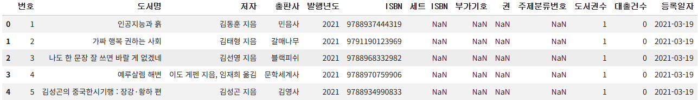

#### 2. 4개의 포인트로 이루어진 산점도를 그려보자

```py
import matplotlib.pyplot as plt

plt.scatter([1,2,3,4], [1,2,3,4])
plt.show()
```

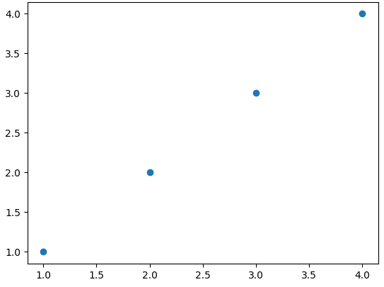

- `scatter()` 함수를 사용하면, 산점도를 그릴 수 있음
  - 첫 번째 매개변수: 포인트의 x축 좌표
  - 두 번째 매개변수: 포인트의 y축 좌표
- `show()` 함수를 호출하면, 그래프를 출력할 수 있음

#### 3. 남산도서관 대출 데이터의 '번호'와 '대출건수' 열의 산점도를 그려보자

```py
plt.scatter(ns_book7['번호'], ns_book7['대출건수'])
plt.show()
```

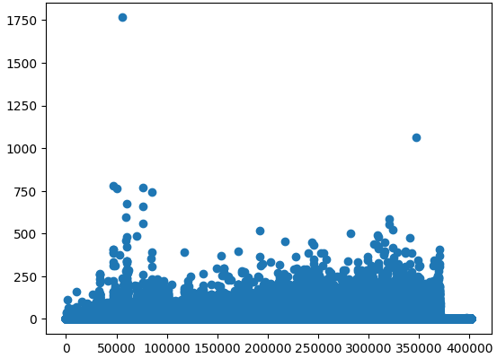

- 맷플롯립은 x축, y축의 값으로 데이터프레임의 열을 입력받을 수 있음
- 확인 결과, 대출건수(y축의 값)는 번호(x축의 값)를 따라 비교적 고르게 퍼져 있음

#### 4. '도서권수'와 '대출건수' 열의 산점도를 그려보자

```py
plt.scatter(ns_book7['도서권수'], ns_book7['대출건수'])
plt.show()
```

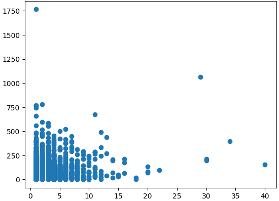

- 도서권수가 많으면 대출건수도 많을 거라 예상하기 쉽지만, 위의 산점도를 보면 이런 경향을 파악하기 쉽지 않음
- 이슈) 대부분의 도서가 1~2권이기 때문에 x축 0~10 범위인 왼쪽 아래 모서리 부분에 같은 값을 가진 데이터 포인트가 중첩되어 그려짐
- 해결책) 산점도에 투명도를 주면 중첩된 데이터 포인트를 가늠하기 좋음

### 투명도 조절하기

#### 5. 투명도가 반영된 '도서권수'와 '대출건수' 열의 산점도를 그려보자

```py
plt.scatter(ns_book7['도서권수'], ns_book7['대출건수'], alpha=0.1)
plt.show()
```

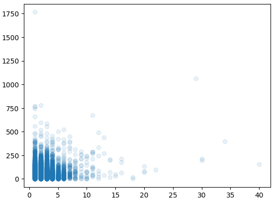

- `alpha` 매개변수에 0~1 사이의 값으로 투명도를 지정할 수 있음
  - `0`: 투명
  - `1`: 불투명
- 투명도를 주더라도 데이터가 많이 중첩된 부분은 짙게 나타남
- 왼쪽 아래 모서리 근처는 여전히 짙게 나타나는데, 이는 대부분의 도서권수가 적다는 것을 의미함
- 이슈) 도서권수가 대부분 작은 값이기 때문에 도서권수와 대출권수 사이의 관계를 파악하기 어려움
  - 양의 상관관계: 도서권수가 많으면 대출건수도 많음
  - 음의 상관관계: 도서권수가 적을수록 대출건수가 많음

#### 6. '도서권수 당 대출권수'를 x축에 두고, '대출권수'를 y축에 두어 산점도를 그려보자

```py
average_borrows = ns_book7['대출건수']/ns_book7['도서권수']
plt.scatter(average_borrows, ns_book7['대출건수'], alpha=0.1)
plt.show()
```

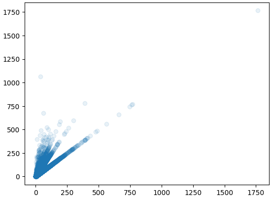

- 양의 상관관계: x축이 증가함에 따라 y축이 증가함
- 음의 상관관계: x축이 증가함에 따라 y축이 감소함
- 도서권수 당 대출건수가 증가함에 따라 대출건수가 증가함 (양의 상관관계)

## 2️⃣ 히스토그램 그리기

### 히스토그램

- histogram
- 수치형 특성의 값을 일정한 구간(bin)으로 나누어 구간 안에 포함된 데이터 개수를 막대 그래프로 그린 것
- 도수(frequency): 구간 안에 속한 데이터 개수
- 도수분포표: 히스토그램에 나오는 구간과 도수를 표로 요약한 것
- 장점
  - 하나의 특성에 대한 데이터 분포를 확인하기 좋음
- 단점
  - 여러 개의 특성을 비교하려면 각기 따로 그린 히스토그램을 비교해야 함
  - 이때, 두 그래프를 잘 비교하려면 각 축의 범위를 맞추어 그려야 함

### `hist()` 함수

#### 1. 8개의 정수로 이루어진 데이터를 5개의 구간으로 나눈 히스토그램을 그려보자

```py
plt.hist([0,3,5,6,7,7,9,13], bins=5)
plt.show()
```

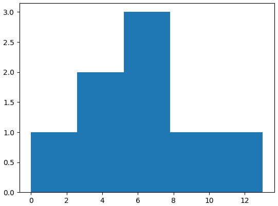

- `hist()` 함수를 사용하면, 히스토그램을 그릴 수 있음
  - 1차원 데이터를 입력받아 히스토그램을 그림
- `bins` 매개변수를 지정하면, 지정한 숫자만큼 데이터 사이를 동일한 간격으로 나눔
  - 기본적으로 데이터를 10개의 구간으로 나눔
- 한계점) 구간이 어떻게 나누어졌는지 수치를 확인할 수 없음

#### 2. 위 히스토그램의 다섯 구간 경겟값을 출력해보자

```py
import numpy as np

np.histogram_bin_edges([0,3,5,6,7,7,9,13], bins=5)
# array([ 0. ,  2.6,  5.2,  7.8, 10.4, 13. ])
```

- `histogram_bin_edges()` 함수를 사용하면, 히스토그램의 구간을 정확하게 확인할 수 있음
- 첫 번째 구간은 0~2.6까지고, 두 번째 구간은 2.6~5.2까지임
  - 이때 경곗값인 2.6은 두 번째 구간에 포함됨
  - 마지막 구간은 10.4~13까지고 13을 포함함

#### 3. 1,000개의 난수로 이루어진 데이터를 히스토그램으로 그려보자

```py
np.random.seed(42)
random_samples = np.random.randn(1000)

print(np.mean(random_samples), np.std(random_samples))
# 0.01933205582232549 0.9787262077473543

plt.hist(random_samples)
plt.show()
```

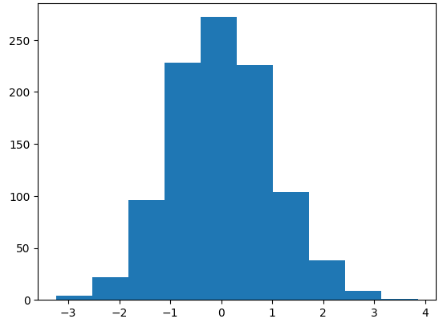

- `randn()` 함수에 샘플 개수를 전달하면, 표준정규분포를 따르는 랜덤한 실수를 생성함
  - 정규분포: 종 모양처럼 가운데가 볼록하고 평균을 중심으로 대칭인 분포
  - 표준정규분포: 평균이 0, 표준편차가 1인 정규분포
- `randn()` 함수는 랜덤한 값을 생성하기 때문에, 실행할 때마다 다른 값이 추출됨
- `randn()` 함수 전에 `seed()` 함수를 사용하면 항상 같은 난수를 추출할 수 있음 (유사난수, 가짜난수)
- 히스토그램 확인 결과, 평균 0을 중심으로 볼록한 종 모양의 분포(정규분포)가 나온 것을 알 수 있음

#### 4. '대출건수' 열의 히스토그램을 그려보자

```py
plt.hist(ns_book7['대출건수'])
plt.show()
```

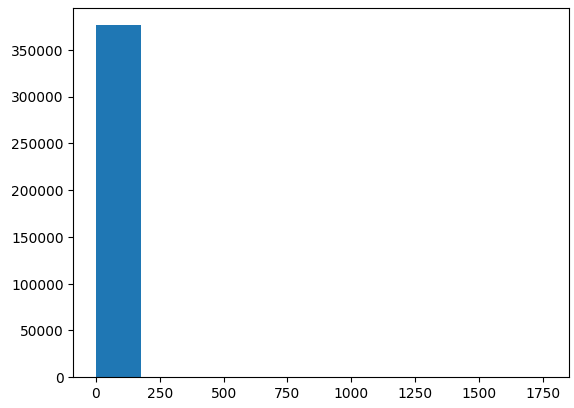

- 이슈) 대부분 도서의 대출건수는 작기 때문에, 첫 번째 구간의 도수가 너무 커 다른 구간에는 도수 값이 표시되지 않는 현상이 발생함

### 구간 조정하기

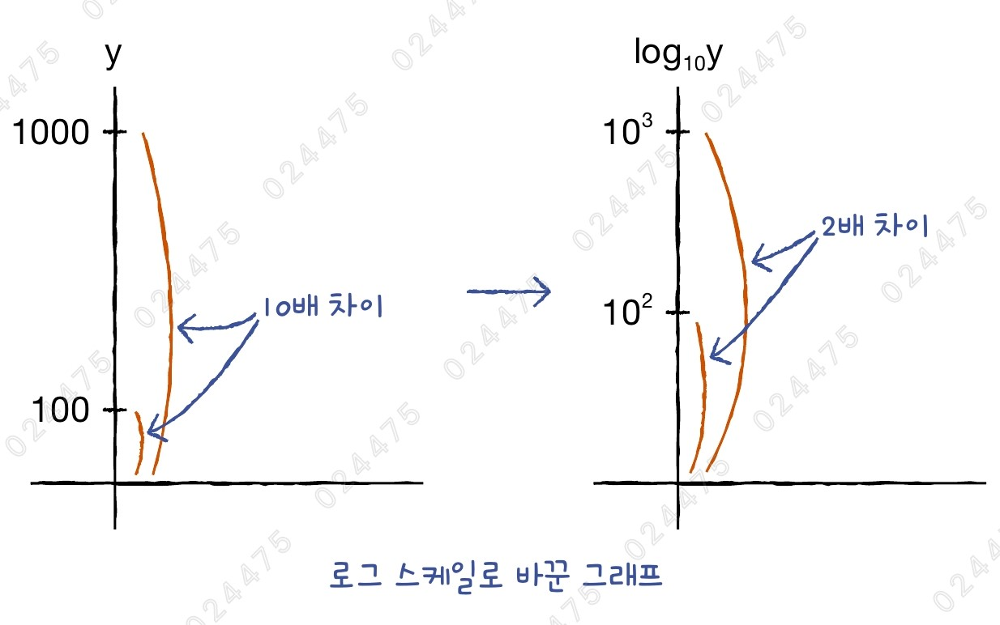

- 수치를 로그로 간결하게 표시할 수 있어 넓은 범위의 데이터를 표시하기 좋음
- y축을 로그 스케일로 바꾸면, 한 구간의 도수가 너무 커서 다른 구간에는 도수가 표시되지 않는 현상을 해결할 수 있음
- 큰 값일수록 도수 크기가 많이 줄어들어 작은 값과의 차이가 줄어듦
- 맷플롯립은 기본적으로 밑이 10인 로그 함수를 사용함

#### 5. 위 히스토그램의 y축을 로그스케일로 바꿔보자

```py
plt.hist(ns_book7['대출건수'])
plt.yscale('log')
plt.show()
```

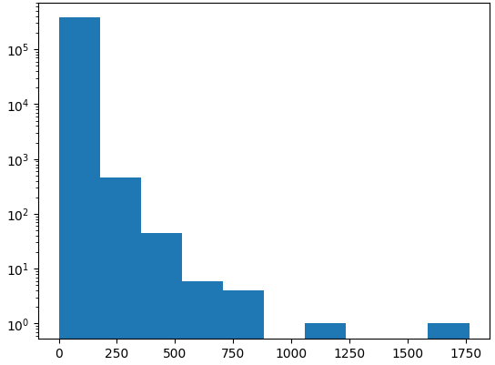

- `yscale()` 함수에 `'log'`로 지정하면, y축을 로그 스케일로 바꿀 수 있음
- 이제 히스토그램을 보면, 나타나지 않았던 다른 구간의 도수가 표시됨

#### 6. 위 히스토그램의 구간을 100개로 늘려보자

```py
plt.hist(ns_book7['대출건수'], bins=100)
plt.yscale('log')
plt.show()
```

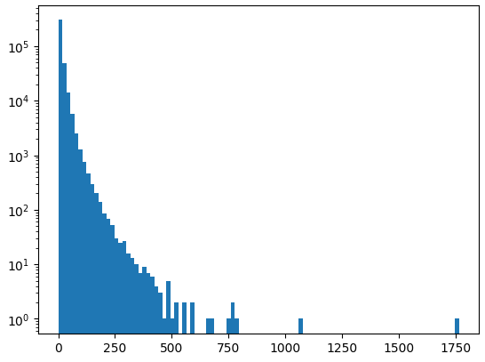

- 대출건수 0이 가장 많고, 대출건수가 증가함에 따라 도수가 줄어듦

#### 7. '도서명' 열의 길이 데이터를 100개의 구간을 가진 히스토그램으로 그려보자

```py
title_len = ns_book7['도서명'].apply(len)
plt.hist(title_len, bins=100)
plt.show()
```

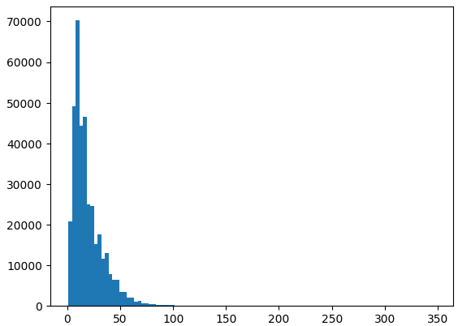

#### 8. 위 히스토그램의 x축을 로그 스케일로 바꿔보자

```py
plt.hist(title_len, bins=100)
plt.xscale('log')
plt.show()
```

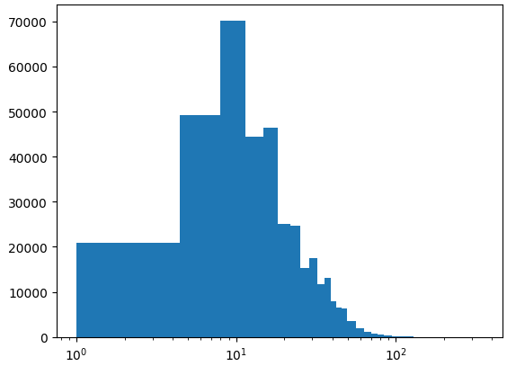

## 3️⃣ 상자 수염 그림 그리기

### 상자 수염 그림

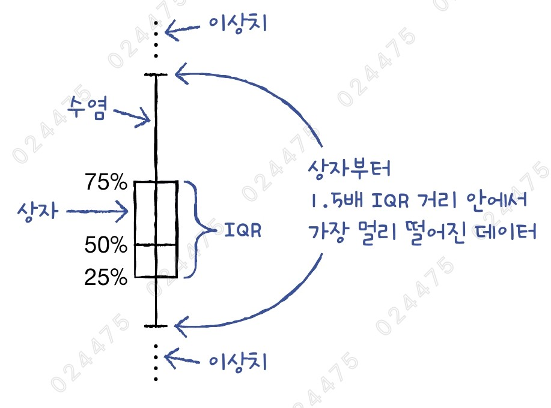

- box-and-whisker plot
- 최솟값, 3개의 사분위수, 최댓값 총 5개의 숫자를 사용해 데이터를 요약하는 그래프
- 상자 수염 그림을 그리는 방법
  1. 25%, 75% 지점을 밑면과 윗면으로 하는 직사각형을 그림
  2. 50%에 해당하는 지점에 수평선을 그음
  3. 사각형의 밑면과 윗면에서 사각형의 높이의 1.5배만큼 떨어진 거리 안에서 가장 멀리 있는 샘플까지 수직선을 그음
  4. 이 수직선 밖에서 최솟값과 최댓값까지 데이터를 점으로 표시함
- 상자 수염 그림에서의 이상치: IQR의 1.5배 거리 밖의 데이터
- IQR (Interquartile Range): 제1사분위수(25% 백분위수)와 제3사분위수(75% 백분위수) 사이의 거리
- 장점
  - 여러 개의 특성을 시각적으로 비교하기 좋음
  - 데이터가 어떤 방향으로 더 많이 늘어져 있는지 한 분에 파악할 수 있음

### `boxplot()` 함수

#### 1. '대출건수'와 '도서권수' 열의 상자 수염 그림을 그려보자

```py
plt.boxplot(ns_book7[['대출건수','도서권수']])
plt.show()
```

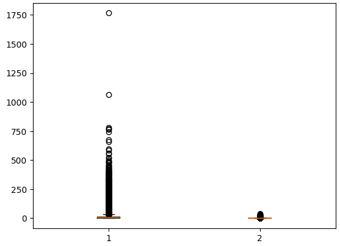

- `boxplot()` 함수에 한 개 이상의 데이터프레임 열을 전달하여 상자 수염 그림을 그릴 수 있음
- 중간값은 붉은 수평선으로 표시됨
- 이슈) 1번 상자(대출건수)와 2번 상자(도서권수)는 사분위수가 매우 작아서 직사각형 상자가 거의 보이질 않음

#### 2. 위 상자 수염 그림의 y축을 로그 스케일로 바꿔보자

```py
plt.boxplot(ns_book7[['대출건수','도서권수']])
plt.yscale('log')
plt.show()
```

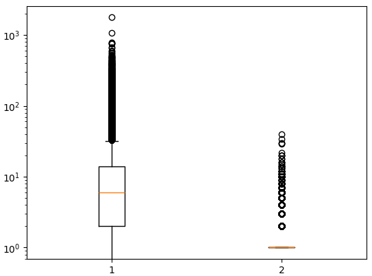

- 이제 1번 상자(대출건수)는 모양을 뚜렷하게 확인할 수 있음
- '도서권수' 열의 사분위수는 모두 1이기 때문에 상자가 보이지 않는 것이 맞음

### 상자 수염 그림 수평으로 그리기

#### 3. '대출건수'와 '도서권수' 열의 상자 수염 그림을 수평으로 그려보자

```py
plt.boxplot(ns_book7[['대출건수','도서권수']], vert=False)
plt.xscale('log')
plt.show()
```

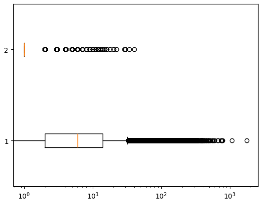

- `boxplot()` 함수의 `vert` 매개변수를 False로 바꾸면 수평으로 그릴 수 있음
- x-y축이 바뀌므로, 로그 스케일도 x축으로 지정해야 함

### 수염 길이 조정하기

#### 4. IQR의 10배 범위 안에서 가장 멀리 떨어진 데이터까지 수염을 그려보자

```py
plt.boxplot(ns_book7[['대출건수','도서권수']], whis=10)
plt.yscale('log')
plt.show()
```

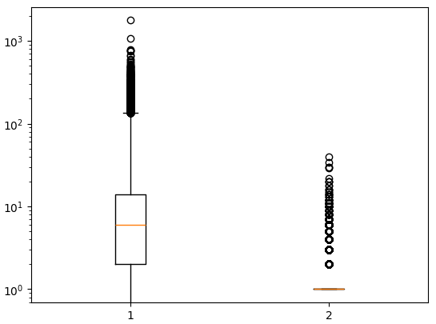

- `boxplot()` 함수의 `whis` 매개변수를 통해 수염 길이를 조정할 수 있음
  - 기본값: `1.5` (IQR의 1.5 배)
- 2번 상자(도서권수)의 IQR은 0이기 때문에 여전히 수염이 전혀 그려지지 않음

#### 5. 전 데이터 범위만큼 수염을 그려보자

```py
plt.boxplot(ns_book7[['대출건수','도서권수']], whis=(0,100))
plt.yscale('log')
plt.show()
```

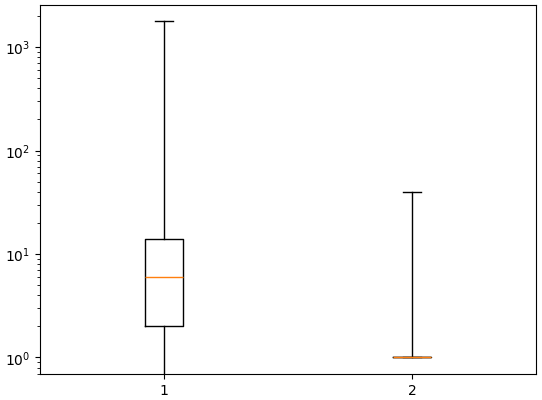

- `whis` 매개변수는 백분율로도 지정할 수 있음
- ex) (10, 90)으로 지정하면 10%, 90% 백분위수에 해당하는 데이터까지 수염을 그림
- 수염 길이를 백분위수로 지정하니 2번 상자(도서권수)에도 수염이 그려지는 것을 볼 수 있음

## cf) 판다스의 그래프 함수

- 판다스도 데이터프레임과 시리즈 객체를 사용해 다양한 그래프 기능을 제공함
- 그래프를 그리기 위해 백엔드로 맷플롯립을 사용하기 때문에, 대부분의 그래프 결과가 맷플롯립으로 그린 것과 비슷함
- 판다스 데이터프레임 객체의 `plot` 속성은 여러 가지 그래프를 그릴 수 있는 메서드를 제공함

### 산점도 그리기

#### 1. '도서권수'와 '대출건수' 열의 산점도를 그려보자

```py
ns_book7.plot.scatter('도서권수', '대출건수', alpha=0.1)
plt.show()
```

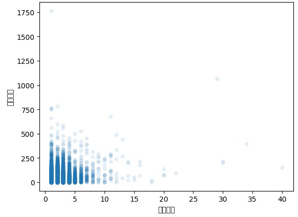

- `scatter()` 메서드에 x축, y축에 해당하는 열 이름만 지정하면 산점도를 그릴 수 있음
- `scatter()` 메서드는 x축과 y축 이름을 자동으로 열 이름으로 표시함
- 이슈) 열 이름이 한글일 때는 실행 결과처럼 제대로 출력되지 않음
- 해결책) 한글 폰트를 사용하도록 지정해야 함

### 히스토그램 그리기

#### 2. '도서명' 열의 길이 데이터를 100개의 구간을 가진 히스토그램으로 그려보자

```py
ns_book7['도서명'].apply(len).plot.hist(bins=100)
plt.show()
```

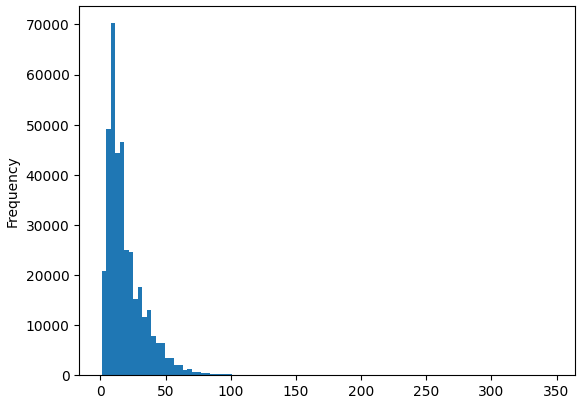

- `hist()` 메서드를 사용하면, 히스토그램을 그릴 수 있음

### 상자 수염 그림 그리기

#### 3. '대출건수'와 '도서권수' 열의 상자 수염 그림을 그려보자

```py
ns_book7[['대출건수','도서권수']].boxplot()
plt.yscale('log')
plt.show()
```

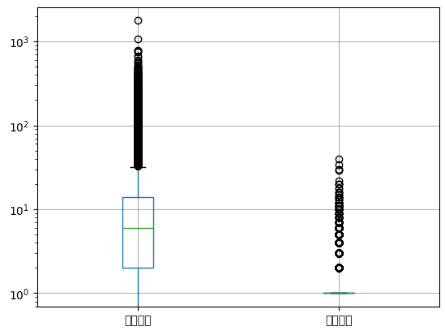

- `boxplot()` 메서드를 사용하면, 상자 수염 그림을 그릴 수 있음
- 이슈) x축에 자동으로 열 이름이 나오지만, 한글 폰트 문제 때문에 제대로 출력되지 않음

## cf) 핵심 함수와 메서드

| 함수/메서드                   | 기능                                                               |
| ----------------------------- | ------------------------------------------------------------------ |
| `Matplotlib.pyplot.scatter()` | 2차원 평면에 산점도를 그림                                         |
| `Matplotlib.pyplot.hist()`    | 히스토그램을 그림                                                  |
| `Matplotlib.pyplot.boxplot()` | 상자 수염 그림을 그림                                              |
| `Matplotlib.pyplot.xscale()`  | x축의 스케일을 지정함                                              |
| `Matplotlib.pyplot.yscale()`  | y축의 스케일을 지정함                                              |
| `numpy.random.seed()`         | 원하는 임의의 정수를 입력하면, 난수 발생을 동일하게 재현할 수 있음 |
| `numpy.random.randn()`        | 표준정규분포를 따르는 난수를 생성함                                |
