# ✔ 통계로 요약하기

> ['통계로 요약하기' 구글 코랩](https://colab.research.google.com/github/rickiepark/hg-da/blob/main/04-1.ipynb)

## 1️⃣ 기술통계 구하기

### 기술 통계

- 자료의 내용을 압축하여 설명하는 방법
- 요약 통계 라고도 함
- 정량적인 수치로 전체 데이터의 특징을 요약하거나 이해하기 쉬운 간단한 그래프를 사용함
- 대표적인 통계량에는 평균, 표준편차 등이 있음
- 탐색적 데이터 분석: 데이터 시각화를 아우르는 데이터 분석 방법

#### 1. 구글 드라이브에 저장된 'ns_book6.csv' 파일을 다운로드하자

```py
import gdown
import pandas as pd

gdown.download('https://bit.ly/3736JW1', 'ns_book6.csv', quiet=False)

ns_book6 = pd.read_csv('ns_book6.csv', low_memory=False)
ns_book6.head()
```

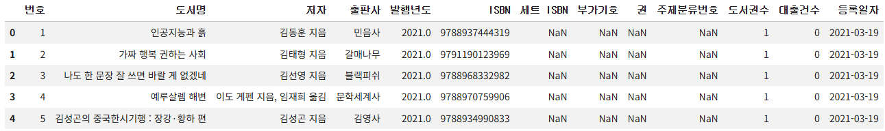

#### 2. 데이터프레임에서 수치형 열에 대한 요약 통계를 확인해보자

```py
ns_book6.describe()
```

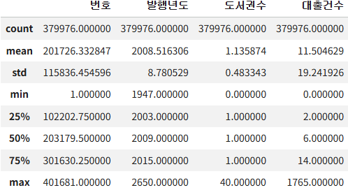

- 판다스 데이터프레임의 `describe()` 메서드를 사용하면, 기본적인 몇 가지 기술통계를 자동으로 추출해 줌
- 수치형 열의 통계량 (8가지)
  - `count`: 누락된 값을 제외한 데이터 개수
  - `mean`: 평균
  - `std`: 표준편차
  - `min`: 최솟값
  - `50%`: 중앙값
  - `25%`, `75%`: 순서대로 늘어 놓았을 때, 25%와 75% 지점에 놓인 값
  - `max`: 최댓값
- 확인 결과 '도서권수'가 0인 값이 있고, 실제로 없는 도서의 대출 데이터는 의미가 없으므로 제외할 필요가 있어 보임

#### 3. '도서권수' 열의 값이 0인 행은 제외해보자

```py
sum(ns_book6['도서권수']==0)
# 3206
```

```py
ns_book7 = ns_book6[ns_book6['도서권수']>0]
```

#### 4. 데이터의 25%, 75% 대신, 30%, 60%, 90%에 위치한 값을 확인해보자

```py
ns_book7.describe(percentiles=[0.3, 0.6, 0.9])
```

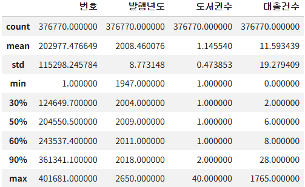

- `describe()` 메서드의 `percentiles` 매개변수를 통해 원하는 위치의 값을 볼 수 있음

#### 5. 데이터프레임에서 수치형 이외의 열에 대한 요약 통계를 확인해보자

```py
ns_book7.describe(include='object')
```

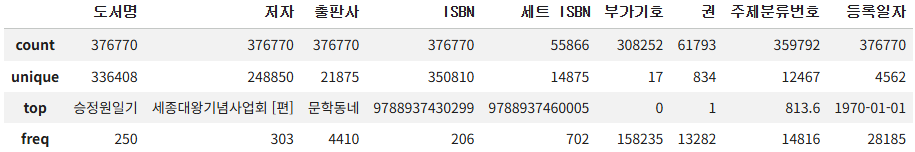

- `describe()` 메서드의 `include` 매개변수에 기술통계를 보고자하는 열의 데이터 타입을 지정할 수 있음
- object 타입 열의 통계량 (4가지)
  - `count`: 누락된 값을 제외한 데이터 개수
  - `unique`: 고유한 값의 개수
  - `top`: 가장 많이 등장하는 값
  - `freq`: top 행에 등장하는 항목의 빈도수

## 2️⃣ 평균 구하기

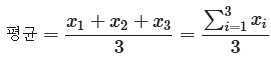

- 평균은 숫자 값을 모두 더해 개수로 나는 것임

### `mean()` 메서드

#### 1. 남산도서관의 평균 대출 건수를 구해보자

```py
print(ns_book7['대출건수'].mean())
# 11.593438968070707
```

- `mean()` 메서드를 사용하묜, 판다스 데이터프레임과 시리즈 객체의 평균을 계산할 수 있음

## 3️⃣ 중앙값 구하기

- 중앙값은 전체 데이터를 순서대로 늘어 놓았을 때 중앙에 위치하는 값임
- 50% 위치의 값이 중앙값에 해당함

### `median()` 메서드

#### 1. 남산도서관의 대출 건수 중앙값을 구해보자

```py
print(ns_book7['대출건수'].median())
# 6.0
```

- 데이터 개수가 홀수인 경우, 정확히 가운데 놓인 값을 찾음
- 데이터 개수가 짝수인 경우, 가운데 2개의 값을 평균하여 중앙값을 결정함
  - ex) [1,2,3,4]에서 중앙값은 2.5

### 중복값 제거하고 중앙값 구하기

#### 2. 같은 값의 대출 건수를 모두 제외하고 중앙값을 구해보자

```py
print(ns_book7['대출건수'].drop_duplicates().median())
# 183.0
```

- 확인 결과, 중복된 값을 제거하니 중앙값이 엄청나게 높아졌음
- 따라서, 작은 대출 건수에 중복된 행이 많다고 생각할 수 있음

## 4️⃣ 최솟값, 최댓값 구하기

### `min()`, `max()` 메서드

#### 1. 남산도서관의 대출 건수 최솟값을 구해보자

```py
print(ns_book7['대출건수'].min())
# 0
```

#### 2. 남산도서관의 대출 건수 최댓값을 구해보자

```py
print(ns_book7['대출건수'].max())
# 1765
```

## 5️⃣ 분위수 구하기

- 분위수는 데이터를 순서대로 늘어 놓았을 때 이를 균등한 간격으로 나누는 기준점 임
- 사분위수: 순서대로 정렬된 데이터를 4구간으로 나눔
  - 25%(제1사분위수), 50%(제2사분위수), 75%(제3사분위수)에 해당함
- 백분위수: 순서대로 정렬된 데이터를 100개의 구간으로 나눔

### `quantile()` 메서드

#### 1. 남산도서관의 대출 건수에서 하위 25%에 위치한 값을 구해보자

```py
print(ns_book7['대출건수'].quantile(0.25))
# 2.0
```

- `quantile()` 메서드를 사용하면, 분위수 값을 계산할 수 있음

#### 2. 남산도서관의 대출 건수에서 하위 25%, 50%, 75%에 위치한 값을 구해보자

```py
ns_book7['대출건수'].quantile([0.25,0.5,0.75])
```

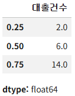

- `quantile()` 메서드에 여러 대의 분위수를 지정할 수도 있음
- 여러 개의 분위수를 지정하면, 각 분위수에 해당하는 값을 담은 시리즈 객체를 반환함

#### 3. [1,2,3,4,5] 다섯 개의 숫자가 있을 때, 90% 위치에 있는 값을 구해보자

```py
print(pd.Series([1,2,3,4,5]).quantile(0.9))
# 4.6
```

- 보간(interpolation): 두 지점 사이에 놓인 특정 위치의 값을 구하는 방법
- `quantile()` 메서드의 `interpolation` 매개변수는 두 지점 사이에 놓인 특정 위치의 값을 어떻게 구할지 방식을 지정함
  - `'linear'` (기본값): 양쪽 분위수에 비례하여 결정됨
  - `'midpoint'`: 분위수에 상관없이 무조건 두 수 사이의 중앙값을 사용함
  - `'nearest'`: 두 수 중에서 가까운 값을 선택함
  - `'lower'`: 두 수 중에서 작은 값을 선택함
  - `'higher'`: 두 수 중에서 큰 값을 선택함
- 위 코드는 `interpolation` 매개변수를 따로 지정하지 않아서 기본값인 `'linear'`로 계산됨

  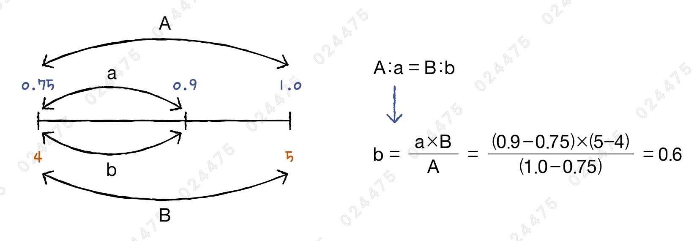

### 백분위 구하기

- 위에서는 분위수를 직접 지정해서 구해 보았는데, 이제는 반대로 어떤 숫자의 백분위를 구해보자

#### 4. 남산도서관의 대출 건수 10이 위치한 백분위를 구해보자

```py
borrow_10_flag = ns_book7['대출건수'] < 10
borrow_10_flag.mean()
# 0.6402712530190833

ns_book7['대출건수'].quantile(0.65)
# 10.0
```

- 판다스는 이에 대한 메서드를 제공하지는 않음
- 대신, 불리언 배열과 `mean()` 메서드를 통해 10보다 작은 대출 건수의 비율을 얻으면 10이 위치한 백분위를 비슷하게 구할 수 있음

## 6️⃣ 분산 구하기

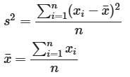

- 분산은 평균으로부터 데이터가 얼마나 퍼져있는가를 나타내는 통계량 임
- 데이터가 가운데 모여 있다면 분산이 작고, 넓게 퍼져 있다면 분산이 큼
- 분산은 데이터의 각 값에서 평균을 뺀 다음 제곱한 후, 샘플 개수로 나누어 구할 수 있음

### `var()` 메서드

#### 1. 남산도서관의 대출 건수 분산을 구해보자

```py
print(ns_book7['대출건수'].var())
# 371.6956304306922
```

- `var()` 메서드를 사용하면, 분산을 구할 수 있음
- 이 결과만 보고 값이 작은지 큰지 판단하기 어려움
- 한계점 1) 분산은 제곱을 했기 때문에, 데이터가 평균에서 멀어질수록 값이 급격히 커짐
- 한계점 2) 단위가 대출건수의 제곱이 되어 해석하기 조금 어려움
- 해결책) 분산에 제곱근을 취한 표준편차 사용

## 7️⃣ 표준편차 구하기

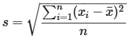

- 표준편차는 평균을 중심으로 데이터가 대략 얼만큼 떨어져 분포해 있는지를 표현하는 값임
- 표준편차는 분산에 제곱근을 한 것임

### `std()` 메서드

#### 1. 남산도서관의 대출 건수 표준편차를 구해보자

```py
print(ns_book7['대출건수'].std())
# 19.27940949382766
```

- `std()` 메서드를 사용하면, 표준편차를 계산할 수 있음
- 이는 어떤 도서의 대출건수를 확인했을 때, 평균(11회)보다 19만큼 더 많거나 적을 수 있다는 것을 의미함
- 아마 평균보다 훨씬 큰 대출건수가 있기 때문에 표준편차가 큰 것으로 예상됨

#### 2. 남산도서관의 대출 건수 표준편차를 수식대로 직접 계산해보자

```py
import numpy as np

diff = ns_book7['대출건수'] - ns_book7['대출건수'].mean()
print(np.sqrt( np.sum(diff**2) / (len(ns_book7)-1) ))
# 19.279409493785508
```

- 판다스의 `std()` 메서드를 수식으로 구현하려면, 샘플 개수를 `n`이 아닌 `n-1`로 나누어야 함 (자유도, degree of freedom)

## 8️⃣ 최빈값 구하기

- 최빈값은 데이터에서 가장 많이 등장하는 값을 의미함

### `mode()` 메서드

#### 1. 남산도서관 대출 데이터의 '도서명' 열에서 가장 많이 등장하는 값을 찾아보자

```py
ns_book7['도서명'].mode()
```

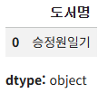

- `mode()` 메서드를 사용하면, 최빈값을 구할 수 있음

#### 2. 남산도서관 대출 데이터의 '발행년도' 열에서 가장 많이 등장하는 값을 찾아보자

```py
ns_book7['발행년도'].mode()
```

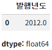

- `mode()` 메서드는 텍스트뿐만 아니라 수치형에도 적용할 수 있음

## cf) 데이터프레임에서 기술통계 구하기

- 지금까지 판다스 시리즈 객체에서 메서드를 호출해 기술통계를 구하는 방법을 알아봄
- 평균, 중앙값, 최솟값, 최댓값, 분위수, 분산, 표준편차 메서드들은 판다스 데이터프레임에서도 직접 호출할 수 있음

#### 1. 데이터프레임에서 수치형인 4개의 열에 대한 평균값을 구해보자

```py
ns_book7.mean(numeric_only=True)
```

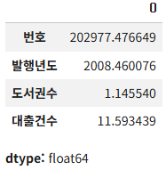

- `numeric_only` 매개변수를 True로 지정해야, 수치형 열에서만 연산이 가능함

#### 2. 데이터프레임에서 '번호' 열은 제외하고 최빈값을 찾아보자

```py
ns_book7.loc[:, '도서명':].mode()
```

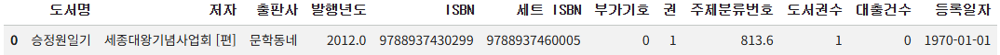

#### 3. 'ns_book7' 데이터프레임을 CSV 파일로 저장하자

```py
ns_book7.to_csv('ns_book7.csv', index=False)
```

## cf) 넘파이의 기술통계 함수

- 넘파이도 여러 가지 기술통계 함수를 제공함
- 이 함수들은 판다스 데이터프레임과 시리즈 객체에서도 잘 동작함

### 평균 구하기 - `mean()`, `average()` 함수

- 하나의 통계량은 여러 가지 방식으로 계산될 수 있음

#### 1. `mean()` 함수로 대출 건수의 평균을 구해보자

```py
import numpy as np

print(np.mean(ns_book7['대출건수']))
# 11.593438968070707
```

#### 2. `average()` 함수로 가중치에 따라 대출 건수의 평균을 구해보자

```py
print(np.average(ns_book7['대출건수'], weights=1/ns_book7['도서권수']))
# 10.543612175385386
```

- `average()` 함수는 기본적으로 `mean()` 함수와 동일하게 평균을 처리하는데, `weights` 매개변수에 가중치를 제공하면 가중 평균을 계산함
  - `weights` 매개변수에 전달할 가중치는 입력 배열과 크기가 같아야 함
- 가중 평균: 평균을 구할 때 각 값의 중요도에 따라 가중치를 부여하여 계산하는 평균값

  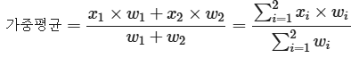

- 위 코드에서는 가중치를 도서권수의 역수로 지정해, 도서권수가 많을수록 대출건수에 낮은 가중치를 줌

#### 3. 모든 도서가 1권일 때의 대출건수 평균을 구해보자

```py
print(np.mean(ns_book7['대출건수']/ns_book7['도서권수']))
# 9.873029861445774
```

- 이렇게 계산한 평균값은 모든 도서권수가 1이기 때문에 도서권수에 따라 대출건수에 미치는 영향을 덜 받아 단순한 평균값보다 낮음

#### 4. 도서에 상관없이 한 권당 대출건수를 구해보자

```py
print(ns_book7['대출건수'].sum()/ns_book7['도서권수'].sum())
# 10.120503701300958
```

### 중앙값 구하기 - `median()` 함수

#### 5. 대출건수의 중앙값을 구해보자

```py
print(np.median(ns_book7['대출건수']))
# 6.0
```

### 최솟값, 최댓값 구하기 - `min()`, `max()` 함수

#### 6. 대출건수의 최솟값, 최댓값을 구해보자

```py
print(np.min(ns_book7['대출건수']))
# 0

print(np.max(ns_book7['대출건수']))
# 1765
```

### 분위수 구하기 - `quantile()` 함수

#### 7. 대출건수의 사분위수를 구해보자

```py
print(np.quantile(ns_book7['대출건수'], [0.25,0.5,0.75]))
# array([ 2.,  6., 14.])
```

### 분산 구하기 - `var()` 함수

#### 8. 대출건수의 분산을 구해보자

```py
print(np.var(ns_book7['대출건수']))
# 371.694643898775

print(ns_book7['대출건수'].var())
# 371.6956304306922

print(ns_book7['대출건수'].var(ddof=0))
# 371.694643898775
```

- 이 값은 판다스의 `var()` 메서드로 계산했을 때와 값이 조금 다름
- 이유) 사실 판다스는 분산을 계산할 때 분모가 `n-1` 이고, 넘파이는 `n` 임
  - 모집단(population): 전체 데이터
  - 표본집단(sample): 전체 데이터 중에서 수집한 일부 데이터
  - 모집단은 아예 구할 수 없거나 구하기 매우 어려운 경우가 많아, 표본집단을 사용해 모집단의 특징을 추정하는 일이 많음
  - 표본집단은 평균과 `n-1`개의 샘플 데이터를 알고 있다면, 마지막 한 개의 샘플 값은 자동으로 알 수 있음 (`n-1` 자유도)
  - 표본집단으로 모집단의 특징을 추정하려는 것이 아니고, 단순히 일련의 데이터에 대해 분산을 계산하려면 `n`으로 나누면 됨
- 판다스와 넘파이 모두 `ddof` 매개변수를 사용해 자유도 차감값을 지정할 수 있음
  - `0`: `n`으로 나눔 (넘파이 `var()` 함수의 `ddof` 매개변수 기본값)
  - `1`: `n-1`로 나눔 (판다스 `var()` 메서드의 `ddof` 매개변수 기본값)
- 넘파이는 주로 머신러닝 작업에 많이 사용되고, 판다스는 데이터 분석에 많이 사용되기 때문에 기본값에 차이가 있음
- 데이터 개수가 충분하다면, 판다스와 넘파이 계산 결과에 차이가 크지 않기 때문에 분산을 나타낼 때 자유도를 고려할 필요는 없음

### 표준편차 구하기 - `std()` 함수

#### 9. 대출건수의 표준편차를 구해보자

```py
print(np.std(ns_book7['대출건수']))
# 19.279383908693113
```

### 최빈값 구하기

#### 10. '도서명' 열의 최빈값을 구해보자

```py
values, counts = np.unique(ns_book7['도서명'], return_counts=True)
max_idx = np.argmax(counts)

print(values[max_idx])
# 승정원일기
```

- 넘파이는 직접적으로 최빈값을 계산하는 함수를 제공하지 않음
- 대신, `unique()` 함수의 `return_counts` 매개변수를 True로 지정해주면, 배열에서 고유한 값을 찾아 등장 횟수와 함께 반환해줌
- 그 다음, `argmax()` 함수를 사용해 counts 배열에서 가장 큰 값의 인덱스를 찾아 values 배열에서 해당 인덱스의 값을 출력하면 최빈값을 얻을 수 있음

## cf) 핵심 함수와 메서드

| 함수/메서드            | 기능                               |
| ---------------------- | ---------------------------------- |
| `DataFrame.describe()` | 데이터프레임의 기술통계량을 출력함 |
| `Series.mean()`        | 데이터에서 평균을 계산함           |
| `numpy.mean()`         | 입력된 배열의 평균을 계산함        |
| `Series.median()`      | 데이터에서 중앙값을 계산함         |
| `numpy.median()`       | 입력된 배열의 중앙값을 계산함      |
| `Series.quantile()`    | 데이터에서 분위수를 계산함         |
| `numpy.quantile()`     | 입력된 배열의 분위수를 계산함      |
| `Series.var()`         | 데이터에서 분산을 계산함           |
| `numpy.var()`          | 입력된 배열의 분산을 계산함        |
| `Series.std()`         | 데이터에서 표준편차를 계산함       |
| `numpy.std()`          | 입력된 배열의 표준편차를 계산함    |
| `Series.mode()`        | 데이터에서 최빈값을 계산함         |
