# ✔ 잘못된 데이터 수정하기

> ['잘못된 데이터 수정하기' 구글 코랩](https://colab.research.google.com/github/rickiepark/hg-da/blob/main/03-2.ipynb)

## 1️⃣ 데이터프레임 정보 요약 확인하기

#### 1. 구글 드라이브에 저장된 'ns_book4.csv' 파일을 다운로드하자

```py
import gdown
import pandas as pd

gdown.download('https://bit.ly/3GisL6J', 'ns_book4.csv', quiet=False)

ns_book4 = pd.read_csv('ns_book4.csv', low_memory=False)
ns_book4.head()
```

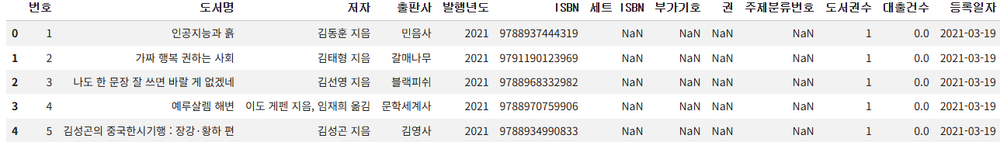

#### 2. 열마다 NaN이 아닌 값이 몇 개인지 확인해보자

```py
ns_book4.info()
```

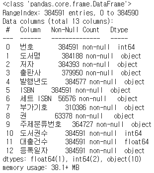

- `info()` 메서드를 사용하면, 데이터프레임 정보를 요약해서 출력해 줌
  - 전체 행 개수, 열 개수, 열 이름, 각 열마다 누락된 값이 없는 행 개수, 열 데이터 타입, 메모리 사용량
- `info()` 메서드는 기본적으로 원소 개수와 열 데이터 타입을 기반으로 메모리 사용량을 추정함
  - `memory_usage` 매개변수에 `'deep'` 옵션을 지정하면, 정확한 메모리 사용량을 얻을 수 있음
- 데이터 타입
  - `float64`: 실수형
  - `int64`: 정수형
  - `object`: 문자열 또는 혼합형

## 2️⃣ 누락된 값 처리하기

### 누락된 값 개수 확인하기: `isna()` 메서드

#### 1. 열마다 NaN인 값이 몇 개인지 확인해보자

```py
ns_book4.isna().sum()
```

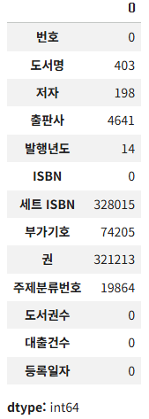

- `isna()` 메서드는 각 행이 비어 있는지를 나타내는 불리언 배열을 반환함
- `sum()` 메서드를 이어서 호출하면, 불리언 배열의 True 개수로 비어있는 행 개수를 얻을 수 있음

### 누락된 값으로 표시하기: `None`, `np.nan`

#### 2. 정수형 타입인 '도서권수' 열에 있는 첫 번쨰 행 값을 NaN으로 바꿔보자

```py
ns_book4.loc[0, '도서권수'] = None

ns_book4['도서권수'].isna().sum() # np.int64(1)
ns_book4.head(2)
```

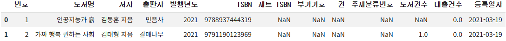

- 판다스 데이터프레임에서는 정수를 저장하는 열에 파이썬의 `None`을 입력하면 누락된 값(NaN)으로 인식함
- 이슈) 두 번째 행의 '도서권수' 값이 1에서 1.0으로 변경됨
  - 원인) 판다스가 NaN을 특별한 실수 값으로 저장하기 때문에, 원래 데이터 타입인 int64에서 float64로 자동으로 바뀜

#### 3. '도서권수' 열의 첫 번째 행과 데이터 타입을 원래대로 돌려놓자

```py
ns_book4.loc[0, '도서권수'] = 1
ns_book4 = ns_book4.astype({'도서권수':'int64', '대출건수': 'int64'})
ns_book4.head(2)
```

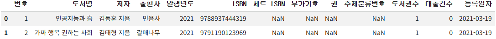

- `astype()` 메서드를 사용하면, 데이터 타입을 지정할 수 있음
- 매개변수를 `{ 열 이름: 데이터 타입 }` 형식의 딕셔너리로 전달하면 됨

#### 4. 문자열 타입인 '부가기호' 열에 있는 첫 번쨰 행 값을 NaN으로 바꿔보자

```py
ns_book4.loc[0, '부가기호'] = None
ns_book4.head(2)
```

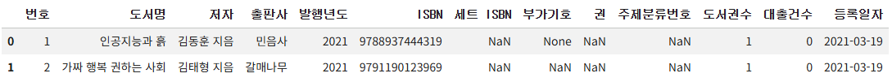

- 이슈) 정수형 열에 입력했을 때처럼 NaN으로 표시되지 않고, 문자열 그대로 None으로 표시됨
- 해결책) 문자열 열에서 누락된 값(NaN)을 표시하려면, 넘파이 패키지에 있는 `np.nan`을 사용해야 함

```py
import numpy as np

ns_book4.loc[0, '부가기호'] = np.nan
ns_book4.head(2)
```

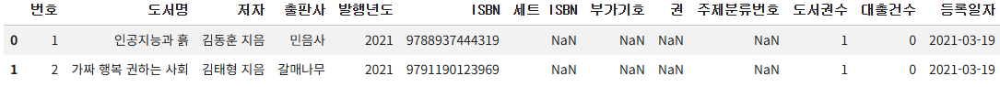

- 넘파이의 `np.nan`을 사용하면, 숫자와 문자열 데이터 타입에 상관없이 데이터프레임 셀 값을 NaN으로 표시할 수 있음

### 누락된 값 바꾸기 1 - `loc`, `fillna()` 메서드

#### 5. '세트 ISBN' 열에서 누락된 값을 NaN이 아니라 빈 문자열로 바꿔보자

```py
set_isbn_na_rows = ns_book4['세트 ISBN'].isna()
ns_book4.loc[set_isbn_na_rows, '세트 ISBN'] = ''

ns_book4['세트 ISBN'].isna().sum()
# np.int64(0)
```

- `loc` 메서드와 누락된 값을 나타내는 불리언 배열을 통해, 누락된 값을 원하는 값으로 바꿀 수 있음

#### 6. 'ns_book4'에 있는 모든 NaN을 '없음' 문자열로 바꿔보자

```py
ns_book4.fillna('없음').isna().sum()
```

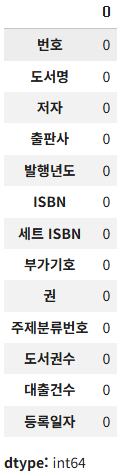

- `fillna()` 메서드에 원하는 값을 전달하면 NaN을 대체할 수 있음

#### 7. '부가기호' 열에 있는 NaN을 '없음' 문자열로 바꿔보자

```py
ns_book4['부가기호'].fillna('없음').isna().sum()
# np.int64(0)
```

- 한계) 특정 열을 선택한 후 `fillna()` 메서드를 적용하면, 열 이름 없이 개수만 있는 판다스 시리즈 객체로 반환됨

#### 8. '부가기호' 열의 NaN을 바꾸면서 전체 데이터프레임을 반환해보자

```py
ns_book4.fillna({'부가기호':'없음'}).isna().sum()
```

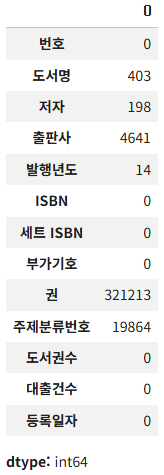

- `fillna()` 메서드에 `{ 열 이름: 변경하려는 값 }` 형식의 딕셔너리를 전달하면, NaN을 바꾸면서 전체 데이터프레임을 반환함

### 누락된 값 바꾸기 2 - `replace()` 메서드

- `replace` 메서드는 NaN은 물론 어떤 값도 바꿀 수 있음
- 바꾸려는 값이 하나일 때

  ```py
  replace(원래 값, 새로운 값)
  ```

- 바꾸려는 값이 여러 개일 때

  ```py
  # 방법 1)
  replace([원래 값1, 원래 값2], [새로운 값1, 새로운 값2])
  # 방법 2)
  replace({ 원래 값1: 새로운 값1, 원래 값2: 새로운 값2 })
  ```

- 열 마다 다른 값으로 바꿀 때

  ```py
  # 방법 1)
  replace({ 열 이름: 원래 값 }, 새로운 값)
  # 방법 2)
  replace({ 열 이름: { 원래 값1: 새로운 값1 } })
  ```

#### 9. 데이터프레임에서 NaN을 '없음'으로 바꿔보자

```py
ns_book4.replace(np.nan, '없음').isna().sum()
```


#### 10. 데이터프레임에서 NaN을 '없음'으로 바꾸고, '2021' 문자열을 '21'로 바꾸자

```py
# 방법 1)
ns_book4.replace([np.nan, '2021'], ['없음', '21']).head(2)
# 방법 2)
ns_book4.replace({np.nan: '없음', '2021': '21'}).head(2)
```

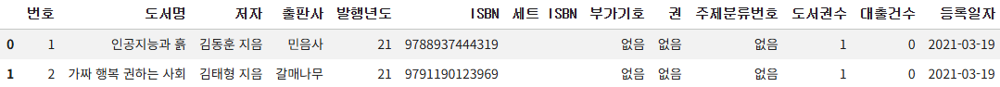

#### 11. '부가기호' 열의 NaN을 '없음'으로 바꾸자

```py
ns_book4.replace({'부가기호': np.nan}, '없음').head(2)
```

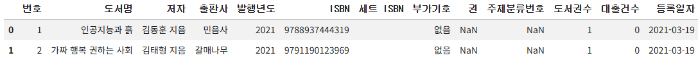

#### 12. '부가기호' 열의 NaN을 '없음'으로 바꾸고, '2021' 문자열을 '21'로 바꾸자

```py
ns_book4.replace({'부가기호': {np.nan: '없음'}, '발행년도': {'2021': '21'}}).head(2)
```

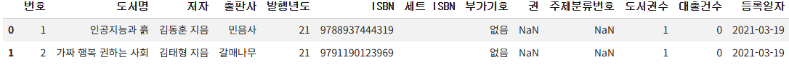

## 3️⃣ 정규 표현식

- Regular Expression
- 문자열 패턴을 찾아서 대체하기 위한 규칙의 모음

### 숫자 찾기: `\d`

- `\d`: 정규 표현식에서 숫자를 나타내는 기호
  - ex) 4자리 연도: `\d\d\d\d`
- 표현식을 그룹으로 묶을 때는 괄호를 사용함
  - ex) 4자리 연도에서 뒤에 두 자리를 묶음: `\d\d(\d\d)`
- 패턴 안에 있는 그룹을 나타낼 때는 `\1`, `\2`처럼 사용함
  - 그룹의 번호는 패턴 안에 등장하는 순서대로 매겨짐
- 정규 표현식이 반복될 때는 일일이 쓰는 대신 중괄호를 사용해 개수를 지정할 수 있음
  - ex) `\d\d` == `d{2}`

#### 1. '발행연도' 열의 값을 두 자리 연도로 바꿔보자

```py
# 방법 1)
ns_book4.replace({'발행년도': {r'\d\d(\d\d)': r'\1'}}, regex=True)[100:102]
# 방법 2)
ns_book4.replace({'발행년도': {r'\d{2}(\d{2})': r'\1'}}, regex=True)[100:102]
```

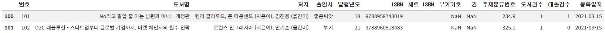

- `replace()` 메서드에서 `regex` 매개변수 옵션을 True로 지정하면, 정규 표현식을 사용할 수 있음
- 정규 표현식 앞에 붙인 `r` 문자는 원시 문자열(raw string)을 만듦
  - 이러면 역슬래시 `\` 문자를 escape 문자가 아니라 있는 그대로로 처리함

### 문자 찾기: 마침표 `.`

- 마침표 `.`: 정규 표현식에서 어떤 문자도 대응하는 기호
- `*` 문자: 0개 이상 반복을 의미
- `\s`: 정규 표현식에서 공백 문자를 나타내는 기호

#### 2. '저자' 열의 값에서 '(지은이)'와 '(옮긴이)' 문자열을 제거해보자

```py
ns_book4.replace({'저자': {r'(.*)\s\(지은이\)(.*)\s\(옮긴이\)': r'\1\2'},
                  '발행년도': {r'\d{2}(\d{2})': r'\1'}}, regex=True)[100:102]
```

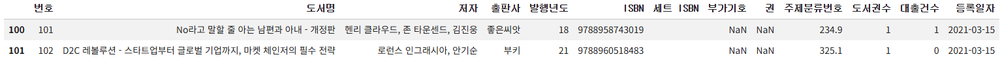

- 정규 표현식에서 괄호는 그룹을 나타내는 데 사용하므로, 일반 문자라고 인식하게 하려면 역슬래시 `\`를 앞에 붙여야 함

## 4️⃣ 잘못된 값 바꾸기

#### 1. '발행년도' 열에서 숫자가 아닌 문자를 포함하는 모든 행을 찾아보자

```py
invalid_number = ns_book4['발행년도'].str.contains(r'\D', na=True)

print(invalid_number.sum())
# 1777
ns_book4[invalid_number].head()
```

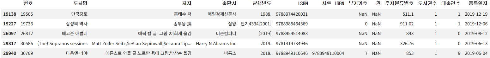

- '발행년도' 열에는 '1998.'처럼 숫자가 아닌 다른 문자가 들어있는 연도가 있음
- 판다스 시리즈 객체는 `str` 속성 아래 다양한 문자열 처리 함수를 제공함
- `contains()` 메서드는 시리즈나 인덱스에서 문자열 패턴을 포함하고 있는지 검사함
- `contains()` 메서드의 `na` 매개변수를 True로 지정하면, 연도가 누락된 행을 True로 표시함
- `\D`: 숫자가 아닌 다른 모든 문자에 대응하는 기호

#### 2. '발행년도' 열에서 4자리 연도 앞/뒤에 있는 문자를 제거해보자

```py
ns_book5 = ns_book4.replace({'발행년도':r'.*(\d{4}).*'}, r'\1', regex=True)
ns_book5[invalid_number].head()
```

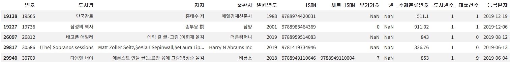

- 여기서 변환되지 않은 값은 NaN이거나 4자리 숫자가 아닌 값일 것임

#### 3. 위에서 변환되지 않은 값을 -1로 변경한 다음, 데이터 타입을 정수형으로 수정하자

```py
unkown_year = ns_book5['발행년도'].str.contains(r'\D', na=True)
ns_book5.loc[unkown_year, '발행년도'] = '-1'
ns_book5 = ns_book5.astype({'발행년도': 'int64'})
```

#### 4. 4000년이 넘는 연도에서 2333년을 빼서 서기로 바꾸자

```py
ns_book5['발행년도'].gt(4000).sum()
# np.int64(131)
```

```py
dangun_yy_rows = ns_book5['발행년도'].gt(4000)
ns_book5.loc[dangun_yy_rows, '발행년도'] = ns_book5.loc[dangun_yy_rows, '발행년도'] - 2333
```

- `gt()` 메서드를 사용하면, 전달된 값보다 큰 값을 찾을 수 있음

#### 5. 0보다 크고 1900년보다 작은 연도를 -1로 설정하자

```py
old_books = ns_book5['발행년도'].gt(0) & ns_book5['발행년도'].lt(1900)
ns_book5.loc[old_books, '발행년도'] = -1
```

#### 6. 최종적으로 '발행년도' 열에서 -1 값이 몇 개인지 확인해보자

```py
ns_book5['발행년도'].eq(-1).sum()
# np.int64(86)
```

- 총 86권이 연도가 잘못 저장되었거나 알 수 없음

## 5️⃣ 누락된 정보 채우기

#### 1. '도서명', '저자', '출판사' 열에 누락된 값이 있거나, '발행년도' 열이 -1인 행의 개수를 확인해보자

```py
na_rows = ns_book5['도서명'].isna() | ns_book5['저자'].isna() \
          | ns_book5['출판사'].isna() | ns_book5['발행년도'].eq(-1)

print(na_rows.sum())
# 5268
ns_book5[na_rows].head(2)
```

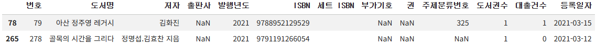

#### 2. 'Yes24 도서 검색 페이지'에서 '도서명' 데이터를 추출하는 함수를 만들자

```py
import requests
from bs4 import BeautifulSoup

def get_book_title(isbn):
    # Yes24 도서 검색 페이지 URL
    url = 'http://www.yes24.com/Product/Search?domain=BOOK&query={}'
    # URL에 ISBN을 넣어 HTML 가져옵니다.
    r = requests.get(url.format(isbn))
    soup = BeautifulSoup(r.text, 'html.parser')   # HTML 파싱
    # 클래스 이름이 'gd_name'인 a 태그의 텍스트를 가져옵니다.
    title = soup.find('a', attrs={'class':'gd_name'}) \
            .get_text()
    return title
```

```py
get_book_title(9791191266054)
# 골목의 시간을 그리다
```

#### 3. 'Yes24 도서 검색 페이지'에서 '도서명', '저자', '출판사', '발행년도' 데이터를 추출하는 함수를 만들자

```py
import re

def get_book_info(row):
    title = row['도서명']
    author = row['저자']
    pub = row['출판사']
    year = row['발행년도']
    # Yes24 도서 검색 페이지 URL
    url = 'http://www.yes24.com/Product/Search?domain=BOOK&query={}'
    # URL에 ISBN을 넣어 HTML 가져옵니다.
    r = requests.get(url.format(row['ISBN']))
    soup = BeautifulSoup(r.text, 'html.parser')   # HTML 파싱
    try:
        if pd.isna(title):
            # 클래스 이름이 'gd_name'인 a 태그의 텍스트를 가져옵니다.
            title = soup.find('a', attrs={'class':'gd_name'}) \
                    .get_text()
    except AttributeError:
        pass

    try:
        if pd.isna(author):
            # 클래스 이름이 'info_auth'인 span 태그 아래 a 태그의 텍스트를 가져옵니다.
            authors = soup.find('span', attrs={'class':'info_auth'}) \
                          .find_all('a')
            author_list = [auth.get_text() for auth in authors]
            author = ','.join(author_list)
    except AttributeError:
        pass

    try:
        if pd.isna(pub):
            # 클래스 이름이 'info_auth'인 span 태그 아래 a 태그의 텍스트를 가져옵니다.
            pub = soup.find('span', attrs={'class':'info_pub'}) \
                      .find('a') \
                      .get_text()
    except AttributeError:
        pass

    try:
        if year == -1:
            # 클래스 이름이 'info_date'인 span 태그 아래 텍스트를 가져옵니다.
            year_str = soup.find('span', attrs={'class':'info_date'}) \
                           .get_text()
            # 정규식으로 찾은 값 중에 첫 번째 것만 사용합니다.
            year = re.findall(r'\d{4}', year_str)[0]
    except AttributeError:
        pass

    return title, author, pub, year
```

#### 4. 누락된 값이 있었던 처음 2개 행에 `get_book_info()` 함수를 적용해보자

```py
updated_sample = ns_book5[na_rows].head(2).apply(get_book_info,
    axis=1, result_type ='expand')
print(updated_sample)
```

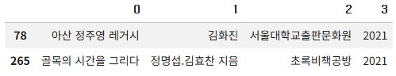

- 함수가 여러 개의 값을 반환하는 경우, `apply()` 메서드는 기본적으로 반환된 값을 하나의 튜플로 만듦
- `result_type` 매개변수를 `'expand'`로 지정하면, 반환된 값을 각기 다른 열로 만들 수 있음

#### 5. 데이터프레임 전체에 `get_book_info()` 함수를 적용해 누락된 정보를 채워보자

```py
ns_book5_update = ns_book5[na_rows].apply(get_book_info,
    axis=1, result_type ='expand')
ns_book5_update.columns = ['도서명','저자','출판사','발행년도']

ns_book5_update.head()
```

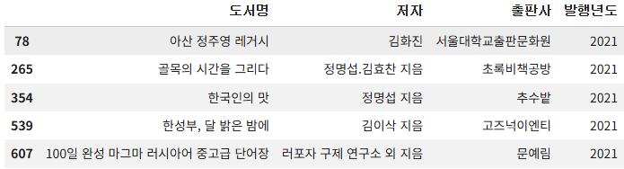

#### 6. 이제 다시 '도서명', '저자', '출판사', '발행년도' 열에서 누락된 행이 몇 개인지 확인해보자

```py
na_rows = ns_book5['도서명'].isna() | ns_book5['저자'].isna() \
          | ns_book5['출판사'].isna() | ns_book5['발행년도'].eq(-1)

print(na_rows.sum())
# 4615
```

#### 7. '도서명', '저자', '출판사', '발행년도' 열에서 누락된 값을 가진 행을 삭제하자

```py
ns_book6 = ns_book5.dropna(subset=['도서명','저자','출판사'])
ns_book6 = ns_book6[ns_book6['발행년도'] != -1]
ns_book6.head()
```

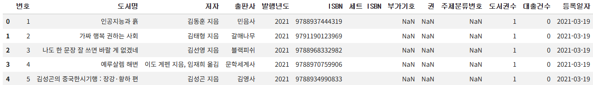

#### 8. 누락된 행이 제거된 'ns_book6' 데이터프레임을 저장하자

```py
ns_book6.to_csv('ns_book6.csv', index=False)
```

## cf) 잘못된 데이터를 수정하는 함수

```py
def data_fixing(ns_book4):
    """
    잘못된 값을 수정하거나 NaN 값을 채우는 함수

    :param ns_book4: data_cleaning() 함수에서 전처리된 데이터프레임
    """
    # 도서권수와 대출건수를 int64로 바꿉니다.
    ns_book4 = ns_book4.astype({'도서권수':'int64', '대출건수': 'int64'})
    # NaN인 세트 ISBN을 빈문자열로 바꿉니다.
    set_isbn_na_rows = ns_book4['세트 ISBN'].isna()
    ns_book4.loc[set_isbn_na_rows, '세트 ISBN'] = ''

    # 발행년도 열에서 연도 네 자리를 추출하여 대체합니다. 나머지 발행년도는 -1로 바꿉니다.
    ns_book5 = ns_book4.replace({'발행년도':r'.*(\d{4}).*'}, r'\1', regex=True)
    unkown_year = ns_book5['발행년도'].str.contains(r'\D', na=True)
    ns_book5.loc[unkown_year, '발행년도'] = '-1'

    # 발행년도를 int64로 바꿉니다.
    ns_book5 = ns_book5.astype({'발행년도': 'int64'})
    # 4000년 이상인 경우 2333년을 뺍니다.
    dangun_yy_rows = ns_book5['발행년도'].gt(4000)
    ns_book5.loc[dangun_yy_rows, '발행년도'] = ns_book5.loc[dangun_yy_rows, '발행년도'] - 2333
    # 여전히 4000년 이상인 경우 -1로 바꿉니다.
    dangun_year = ns_book5['발행년도'].gt(4000)
    ns_book5.loc[dangun_year, '발행년도'] = -1
    # 0~1900년 사이의 발행년도는 -1로 바꿉니다.
    old_books = ns_book5['발행년도'].gt(0) & ns_book5['발행년도'].lt(1900)
    ns_book5.loc[old_books, '발행년도'] = -1

    # 도서명, 저자, 출판사가 NaN이거나 발행년도가 -1인 행을 찾습니다.
    na_rows = ns_book5['도서명'].isna() | ns_book5['저자'].isna() \
              | ns_book5['출판사'].isna() | ns_book5['발행년도'].eq(-1)
    # 교보문고 도서 상세 페이지에서 누락된 정보를 채웁니다.
    updated_sample = ns_book5[na_rows].apply(get_book_info,
        axis=1, result_type ='expand')
    updated_sample.columns = ['도서명','저자','출판사','발행년도']
    ns_book5.update(updated_sample)

    # 도서명, 저자, 출판사가 NaN이거나 발행년도가 -1인 행을 삭제합니다.
    ns_book6 = ns_book5.dropna(subset=['도서명','저자','출판사'])
    ns_book6 = ns_book6[ns_book6['발행년도'] != -1]

    return ns_book6
```

## cf) 핵심 함수와 메서드

| 함수/메서드             | 기능                                                     |
| ----------------------- | -------------------------------------------------------- |
| `DataFrame.info()`      | 데이터프레임의 요약 정보를 출력함                        |
| `DataFrame.isna()`      | 셀의 값이 None이나 NaN일 경우, True를 반환함             |
| `DataFrame.astype()`    | 데이터의 타입을 지정함                                   |
| `DataFrame.fillna()`    | 데이터프레임에서 누락된 원소의 값을 채움                 |
| `DataFrame.replace()`   | 데이터프레임의 값을 다른 값으로 바꿈                     |
| `Series.str.contains()` | 시리즈나 인덱스에서 문자열 패턴을 포함하고 있는지 검사함 |
| `DataFrame.gt()`        | 데이터프레임의 원소보다 큰 값을 검사함                   |
